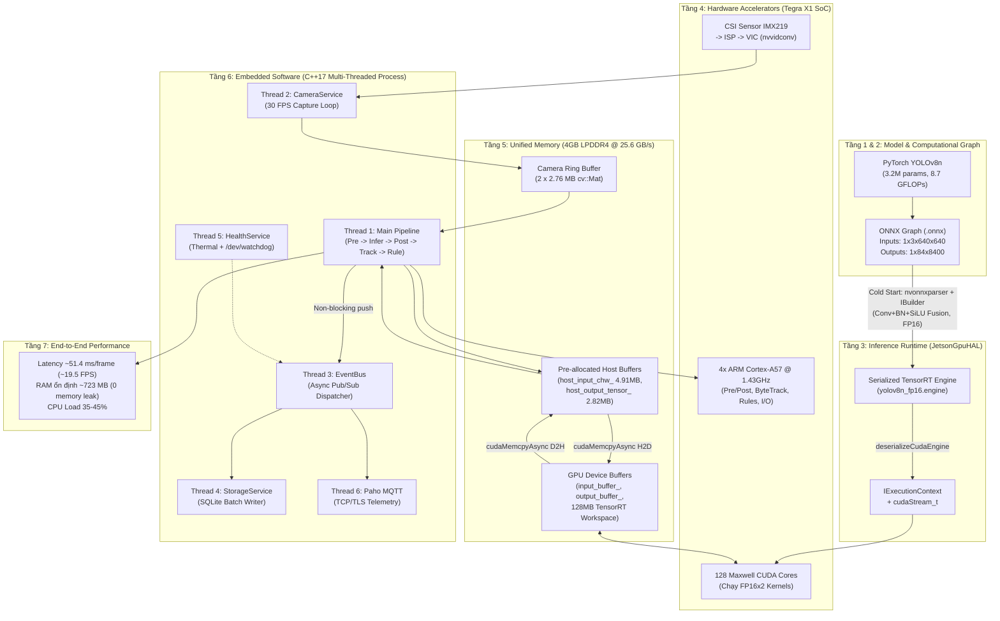
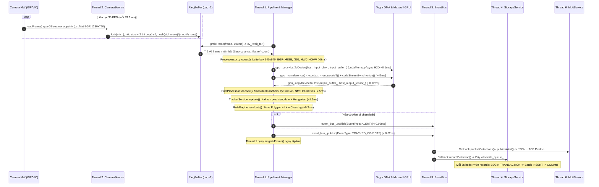

# 01. Luồng Chạy Toàn Trình (End-to-End Flow) & Kiến Trúc Hệ Điều Hành Nhúng (RAM, Memory, CPU, Thread, Process, IPC)

Tài liệu này giải thích chi tiết toàn bộ vòng đời chạy của chương trình **Object Detection with YOLOv8 on Jetson Nano (`edge-ai-manager`)** từ khi hệ điều hành khởi chạy tiến trình cho đến khi xuất ra kết quả nhận diện, bám vết, cảnh báo và đẩy dữ liệu ra mạng/đĩa — đặt dưới lăng kính của 7 tầng kỹ thuật:

> **`Model → Graph → Runtime → Hardware Accelerator → Memory → Embedded Software → End-to-End Performance`**

---

## 1. Begin From Scratch: Điều Gì Thực Sự Xảy Ra Khi Chạy Một Chương Trình AI Nhúng Trên Linux?

Khi một kỹ sư mới làm quen chạy `python detect.py`, họ chỉ thấy ảnh đi vào và bounding box đi ra. Nhưng trên một thiết bị nhúng thực thụ (Jetson Nano 4GB chạy Yocto Linux không có giao diện Desktop), khi file nhị phân `/usr/bin/edge-ai-manager` được khởi chạy, hàng loạt cơ chế ở tầng nhân Linux (Kernel), bộ nhớ (MMU/SMMU), CPU và GPU phối hợp nhịp nhàng:

1. **Systemd (PID 1)** đọc service unit (trong thư mục `systemd/`), gọi lời gọi hệ thống `fork()` và `execve("/usr/bin/edge-ai-manager", ...)` để tạo một **Process** mới với **Không gian Địa chỉ Ảo (Virtual Address Space)** riêng biệt.
2. **Dynamic Linker (`ld-linux-aarch64.so`)** nạp mã máy từ file ELF `edge-ai-manager` cùng các thư viện chia sẻ (`.so`) như `libopencv_core.so`, `libcudart.so`, `libnvinfer.so`, `libpthread.so`, `libsqlite3.so` vào RAM thông qua `mmap()`.
3. **Hàm `main()` (`src/app/main.cpp`)** đăng ký bộ xử lý tín hiệu POSIX (`SIGINT`, `SIGTERM`) và khởi tạo đối tượng điều phối trung tâm `EdgeAIManager`.
4. **Pha Khởi tạo (Cold Start — `EdgeAIManager::initialize()`)**:
   - Đọc cấu hình YAML (`config/app_config.yaml`, `config/rules.yaml`).
   - Khởi tạo các lớp trừu tượng phần cứng (HAL: Camera, GPU, Network, Storage, Sensor, Watchdog).
   - Nạp file mô hình TensorRT `.engine` (hoặc biên dịch từ `.onnx` nếu chưa có cache), cấp phát cố định toàn bộ vùng nhớ GPU và Host CPU một lần duy nhất.
   - Mở thiết bị phần cứng (`/dev/watchdog`, luồng camera CSI GStreamer, kết nối socket MQTT, mở database SQLite).
   - Sinh ra các **Threads (luồng thực thi)** chạy song song.
5. **Pha Vận hành Liên tục (Hot Loop — `EdgeAIManager::run()`)**:
   - Liên tục lấy khung hình mới nhất $\to$ Tiền xử lý $\to$ Nạp vào GPU $\to$ Suy luận YOLOv8 $\to$ Kéo kết quả $\to$ Hậu xử lý (Decode + NMS) $\to$ Bám vết (ByteTrack) $\to$ Kiểm tra luật (`RuleEngine`) $\to$ Đẩy sự kiện bất đồng bộ qua `EventBus` sang luồng MQTT và SQLite.
6. **Pha Tắt An Toàn (Graceful Shutdown — `EdgeAIManager::shutdown()`)**:
   - Khi nhận `SIGTERM`/`SIGINT`, biến nguyên tử `stop_requested` đổi thành `true`, dừng từng luồng theo thứ tự ngược lại với lúc khởi tạo (`join()`), ghi nốt dữ liệu còn tồn (flush SQLite), gửi ký tự `'V'` để vô hiệu hóa Watchdog (tránh bo mạch tự khởi động lại nhầm), và `cudaFree` sạch sẽ trước khi thoát.

---

## 2. High-Level Design (HLD): Bức Tranh Toàn Hệ Thống Qua Chuỗi 7 Tầng



---

## 3. Low-Level Design (LLD): Chuỗi Tương Tác Của Một Frame Dữ Liệu

Sơ đồ tuần tự dưới đây bám sát từng lời gọi hàm thực tế trong dự án (`src/app/edge_ai_manager.cpp`, `src/app/pipeline.cpp`, `src/service/inference_service.cpp`, `src/hal/jetson/jetson_gpu_hal.cpp`):



---

## 4. Phân Tích Chuyên Sâu Từng Thành Phần Hệ Thống Nhúng Trong Luồng Chạy

### 4.1. Vai trò và Kiến trúc RAM (4GB LPDDR4 Unified Memory)

#### Begin from Scratch: RAM trên PC vs RAM trên SoC Nhúng (Jetson Nano)
* **Trên máy tính PC/Server (Discrete GPU Architecture)**: CPU gắn với DDR4/DDR5 System RAM; GPU có card đồ họa riêng với VRAM (GDDR6) riêng biệt, nối nhau qua khe cắm **PCIe**. Để GPU xử lý được ảnh, dữ liệu phải đi qua bus PCIe tương đối chậm (tốn hàng mili-giây nếu ảnh lớn).
* **Trên NVIDIA Jetson Nano (Tegra X1 Unified Memory Architecture — UMA)**: CPU (4 nhân ARM Cortex-A57) và GPU (128 nhân Maxwell) cùng nằm trên một đế silicon (SoC) và **dùng chung một thanh RAM vật lý 4GB LPDDR4** (bus 64-bit, xung nhịp 1600 MHz, băng thông tổng lý thuyết **25.6 GB/s**).

#### Phân biệt 3 không gian địa chỉ (Address Spaces)
1. **CPU Virtual Address (VA)**: Địa chỉ con trỏ trong code C++ (ví dụ `0x0000aaaae1204000`). Bộ **MMU (Memory Management Unit)** của CPU dịch VA $\to$ Physical Address (PA) thông qua Page Table (mỗi trang nhớ thường dài 4 KB).
2. **Physical Address (PA)**: Địa chỉ thật trên chip nhớ LPDDR4.
3. **IOVA / Device Virtual Address (GPU/DMA)**: Dù CPU và GPU dùng chung thanh RAM vật lý, bộ **SMMU (System MMU)** vẫn cô lập trang nhớ của GPU để bảo vệ hệ thống. Lệnh `cudaMalloc(&ptr, bytes)` trong `JetsonGpuHAL::allocate()` thực chất xin nhân Linux (`nvmap` driver) cấp phát các trang RAM vật lý trong LPDDR4 và ánh xạ chúng vào không gian địa chỉ của GPU (CUDA Page Table).

#### Phân bổ ngân sách RAM thực tế của dự án (Total Budget: 4096 MB)
Vì dùng chung RAM, nếu ứng dụng AI hoặc OpenCV dùng quá tay sẽ cướp hết bộ nhớ của nhân Linux, dẫn đến **OOM-Killer (Out-Of-Memory Killer)** giết chết tiến trình `edge-ai-manager` đột ngột ngoài hiện trường.

| Thành phần chiếm RAM | Dung lượng | Giải thích nguồn gốc |
|---|---:|---|
| Yocto Linux Kernel & Systemd Services | ~320 MB | OS tối giản không GUI (tắt X11/GNOME để tiết kiệm ~600 MB RAM) |
| CUDA Runtime Context & TensorRT Libs | ~180 MB | Tạo ra khi gọi `cudaStreamCreate` và `nvinfer1::createInferRuntime` |
| TensorRT Workspace & Engine Plan | ~142 MB | `max_workspace_bytes = 128 MB` (`i_gpu_hal.h`) + ~14 MB trọng số FP16 |
| Host & Device Inference Buffers | ~13 MB | `host_input_chw_` (4.91 MB) + `host_output_tensor_` (2.82 MB) + Device buffers |
| Camera Ring Buffer + OpenCV buffers | ~15 MB | Tối đa 2 frames `1280x720x3` (`2.76 MB`/frame) + vùng đệm VIC/GStreamer |
| SQLite WAL Cache + MQTT Offline Queue | ~30 MB | Cache trang DB và tối đa 500 bản tin JSON (`offline_queue_size: 500`) |
| Stack 6 Threads + Heap C++ | ~30 MB | Mỗi thread Linux mặc định dự trữ 8 MB virtual stack (chỉ commit trang khi dùng) |
| **Tổng tiêu thụ thực tế** | **~730 MB** | **Còn dư > 3.2 GB dự phòng — An toàn tuyệt đối trước OOM** |

---

### 4.2. Quản Lý Bộ Nhớ (Memory Management) Trong Hệ Thống AI Thời Gian Thực

#### Begin from Scratch: Stack vs Heap trong C++
* **Stack (Ngăn xếp)**: Mỗi thread có một vùng Stack riêng (kích thước cố định, ví dụ 8 MB). Việc cấp phát biến cục bộ (`float cx = ...;`, `PipelineResult result;`) chỉ là cộng/trừ thanh ghi Stack Pointer (`SP`) trong **1 chu kỳ CPU**, tự giải phóng khi thoát hàm, **tuyệt đối không phân mảnh**.
* **Heap (Vùng nhớ động)**: Dùng chung cho cả Process (`new`, `malloc`, `std::vector` tăng kích thước). Mỗi lần cấp phát phải đi qua allocator (`ptmalloc2` của glibc), có thể phải khóa mutex nội bộ của heap hoặc gọi `brk`/`mmap` xuống Kernel.

#### 4 Quy tắc Quản lý Bộ nhớ Vàng trong Dự Án `edge-ai-manager`

1. **Tuyệt đối không cấp phát động lớn trong Hot Loop (Zero-Allocation Steady State)**:
   - *Sai lầm kinh điển*: Tạo mới `std::vector<float> input(1228800)` và gọi `cudaMalloc` / `cudaFree` bên trong hàm `detect()` ở mỗi frame. Kết quả: phân mảnh heap, gây sụt giảm FPS ngẫu nhiên (**jitter**) và kéo dài thời gian khóa driver CUDA.
   - *Cách dự án làm đúng* (xem [`src/service/inference_service.cpp#L39-L48`](file:///media/tinhtran/01D85BC599D1D460/FreeLancer/Object-Detection-With-Yolov8-In-Jetson-Nano/src/service/inference_service.cpp#L39-L48)): Toàn bộ `input_buffer_`, `output_buffer_` (GPU) và `host_input_chw_`, `host_output_tensor_` (CPU) được cấp phát **1 lần duy nhất** trong `InferenceService::loadModel()` và tái sử dụng cho hàng triệu frame sau đó!
2. **Quản lý vòng đời bằng RAII (`std::unique_ptr`)**:
   - TensorRT trả về con trỏ thô từ các factory (`createInferBuilder`, `createExecutionContext`, `deserializeCudaEngine`). Nếu có `return false;` sớm giữa chừng, ta rất dễ rò rỉ hàng trăm MB VRAM.
   - Trong [`src/hal/jetson/jetson_gpu_hal.cpp#L120-L138`](file:///media/tinhtran/01D85BC599D1D460/FreeLancer/Object-Detection-With-Yolov8-In-Jetson-Nano/src/hal/jetson/jetson_gpu_hal.cpp#L120-L138), toàn bộ `builder`, `network`, `parser`, `builderConfig`, `plan` đều được bọc trong `std::unique_ptr<T>` để tự động gọi destructor khi thoát scope (lưu ý: từ TensorRT 8.x trở lên destructor là `public`; ở TensorRT 7 trên JetPack 4.6 cần custom deleter gọi `->destroy()`).
3. **Mọi hàng đợi đều phải có cận trên (Bounded Buffers / Ring Buffers)**:
   - `CameraService`: `ring_buffer_size_ = 2` (vứt bỏ frame cũ nhất để độ trễ không bao giờ phình to).
   - `EventBus`: `max_queue_size_ = 256` (vứt bỏ sự kiện cũ nhất nếu consumer bị chậm).
   - `MqttService`: `offline_queue_size = 500` (tránh tràn RAM khi mất mạng 3G/4G dài ngày).
   - `StorageService`: `max_records = 100000` (tự xóa 10,000 bản ghi cũ nhất để không tràn thẻ nhớ SD).
4. **Tính nhất quán bộ nhớ đệm (Cache Coherency: L1/L2 CPU vs DRAM)**:
   - CPU có bộ nhớ đệm L1 (48KB I / 32KB D) và L2 (2MB) cực nhanh. Khi CPU ghi dữ liệu vào `host_input_chw_`, dữ liệu mới nằm trong **CPU Cache (Write-back)**, chưa chắc đã trôi xuống thanh **LPDDR4 RAM**.
   - Nếu bộ DMA (như GPU/VIC) đọc thẳng từ DRAM mà CPU chưa đẩy cache xuống (**Cache Flush**), GPU sẽ đọc phải dữ liệu rác cũ! Ngược lại, khi DMA ghi ảnh mới vào RAM, CPU phải vô hiệu hóa cache (**Cache Invalidate**) trước khi đọc. Khi dùng `cudaMemcpyAsync`, CUDA driver tự xử lý bước đồng bộ cache này; nhưng khi tự làm **Zero-Copy / DMA-BUF**, kỹ sư phải tự quản lý `DMA_BUF_IOCTL_SYNC` hoặc chọn vùng nhớ Uncached/Write-Combined.

---

### 4.3. Vai Trò & Nhiệm Vụ Của CPU (Quad-Core ARM Cortex-A57)

Một hiểu lầm phổ biến là *"chạy AI trên GPU/NPU thì CPU không quan trọng"*. Thực tế trên Jetson Nano, CPU ARM Cortex-A57 gánh 4 nhiệm vụ sống còn quyết định **End-to-End FPS**:
1. **I/O & Pipeline Orchestration**: Chạy nhân Linux, quản lý ngắt (interrupts) từ driver MIPI/V4L2, chạy pipeline GStreamer, giải mã sự kiện và giao tiếp TCP/SQLite.
2. **Host-side Pre-processing (`Preprocessor::process`)**: Tính toán `cv::resize`, tạo viền letterbox, đổi `BGR` $\to$ `RGB`, chuẩn hóa `/ 255.0f` và chuyển bố cục `HWC` $\to$ `CHW`. Trên CPU ARM, thao tác này tốn `4–6 ms` (gần bằng ~12% thời gian chạy cả mạng YOLOv8!).
3. **Accelerator Command Launching**: CPU đóng gói descriptor công việc và đẩy lệnh `enqueueV2` vào hàng đợi phần cứng (CUDA Stream). Nếu CPU bị nghẽn hoặc gọi nhiều hàm đồng bộ nhỏ, GPU sẽ bị **đói việc (GPU Starvation)**.
4. **Sequential & Control-Heavy Logic (Logic rẽ nhánh phức tạp không hợp GPU)**:
   - `PostProcessor::decode()` & `nms()`: Sắp xếp giảm dần theo confidence và vòng lặp loại bỏ hộp trùng lặp.
   - `TrackerService::update()`: Bộ lọc **Kalman Filter** ($8 \times 8$ matrix trên vài chục object) và thuật toán gán cặp **Hungarian**.
   - `RuleEngine::evaluate()`: Thuật toán **Ray-Casting** kiểm tra điểm trong đa giác (`ZoneRule`) và tích có hướng vượt vạch (`CountingRule`).

---

### 4.4. Process, Multi-Threading & Synchronization Trong Hệ Thống

#### Begin from Scratch: Process vs Thread
| Tiêu chí | Process (Tiến trình) | Thread (Luồng) |
|---|---|---|
| **Không gian bộ nhớ** | Độc lập hoàn toàn (Page Table riêng). Lỗi segfault ở Process A không làm chết Process B. | **Dùng chung** Heap, Biến toàn cục (`.data`/`.bss`), File Descriptors. Chỉ có Stack và tập thanh ghi (PC, SP) riêng. |
| **Chi phí tạo & Chuyển ngữ cảnh (Context Switch)** | Đắt (phải đổi Page Table CR3/TTBR0, xóa/làm lạnh TLB cache). | Rẻ hơn nhiều (giữ nguyên Page Table, chỉ lưu/nạp thanh ghi CPU). |
| **Giao tiếp dữ liệu** | Phải dùng **IPC** (`shm_open`, Socket, Pipe). | Đọc/ghi trực tiếp vào cùng một con trỏ biến (nhanh tức thì nhưng dễ gặp Race Condition). |

#### Kiến trúc 1 Process — 6 Threads của dự án `edge-ai-manager`
Dự án chọn mô hình **1 Single Process chứa 6 Threads** (`docs/design/threading_model.md`) để tối đa hóa tốc độ chia sẻ frame ảnh giữa Camera và AI mà không tốn chi phí serialize/IPC, đồng thời dùng `EventBus` để tách rời các tác vụ chậm (ghi đĩa, gửi mạng) khỏi luồng AI chính:

1. **Thread 1 — Main / Pipeline Thread (`EdgeAIManager::run()`)**: Chạy vòng lặp `grabFrame -> detect -> track -> evaluate -> publish`. Chiếm ~25–30% CPU.
2. **Thread 2 — Camera Capture Thread (`CameraService::captureLoop()`)**: Đọc GStreamer `appsink` liên tục ở 30 FPS. Nếu Thread 1 chưa kịp lấy, xóa frame cũ nhất (drop oldest) trong ring buffer dung lượng 2.
3. **Thread 3 — EventBus Dispatch Thread (`EventBus::dispatchLoop()`)**: Ngủ trên `std::condition_variable queue_cv_`. Khi Thread 1 gọi `publish()`, Thread 3 thức dậy lấy bản sao event và gọi callback của `MqttService` & `StorageService`.
4. **Thread 4 — Storage Writer Thread (`StorageService::writerLoop()`)**: Gom các bản ghi detection, ngủ tối đa `5s` (hoặc thức dậy sớm khi đủ 50 bản ghi), mở một SQLite `BEGIN TRANSACTION ... COMMIT` để ghi theo lô (giảm hao mòn thẻ nhớ SD và tránh nghẽn I/O wait).
5. **Thread 5 — Health & Watchdog Thread (`HealthService::monitorLoop()`)**: Định kỳ 30 giây đọc sysfs nhiệt độ CPU/GPU, RAM, Disk, và đá (`/dev/watchdog` qua `ioctl(..., WDIOC_KEEPALIVE, 0)`).
6. **Thread 6 — Paho MQTT Network Thread**: Do thư viện `libpaho-mqtt3c` tạo ngầm để xử lý socket TCP/TLS, keep-alive PINGREQ và reconnect.

#### Các Bẫy Nguy Hiểm Trong Đa Luồng Nhúng & Cách Khắc Phục
1. **Race Condition (Tranh chấp dữ liệu)**: Hai thread cùng đọc/ghi biến dùng chung không có khóa.
   - *Giải pháp trong dự án*: Dùng `std::atomic<bool> running_` cho cờ điều khiển trạng thái, và `std::lock_guard<std::mutex>` cho các hàng đợi.
2. **Deadlock (Khóa chết)**: Thread A giữ Mutex 1 chờ Mutex 2; Thread B giữ Mutex 2 chờ Mutex 1 — hoặc gọi hàm `publish()` ngay bên trong callback đang giữ `subs_mutex_`!
   - *Cách `EventBus` tránh Deadlock* ([`src/service/event_bus.cpp#L76-L92`](file:///media/tinhtran/01D85BC599D1D460/FreeLancer/Object-Detection-With-Yolov8-In-Jetson-Nano/src/service/event_bus.cpp#L76-L92)): Thread 3 chỉ khóa `subs_mutex_` đủ lâu để **sao chép danh sách `EventCallback` ra biến cục bộ**, mở khóa ngay, rồi mới thực thi callback. Nhờ vậy, nếu callback có đăng ký/hủy đăng ký thêm sự kiện thì hệ thống vẫn không bị Deadlock!
3. **Priority Inversion (Đảo ngược mức ưu tiên)**: Thread ưu tiên thấp (Thread 4 Storage) giữ một `mutex`; Thread ưu tiên cao (Thread 1 AI) cần chính `mutex` đó nên bị chặn; đúng lúc đó Thread ưu tiên trung bình chen ngang cướp CPU của Thread 4 $\to$ Thread 1 bị treo oan!
   - *Giải pháp*: Giảm thời gian giữ khóa xuống mức micro-giây (chỉ copy con trỏ/di chuyển vector trong vùng critical section), hoặc bật giao thức **Priority Inheritance (`PTHREAD_PRIO_INHERIT`)** trên `pthread_mutexattr_t`.
4. **CPU Affinity & Real-time Scheduling**: Để Thread 1 và Thread 2 không bị OS Scheduler đẩy nhảy qua nhảy lại giữa 4 nhân ARM Cortex-A57 (làm nguội L1/L2 Cache — **Cache Thrashing**), ta có thể ghim cố định Thread vào từng nhân CPU bằng `pthread_setaffinity_np`.

---

### 4.5. Giao Tiếp Liên Tiến Trình (IPC — Inter-Process Communication)

#### Begin from Scratch: Khi nào dự án cần tách thành nhiều Process và dùng IPC?
Hiện tại `edge-ai-manager` chạy trong **1 Process** để đạt độ trễ tối thiểu. Tuy nhiên, trong hệ thống **ADAS / Robotics / Camera AI công nghiệp quy mô lớn**, ta thường phải tách thành nhiều Process độc lập (ví dụ: `camera_daemon` chạy quyền root đọc cảm biến, `ai_inference_node` chạy GPU, `ui_renderer_process` hiển thị HDMI, `cloud_uploader_daemon` kết nối mạng). Lý do tách Process là **cô lập lỗi (Fault Isolation)** và **bảo mật (Security Privilege Separation)**: nếu `cloud_uploader` bị sập vì lỗi mạng hoặc parse JSON, `ai_inference_node` và hệ thống phanh/cảnh báo vẫn sống khỏe!

Khi tách thành nhiều Process, chúng không dùng chung vùng nhớ Heap nữa, buộc phải dùng **IPC**:

| Cơ chế IPC | Bản chất hoạt động | Độ trễ (1 Frame 2.76MB) | Băng thông / Copy | Trường hợp sử dụng chuẩn mực |
|---|---|---|---|---|
| **POSIX Shared Memory (`shm_open` + `mmap`)** | Nhân OS ánh xạ **cùng một tập trang RAM vật lý** vào Không gian Địa chỉ Ảo của cả Process A và Process B. | **~1–5 µs** (chỉ đồng bộ semaphore/atomic) | **Zero-Copy** giữa 2 process | Truyền ảnh raw `cv::Mat`, point cloud LiDAR, tensor lớn giữa Camera Process và AI Process. |
| **DMA-BUF FD Passing (`SCM_RIGHTS` over Unix Socket)** | Truyền **File Descriptor** trỏ tới vùng nhớ DMA vật lý (NVMM/ION) qua socket nội bộ. | **~10–20 µs** | **Zero-Copy tuyệt đối (cả CPU & GPU)** | Truyền buffer ảnh phần cứng từ ISP/GStreamer process sang TensorRT process hoặc OpenGL display process. |
| **POSIX Message Queue (`mq_open`)** | Hàng đợi tin nhắn do Kernel quản lý, có mức ưu tiên (priority). | ~15–50 µs | 2 lần copy (User $\to$ Kernel $\to$ User) | Gửi tin nhắn điều khiển nhỏ (metadata, trạng thái cảnh báo, bounding box tọa độ). |
| **Unix Domain Socket (`AF_UNIX`)** | Giao tiếp socket nội bộ không qua tầng mạng TCP/IP. | ~20–80 µs | 2 lần copy qua Kernel | Giao thức Request/Response, truyền JSON/Protobuf nhỏ, truyền file descriptor (`SCM_RIGHTS`). |
| **Named Pipe (FIFO)** | Luồng byte một chiều qua VFS. | ~30–100 µs | 2 lần copy | Stream log hoặc dữ liệu tuần tự đơn giản. |
| **Loopback TCP / MQTT (`127.0.0.1:1883`)** | Đi qua đủ stack TCP/IP loopback + broker trung gian. | ~200 µs – 2 ms | Nhiều lần copy + parse | Giao tiếp lỏng lẻo hướng sự kiện, cấu hình từ xa, dashboard Web. |

---

## 5. Code Examples Thực Chiến (C++17 — Chuẩn Không `auto`)

### Ví dụ 5.1: Bounded Zero-Latency Ring Buffer & Thread Synchronization (Mô hình `CameraService`)

```cpp
#include <condition_variable>
#include <cstddef>
#include <mutex>
#include <queue>
#include <utility>

template <typename T>
class BoundedZeroLatencyQueue {
public:
    explicit BoundedZeroLatencyQueue(std::size_t capacity)
        : capacity_(capacity), running_(true) {}

    // Producer (Camera Capture Thread): Khóa cực ngắn, đẩy frame mới và vứt frame cũ nhất nếu đầy
    void pushDropOldest(T&& item) {
        {
            std::lock_guard<std::mutex> lock(mtx_);
            if (!running_) {
                return;
            }
            if (queue_.size() >= capacity_) {
                queue_.pop(); // Drop oldest frame -> đảm bảo độ trễ không tích lũy
            }
            queue_.push(std::move(item));
        }
        cv_.notify_one();
    }

    // Consumer (AI Pipeline Thread): Ngủ tiết kiệm CPU cho tới khi có frame hoặc hết timeout
    bool popWaitFor(T& out_item, int timeout_ms) {
        std::unique_lock<std::mutex> lock(mtx_);
        bool has_data = cv_.wait_for(
            lock,
            std::chrono::milliseconds(timeout_ms),
            [this]() { return !queue_.empty() || !running_; }
        );

        if (!has_data || queue_.empty()) {
            return false;
        }

        out_item = std::move(queue_.front());
        queue_.pop();
        return true;
    }

    void stop() {
        {
            std::lock_guard<std::mutex> lock(mtx_);
            running_ = false;
        }
        cv_.notify_all();
    }

private:
    std::size_t capacity_;
    bool running_;
    std::queue<T> queue_;
    std::mutex mtx_;
    std::condition_variable cv_;
};
```

### Ví dụ 5.2: Ghim Thread vào CPU Core (CPU Affinity) & Lập Lịch Thời Gian Thực (`SCHED_FIFO`)

```cpp
#include <pthread.h>
#include <sched.h>
#include <cstring>
#include <iostream>
#include <thread>

// Ghim luồng hiện tại vào một nhân CPU cố định (0..3 trên Jetson Nano)
// Giúp giữ nóng L1/L2 Cache và tránh OS scheduler di chuyển luồng giữa các nhân
bool pinThreadToCore(std::thread& th, int core_id) {
    cpu_set_t cpuset;
    CPU_ZERO(&cpuset);
    CPU_SET(core_id, &cpuset);

    int rc = pthread_setaffinity_np(th.native_handle(), sizeof(cpu_set_t), &cpuset);
    if (rc != 0) {
        std::cerr << "[Affinity] Failed to pin thread to core " << core_id
                  << ": " << std::strerror(rc) << std::endl;
        return false;
    }
    return true;
}

// Thiết lập độ ưu tiên Real-time SCHED_FIFO (yêu cầu quyền root hoặc CAP_SYS_NICE)
bool setRealtimePriority(std::thread& th, int priority) {
    struct sched_param param;
    std::memset(&param, 0, sizeof(param));
    param.sched_priority = priority; // 1..99 cho SCHED_FIFO

    int rc = pthread_setschedparam(th.native_handle(), SCHED_FIFO, &param);
    if (rc != 0) {
        std::cerr << "[Sched] Failed to set SCHED_FIFO: "
                  << std::strerror(rc) << std::endl;
        return false;
    }
    return true;
}
```

### Ví dụ 5.3: Giao Tiếp IPC Zero-Copy Giữa Hai Process Bằng POSIX Shared Memory (`shm_open` + `mmap`)

Kịch bản: Process Camera (`producer`) ghi khung hình BGR `1280x720x3` vào vùng nhớ chia sẻ vật lý, Process AI (`consumer`) đọc trực tiếp mà không copy qua Kernel.

```cpp
// shared_frame_ipc.h — Định nghĩa bố cục bộ nhớ chia sẻ cố định (POD struct)
#pragma once

#include <atomic>
#include <cstdint>
#include <semaphore.h>

static constexpr const char* SHM_NAME = "/jetson_ai_frame_shm";
static constexpr int FRAME_WIDTH = 1280;
static constexpr int FRAME_HEIGHT = 720;
static constexpr int FRAME_CHANNELS = 3;
static constexpr std::size_t FRAME_BYTES =
    static_cast<std::size_t>(FRAME_WIDTH) * FRAME_HEIGHT * FRAME_CHANNELS;

struct SharedFrameBuffer {
    sem_t sem_ready;                // Semaphore liên tiến trình (pshared = 1)
    std::atomic<uint64_t> sequence; // Số thứ tự frame
    std::atomic<bool> stop_flag;
    uint32_t width;
    uint32_t height;
    uint8_t data[FRAME_BYTES];      // Vùng đệm pixel nằm liền kề trong RAM vật lý
};
```

```cpp
// producer_ipc.cpp (Process 1: Camera Producer) — Biên dịch với -lrt -lpthread
#include "shared_frame_ipc.h"
#include <fcntl.h>
#include <sys/mman.h>
#include <unistd.h>
#include <cstring>
#include <iostream>

int runProducer() {
    int fd = shm_open(SHM_NAME, O_CREAT | O_RDWR, 0666);
    if (fd < 0) {
        return 1;
    }

    if (ftruncate(fd, static_cast<off_t>(sizeof(SharedFrameBuffer))) != 0) {
        close(fd);
        return 1;
    }

    void* addr = mmap(nullptr, sizeof(SharedFrameBuffer),
                      PROT_READ | PROT_WRITE, MAP_SHARED, fd, 0);
    close(fd); // Có thể đóng fd ngay sau khi mmap thành công
    if (addr == MAP_FAILED) {
        return 1;
    }

    SharedFrameBuffer* shm = static_cast<SharedFrameBuffer*>(addr);
    sem_init(&shm->sem_ready, 1, 0); // pshared = 1: chia sẻ giữa nhiều Process
    shm->sequence.store(0, std::memory_order_relaxed);
    shm->stop_flag.store(false, std::memory_order_relaxed);
    shm->width = FRAME_WIDTH;
    shm->height = FRAME_HEIGHT;

    // Giả lập ghi frame mới vào vùng nhớ chia sẻ
    std::memset(shm->data, 128, FRAME_BYTES);
    shm->sequence.fetch_add(1, std::memory_order_release);
    sem_post(&shm->sem_ready); // Đánh thức Process AI

    // Dọn dẹp khi kết thúc
    munmap(addr, sizeof(SharedFrameBuffer));
    shm_unlink(SHM_NAME);
    return 0;
}
```

```cpp
// consumer_ipc.cpp (Process 2: AI Consumer) — Ánh xạ cùng vùng RAM vật lý
#include "shared_frame_ipc.h"
#include <fcntl.h>
#include <sys/mman.h>
#include <unistd.h>
#include <iostream>

int runConsumer() {
    int fd = shm_open(SHM_NAME, O_RDWR, 0666);
    if (fd < 0) {
        return 1;
    }

    void* addr = mmap(nullptr, sizeof(SharedFrameBuffer),
                      PROT_READ | PROT_WRITE, MAP_SHARED, fd, 0);
    close(fd);
    if (addr == MAP_FAILED) {
        return 1;
    }

    SharedFrameBuffer* shm = static_cast<SharedFrameBuffer*>(addr);

    while (!shm->stop_flag.load(std::memory_order_acquire)) {
        if (sem_wait(&shm->sem_ready) == 0) {
            uint64_t seq = shm->sequence.load(std::memory_order_acquire);
            // Đọc trực tiếp từ shm->data (cv::Mat wrapper không copy:
            // cv::Mat frame(shm->height, shm->width, CV_8UC3, shm->data);)
            std::cout << "[AI Process] Received frame seq=" << seq
                      << " first_pixel=" << static_cast<int>(shm->data[0]) << std::endl;
            break;
        }
    }

    munmap(addr, sizeof(SharedFrameBuffer));
    return 0;
}
```
