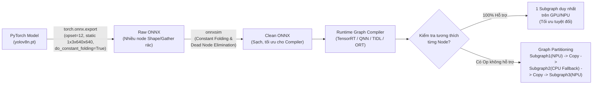
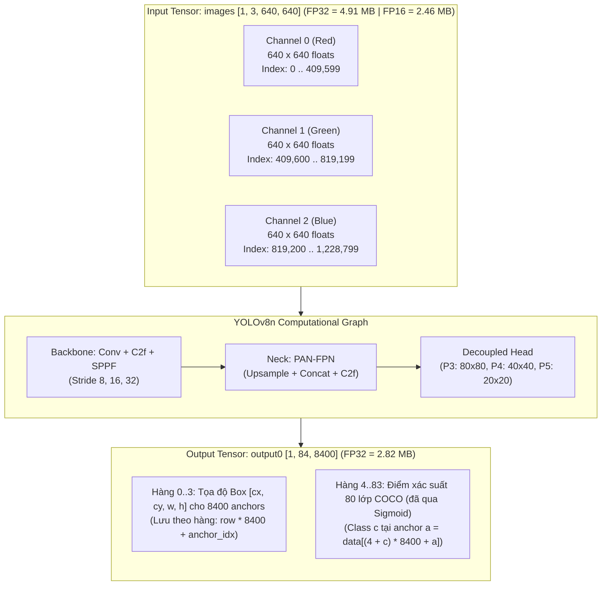

# 02. Kiến Thức Nền Tảng CNN/DNN, Kiến Trúc YOLOv8 & Chuyên Sâu Về ONNX

Tài liệu này đi từ bản chất toán học và cách bố trí từng byte của **Tensor trong RAM** đến cấu trúc bên trong của mạng **YOLOv8**, cách biểu diễn đồ thị tính toán bằng **ONNX**, và xử lý bài toán sống còn khi triển khai xuống phần cứng nhúng: **Operator Compatibility, Graph Partitioning & CPU Fallback**.

> [!IMPORTANT]
> Toàn bộ mã nguồn C++ trong tài liệu tuân thủ quy tắc **không sử dụng `auto`**.

---

## 1. Begin From Scratch: Tensor Trong Bộ Nhớ, Toán Tử CNN & Roofline Model

### 1.1. Tensor thực chất là gì dưới góc độ C/C++ và Phần cứng?
Ở cấp độ toán học Python/PyTorch, Tensor là một mảng đa chiều $N \times C \times H \times W$. Nhưng dưới cấp độ phần cứng RAM, **không hề có bộ nhớ 4 chiều**. RAM chỉ là một **mảng 1 chiều tuyến tính phẳng (1D contiguous byte array)**.

Thứ tự sắp xếp các chiều vào mảng 1 chiều gọi là **Memory Layout (Data Format)**. Có 2 chuẩn phổ biến nhất:

1. **NCHW (Batch, Channel, Height, Width) — Channel-First**:
   - Toàn bộ pixel của kênh Red nằm liền kề nhau, rồi đến kênh Green, rồi đến kênh Blue.
   - **Công thức tính địa chỉ phần tử `(n, c, h, w)`**:
     $$\text{offset}_{\text{NCHW}} = n \cdot (C \cdot H \cdot W) + c \cdot (H \cdot W) + h \cdot W + w$$
   - **Tại sao NVIDIA CUDA / TensorRT / YOLOv8 ONNX ưa chuộng NCHW?** Các GPU truyền thống (như Maxwell trên Jetson Nano) xử lý phép tính tích chập bằng cách gom các pixel không gian $(H \times W)$ vào các warp 32 luồng CUDA để đọc liên tiếp theo chiều $W$ (Coalesced Memory Access). Dự án của chúng ta chuyển ảnh sang `NCHW` ngay tại [`src/service/preprocessor.cpp#L47-L63`](file:///media/tinhtran/01D85BC599D1D460/FreeLancer/Object-Detection-With-Yolov8-In-Jetson-Nano/src/service/preprocessor.cpp#L47-L63).

2. **NHWC (Batch, Height, Width, Channel) — Channel-Last**:
   - Tại một tọa độ $(h, w)$, tất cả các kênh $C$ nằm liền nhau (giống cách OpenCV lưu ảnh `BGR BGR BGR...`).
   - **Công thức tính địa chỉ phần tử `(n, h, w, c)`**:
     $$\text{offset}_{\text{NHWC}} = n \cdot (H \cdot W \cdot C) + h \cdot (W \cdot C) + w \cdot C + c$$
   - **Tại sao Tensor Cores (Volta/Ampere/Orin), Qualcomm Hexagon HTP, TI C7x MMA, và TFLite ưa chuộng NHWC?** Khi tính nhân chập $1 \times 1$ hoặc đọc vector 128-bit/256-bit dọc theo chiều kênh $C$, phần cứng NPU/DSP đọc 1 phát được toàn bộ $C$ kênh tại 1 pixel để nạp vào bộ nhân ma trận (Systolic Array) mà không phải nhảy bước (stride) xa trong RAM.

> **Khái niệm Stride (Bước nhảy)**: Khoảng cách (tính bằng phần tử hoặc byte) phải nhảy trong RAM để tăng chỉ số của một chiều lên 1 đơn vị. Ví dụ với tensor `NCHW = [1, 3, 640, 640]`, stride là `[1228800, 409600, 640, 1]`. Hiểu rõ stride giúp bạn tránh copy lại toàn bộ tensor khi thực hiện các phép toán `Transpose`, `Slice` hoặc `Reshape`.

---

### 1.2. Giải Phẫu Các Toán Tử Cốt Lõi Của CNN & YOLOv8

#### A. Conv2D (Tích chập 2 chiều) — Trái tim tiêu tốn 80–90% thời gian tính toán
Cho đầu vào $X \in \mathbb{R}^{C_{in} \times H \times W}$ và bộ lọc trọng số $W \in \mathbb{R}^{C_{out} \times C_{in} \times K_h \times K_w}$.
Thay vì viết 6 vòng lặp `for` lồng nhau (cực chậm vì cache miss), các runtime nhúng thực thi `Conv2D` bằng 2 kỹ thuật chính:
1. **`im2col` + GEMM (General Matrix Multiplication)**: Trải phẳng mỗi cửa sổ trượt $K_h \times K_w \times C_{in}$ thành một cột của ma trận kích hoạt, biến phép tích chập thành phép nhân 2 ma trận cực lớn $W_{[C_{out}, K^2 C_{in}]} \times X_{[K^2 C_{in}, H_{out} W_{out}]}$. Rất tối ưu cho các nhân CUDA/Tensor Core/MMA.
2. **Winograd Convolution (`F(2x2, 3x3)`)**: Cho bộ lọc $3 \times 3$ với stride=1, biến đổi toán học để giảm số phép nhân từ $3 \times 3 = 9$ xuống còn $(2+3-1)^2 / 4 = 4$ phép nhân (tăng tốc ~2.25x!) với cái giá là tốn thêm bộ nhớ biến đổi và nhạy cảm hơn với sai số lượng tử hóa INT8.

#### B. Batch Normalization (BN) & Hàm kích hoạt SiLU
* **BatchNorm**: Chuẩn hóa đầu ra $y = \gamma \frac{x - \mu}{\sqrt{\sigma^2 + \epsilon}} + \beta$. Khi suy luận (inference), $\mu, \sigma^2, \gamma, \beta$ là hằng số cố định $\implies$ phải gộp (**Fold**) vào trọng số của `Conv2D` đứng trước nó để xóa bỏ hoàn toàn layer BN!
* **SiLU (Swish)**: $\text{SiLU}(x) = x \cdot \sigma(x) = \frac{x}{1 + e^{-x}}$. Không giống ReLU chỉ cần phép so sánh $\max(0, x)$, `SiLU` đòi hỏi hàm mũ $e^{-x}$ và phép chia, nên trên các NPU chuyên INT8 (như Qualcomm HTP/TI MMA), `SiLU` thường được xấp xỉ bằng Lookup Table (LUT) hoặc hàm mảnh tuyến tính (Hard-Swish), và trên TensorRT phải được **fuse** trực tiếp sau Conv để không ghi kết quả trung gian ra DRAM.

#### C. Kiến trúc YOLOv8n (Anchor-Free)
YOLOv8n gồm 3 phần:
1. **Backbone (CSPDarknet nâng cấp với khối `C2f`)**:
   - Dùng `Conv 3x3 stride=2` giảm độ phân giải dần: $640 \to 320 \to 160 \to 80 \to 40 \to 20$.
   - Khối **`C2f` (Cross Stage Partial with 2 convolutions - fast)**: Dùng toán tử `Split` tách đôi tensor theo chiều kênh $C$, một nửa đi qua chuỗi `Bottleneck` (Conv $3\times3$ + shortcut), rồi dùng `Concat` ghép lại. **Lưu ý phần cứng**: `Split` và `Concat` là toán tử **Memory-bound** (tốn băng thông copy RAM mà không tăng FLOPs).
   - **`SPPF` (Spatial Pyramid Pooling Fast)**: 3 tầng `MaxPool2d(5x5, stride=1)` nối tiếp nhau rồi `Concat` lại để mở rộng trường thụ cảm (receptive field) ở mức độ phân giải $20 \times 20$.
2. **Neck (PAN-FPN)**: Kết hợp đặc trưng ngữ nghĩa cao (tầng sâu $20 \times 20$ qua toán tử `Upsample Nearest`) với đặc trưng chi tiết không gian (tầng nông $80 \times 80$).
3. **Head (Decoupled Anchor-Free Head)**:
   - Tách riêng 2 nhánh: nhánh **Box Regression** (dùng **DFL - Distribution Focal Loss** dự đoán phân phối 4 cạnh trái/phải/trên/dưới qua Softmax 16 bin) và nhánh **Classification** (80 lớp COCO qua Sigmoid).
   - Tổng số điểm neo (**Anchor points**) ở 3 tỷ lệ bản đồ đặc trưng ($P3, P4, P5$):
     $$80 \times 80 + 40 \times 40 + 20 \times 20 = 6400 + 1600 + 400 = \mathbf{8400 \text{ anchors}}$$
   - Đầu ra cuối cùng gộp lại thành tensor phẳng **`[1, 84, 8400]`** (4 giá trị box `cx, cy, w, h` + 80 xác suất class).

---

### 1.3. FLOPs, Memory Footprint, Arithmetic Intensity & Roofline Model

Một kỹ sư Embedded AI giỏi phải phân biệt được **Compute-bound** và **Memory-bandwidth-bound** bằng toán học:

1. **Số phép tính nhân-cộng (MACs & FLOPs)** của một lớp `Conv2D` (không padding/bias):
   $$\text{MACs} = H_{out} \times W_{out} \times C_{out} \times C_{in} \times K_h \times K_w$$
   $$\text{FLOPs} \approx 2 \times \text{MACs} \quad (\text{1 phép nhân} + 1 \text{ phép cộng})$$
   *Ví dụ YOLOv8n*: Tổng cộng có **~3.2 triệu tham số (Parameters)** và **~8.7 GFLOPs** ở ảnh $640 \times 640$.

2. **Arithmetic Intensity ($I$ — Cường độ Số học)**:
   $$I = \frac{\text{Tổng số phép tính (FLOPs)}}{\text{Tổng lượng dữ liệu phải đọc/ghi từ DRAM (Bytes)}} \quad [\text{FLOPs/Byte}]$$

3. **Roofline Model (Mô hình Đường mái)** trên **Jetson Nano**:
   - Đỉnh tính toán FP16 của Jetson Nano (128 Maxwell CUDA Cores @ 921 MHz):
     $$P_{\text{peak\_FP16}} \approx 128 \times 2 \text{ (FMA)} \times 2 \text{ (FP16x2)} \times 0.921\text{ GHz} \approx \mathbf{472 \text{ GFLOPs/s}}$$
   - Băng thông bộ nhớ LPDDR4: $BW_{\text{peak}} = \mathbf{25.6 \text{ GB/s}}$.
   - **Điểm gãy (Ridge Point)**:
     $$I_{\text{ridge}} = \frac{472 \text{ GFLOPs/s}}{25.6 \text{ GB/s}} \approx \mathbf{18.4 \text{ FLOPs/Byte}}$$
   - **Ý nghĩa sống còn**:
     - Nếu toán tử có $I > 18.4$ (như `Conv 3x3` mật độ cao): Bị giới hạn bởi **Compute-bound** (tối ưu bằng FP16/INT8, Tensor Core, Winograd).
     - Nếu toán tử có $I < 18.4$ (như `SiLU`, `Concat`, `Upsample`, `Depthwise Conv`, `BatchNorm` rời rạc): Bị giới hạn bởi **Memory-Bandwidth-bound**! Tăng tốc độ nhân tính toán GPU không giúp nhanh hơn; cách duy nhất để tăng tốc là **Operator Fusion** (giữ kết quả trong thanh ghi, không ghi ra LPDDR4) hoặc **giảm số bit lưu trữ (FP32 $\to$ FP16 $\to$ INT8)**.

---

## 2. ONNX (Open Neural Network Exchange) Từ Gốc Rễ

### 2.1. ONNX là gì và bên trong file `.onnx` chứa gì?
**ONNX** là định dạng mã nguồn mở chuẩn hóa biểu diễn đồ thị tính toán của mạng nơ-ron (Computational Graph) dưới dạng **Protocol Buffers (Protobuf)** nhị phân. Nó đóng vai trò cầu nối trung gian tách rời Framework huấn luyện (PyTorch, TensorFlow, JAX) khỏi Inference Runtime nhúng (TensorRT, QNN, TIDL, ONNX Runtime).

Cấu trúc phân cấp bên trong một tệp `.onnx`:
- **`ModelProto`**: Metadata cấp cao (`ir_version`, `opset_import` quy định phiên bản toán tử như Opset 12/13/17).
- **`GraphProto`**: Chứa toàn bộ đồ thị có hướng không chu trình (DAG):
  - `input` (`ValueInfoProto`): Tên, kiểu dữ liệu (`FLOAT`), shape (`[1, 3, 640, 640]`).
  - `output` (`ValueInfoProto`): Ví dụ `output0` shape `[1, 84, 8400]`.
  - `initializer` (`TensorProto`): Toàn bộ trọng số tĩnh đã huấn luyện (weights, biases của Conv, hằng số reshape).
  - `node` (`NodeProto`): Danh sách các phép toán (`op_type`: `"Conv"`, `"Relu"`, `"Sigmoid"`, `"Mul"`, `"Concat"`), tên các tensor đầu vào `input[]`, đầu ra `output[]`, và thuộc tính `attribute` (ví dụ `strides=[2,2]`, `pads=[1,1,1,1]`).

### 2.2. Pipeline Chuẩn: PyTorch (`.pt`) $\to$ ONNX (`.onnx`) $\to$ Simplified ONNX
Khi xuất từ PyTorch (`torch.onnx.export`), cần lưu ý 4 tham số kỹ thuật quan trọng:
1. **`opset_version` (thường dùng `12` hoặc `13` cho Jetson Nano JetPack 4.6 / TensorRT 8.2)**: Chọn Opset quá mới (như 18/19) có thể sinh ra các biến thể `Resize` hoặc `LayerNormalization` mà trình phân tích `nvonnxparser` cũ trên TensorRT không hiểu!
2. **`do_constant_folding=True`**: Tính trước mọi nhánh hằng số ngay lúc export (ví dụ tính sẵn lưới anchor `8400` điểm của YOLOv8 thay vì tính lại ở mỗi frame!).
3. **Static Shape vs Dynamic Axes**: Trên hệ thống nhúng camera cố định `640x640` với `batch_size=1`, **luôn ưu tiên Static Shape (`[1, 3, 640, 640]`)** để Runtime (TensorRT/QNN/TIDL) cấp phát bộ nhớ tĩnh và chọn kernel tối ưu nhất cho đúng kích thước đó.
4. **ONNX Simplifier (`onnxsim`)**: `torch.onnx.export` thường sinh ra hàng loạt node rác kiểu `Shape → Gather → Unsqueeze → Concat → Reshape`. Chạy `onnxsim` sẽ gấp gọn toàn bộ các node tính toán shape tĩnh thành hằng số, giúp đồ thị sạch sẽ, giảm lỗi parser và mở đường cho Operator Fusion.

---

## 3. Operator Compatibility, Graph Partitioning, Accelerator Mapping & CPU Fallback

Đây là kiến thức **phân biệt kỹ sư Senior với người mới** và được hỏi rất kỹ trong JD:

### 3.1. Cơ chế Phân hoạch Đồ thị (Graph Partitioning)
Khi bạn đưa file `yolov8n.onnx` vào một Inference Runtime (như ONNX Runtime với QNN Execution Provider, TIDL, hoặc TensorRT), trình biên dịch của Runtime sẽ duyệt qua từng `NodeProto` theo thứ tự Topo và thực hiện **Capability Check (Kiểm tra Tương thích Toán tử)**:
- Toán tử đó có được Accelerator (NPU/DSP/GPU) hỗ trợ không?
- Tham số của toán tử có nằm trong giới hạn phần cứng không? (Ví dụ: NPU chỉ hỗ trợ `Conv` kernel $\le 7\times7$, `Stride` $\le 4$, `Dilated Conv` giới hạn, hoặc `Resize Bilinear` chỉ hỗ trợ tỷ lệ nguyên).
- Kiểu dữ liệu (`FP16`/`INT8`) có được hỗ trợ cho toán tử đó không?

Nếu **toàn bộ đồ thị** đều tương thích: Đồ thị trở thành **1 Subgraph duy nhất** chạy trọn vẹn trên Accelerator (Lý tưởng nhất — giống như trường hợp `yolov8n.onnx` trên TensorRT của dự án).

Nếu **một hoặc vài toán tử không tương thích** (ví dụ: một hàm `NonMaxSuppression` động, `ScatterND`, hoặc `TopK` với `k` động được nhúng trong ONNX):
Runtime buộc phải cắt đồ thị thành nhiều mảnh (**Graph Partitioning**):
- **Subgraph 1** (Backbone + Neck): Giao cho **Accelerator (GPU/NPU/DSP)** chạy (**Accelerator Mapping**).
- **Subgraph 2** (Toán tử lạ): Đẩy về **CPU** thực thi (**CPU Fallback**).
- **Subgraph 3** (Các lớp còn lại): Lại đẩy ngược xuống **Accelerator**.

### 3.2. Tại sao CPU Fallback làm "Sập" Hiệu năng Hệ thống Nhúng?
Một toán tử fallback đơn độc chỉ nặng `0.1 ms` trên CPU có thể làm toàn bộ pipeline chậm đi **`10–20 ms`** vì 4 hiệu ứng dây chuyền:
1. **Dữ liệu đi vòng (Data Ping-Pong)**: Accelerator phải dừng tính toán, đồng bộ hóa luồng (Pipeline Flush), copy Tensor từ VRAM/VTCM về System RAM (**Device-to-Host**), CPU xử lý xong lại copy ngược lại (**Host-to-Device**).
2. **Mất khả năng Operator Fusion**: Ranh giới cắt đồ thị ép Accelerator phải ghi toàn bộ tensor trung gian ra DRAM thay vì giữ trong SRAM/Registers.
3. **Cache Thrashing & Wake-up Latency**: Phải đánh thức CPU hoặc DSP từ trạng thái nhàn rỗi và xả Cache để đảm bảo tính nhất quán dữ liệu (Cache Coherency).
4. **Hao tốn năng lượng**: Bật cả cụm GPU/NPU lẫn nhân CPU công suất cao hoạt động xen kẽ.

### 3.3. Cách Xử Lý CPU Fallback Trong Thực Tế (Dự án YOLOv8)
Trong dự án `edge-ai-manager`, chúng ta áp dụng giải pháp chuẩn công nghiệp:
1. **Loại bỏ Post-processing (Decode + NMS) khỏi đồ thị ONNX**: Thay vì export cục `EfficientNMS_TRT` hay `NonMaxSuppression` vào trong ONNX (vốn dễ gây lỗi tương thích khi chuyển đổi giữa TensorRT, QNN và TIDL), ta cắt đồ thị YOLOv8 ngay tại đầu ra thô **`[1, 84, 8400]`**. Phần giải mã và NMS được viết bằng C++ thuần tối ưu trong [`src/service/postprocessor.cpp`](file:///media/tinhtran/01D85BC599D1D460/FreeLancer/Object-Detection-With-Yolov8-In-Jetson-Nano/src/service/postprocessor.cpp) (hoặc bằng Custom CUDA Kernel).
2. **Thay thế toán tử (Operator Substitution)**: Nếu gặp toán tử `HardSwish` hoặc `LayerNorm` không hỗ trợ ở bản runtime cũ, viết lại bằng các phép toán sơ cấp (`Sigmoid`, `Mul`, `ReduceMean`) khi export PyTorch.
3. **Viết Custom Plugin / Custom Op**: Trên TensorRT, nếu bắt buộc phải chạy toán tử đặc biệt ngay trên GPU, ta tự viết kernel CUDA kế thừa `nvinfer1::IPluginV2DynamicExt`.

---

## 4. High-Level Design (HLD) & Low-Level Design (LLD)

### 4.1. High-Level Design: Pipeline Chuyển Đổi & Phân Hoạch Đồ Thị



### 4.2. Low-Level Design: Cấu Trúc Tensor Đầu Vào & Đầu Ra Của YOLOv8



---

## 5. Code Examples (Python & C++17 Chuẩn Không `auto`)

### 5.1. Python: Export, Simplify và Kiểm Tra Toán Tử Đồ Thị ONNX (YOLOv8)

```python
import torch
import onnx
from onnxsim import simplify
from collections import Counter

def export_and_optimize_yolov8(pt_model: torch.nn.Module, onnx_path: str) -> None:
    pt_model.eval()
    dummy_input = torch.randn(1, 3, 640, 640, dtype=torch.float32)

    raw_path = onnx_path.replace(".onnx", "_raw.onnx")

    # 1. Export PyTorch -> ONNX với Static Shape & Constant Folding
    torch.onnx.export(
        pt_model,
        dummy_input,
        raw_path,
        export_params=True,
        opset_version=12,              # Tương thích tốt với TensorRT 8.x, QNN, TIDL
        do_constant_folding=True,      # Gấp gọn biểu thức hằng số
        input_names=["images"],
        output_names=["output0"],
        dynamic_axes=None              # Static shape giúp embedded runtime tối ưu tối đa
    )

    # 2. Simplify đồ thị bằng onnxsim
    model_onnx = onnx.load(raw_path)
    onnx.checker.check_model(model_onnx)
    model_simp, check_ok = simplify(model_onnx)
    if not check_ok:
        raise RuntimeError("ONNX simplification failed validation!")

    onnx.save(model_simp, onnx_path)

    # 3. Thống kê toàn bộ loại Operator để kiểm tra Compatibility trước khi build lên chip
    op_counts = Counter(node.op_type for node in model_simp.graph.node)
    print(f"[ONNX] Saved simplified model to {onnx_path}")
    print(f"[ONNX] Total nodes: {len(model_simp.graph.node)}")
    for op_name, count in op_counts.most_common():
        print(f"  - {op_name}: {count}")
```

### 5.2. C++17: Ánh Xạ Layout NCHW vs NHWC, Conv2D Tường Minh & Giải Mã Output `[1, 84, 8400]`

```cpp
#include <algorithm>
#include <cstddef>
#include <cstdint>
#include <vector>

// 1. Công thức truy xuất Tensor 1D phẳng theo layout NCHW và NHWC
inline float getNCHW(const float* data, int c, int h, int w, int H, int W) {
    return data[(c * H + h) * W + w];
}

inline float getNHWC(const float* data, int h, int w, int c, int W, int C) {
    return data[(h * W + w) * C + c];
}

// 2. Chuyển đổi layout HWC (uint8 BGR của OpenCV) -> NCHW (float32 RGB chuẩn hóa [0,1])
void convertHwcBgrToNchwRgb(const uint8_t* src_hwc_bgr,
                            float* dst_nchw_rgb,
                            int height,
                            int width) {
    const std::size_t channel_stride = static_cast<std::size_t>(height) * width;
    float* r_plane = dst_nchw_rgb;
    float* g_plane = dst_nchw_rgb + channel_stride;
    float* b_plane = dst_nchw_rgb + 2 * channel_stride;
    const float inv_255 = 1.0f / 255.0f;

    for (int y = 0; y < height; ++y) {
        int row_idx = y * width;
        for (int x = 0; x < width; ++x) {
            int src_idx = (row_idx + x) * 3;
            int dst_idx = row_idx + x;
            // OpenCV lưu thứ tự B, G, R -> Đảo sang R, G, B cho YOLOv8
            b_plane[dst_idx] = static_cast<float>(src_hwc_bgr[src_idx + 0]) * inv_255;
            g_plane[dst_idx] = static_cast<float>(src_hwc_bgr[src_idx + 1]) * inv_255;
            r_plane[dst_idx] = static_cast<float>(src_hwc_bgr[src_idx + 2]) * inv_255;
        }
    }
}

// 3. Giải mã đầu ra thô YOLOv8 [1, 84, 8400] trên CPU (tách khỏi ONNX để tránh CPU fallback)
struct SimpleBox {
    float x;
    float y;
    float w;
    float h;
    float score;
    int class_id;
};

std::vector<SimpleBox> decodeYolov8Tensor(const float* raw_output,
                                          int num_classes,
                                          int num_anchors,
                                          float conf_thresh) {
    std::vector<SimpleBox> candidates;
    candidates.reserve(64); // Dự trữ trước để tránh realloc trong hot loop

    for (int a = 0; a < num_anchors; ++a) {
        float best_score = -1.0f;
        int best_cls = -1;

        // Hàng 4..(4 + num_classes - 1) lưu xác suất từng class cho anchor `a`
        for (int c = 0; c < num_classes; ++c) {
            float score = raw_output[(4 + c) * num_anchors + a];
            if (score > best_score) {
                best_score = score;
                best_cls = c;
            }
        }

        if (best_score >= conf_thresh) {
            float cx = raw_output[0 * num_anchors + a];
            float cy = raw_output[1 * num_anchors + a];
            float w  = raw_output[2 * num_anchors + a];
            float h  = raw_output[3 * num_anchors + a];

            SimpleBox box;
            box.x = cx - w * 0.5f;
            box.y = cy - h * 0.5f;
            box.w = w;
            box.h = h;
            box.score = best_score;
            box.class_id = best_cls;
            candidates.push_back(box);
        }
    }
    return candidates;
}
```
