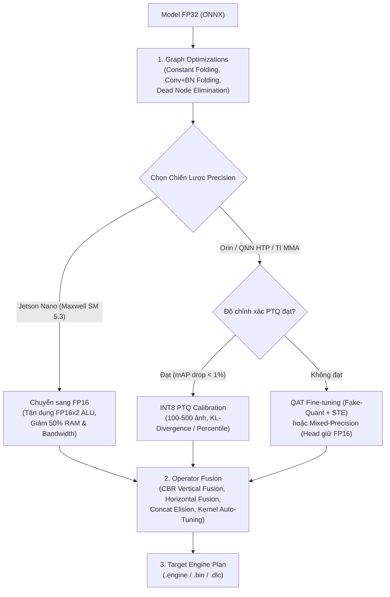
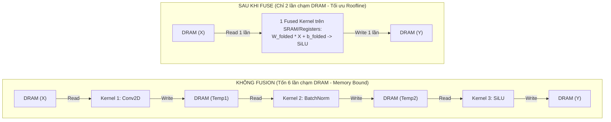

# 03. Tối Ưu Hóa Mô Hình (Model Optimization): FP16, INT8, Quantization (PTQ/QAT) & Operator Fusion

Tài liệu này đi sâu vào toán học và kỹ thuật nén, tăng tốc mạng nơ-ron trên phần cứng nhúng: từ cấu trúc bit **FP32 / FP16 / BF16 / INT8**, toàn bộ lý thuyết **Quantization**, so sánh **PTQ vs QAT**, **Operator Fusion**, cho tới code C++ triển khai **INT8 Entropy Calibrator** cho TensorRT.

> [!IMPORTANT]
> Toàn bộ mã nguồn C++ trong tài liệu tuân thủ quy tắc **không sử dụng `auto`**.

---

## 1. Begin From Scratch: Biểu Diễn Số Trên Phần Cứng (FP32, FP16, BF16, INT8)

Khi mạng YOLOv8n được huấn luyện trên máy chủ, mọi trọng số (weights) và giá trị kích hoạt (activations) mặc định ở kiểu dấu phẩy động 32-bit (**FP32**). Tại sao trên hệ thống nhúng ta phải giảm độ chính xác xuống **FP16** hoặc **INT8**?

### 1.1. Cấu trúc bit của các kiểu dữ liệu AI

| Kiểu dữ liệu | Tổng bit | Sign (Dấu) | Exponent (Số mũ — Dải động) | Mantissa (Phần trị — Độ mịn) | Dải biểu diễn xấp xỉ |
|---|---:|---:|---:|---:|---|
| **FP32** (IEEE 754) | 32 bit (4 B) | 1 bit | 8 bit | 23 bit | $\pm 3.4 \times 10^{38}$ |
| **FP16** (IEEE 754) | 16 bit (2 B) | 1 bit | **5 bit** | 10 bit | $\pm 65,504$ (dễ overflow nếu > 65504!) |
| **BF16** (Brain Float) | 16 bit (2 B) | 1 bit | **8 bit** (bằng FP32!) | 7 bit | $\pm 3.4 \times 10^{38}$ (khó overflow, hợp training) |
| **INT8** (Signed) | 8 bit (1 B) | — | — (Số nguyên bù 2) | — | $[-128, +127]$ (chỉ có 256 mức rời rạc) |

### 1.2. Ý nghĩa Vật lý — Vì sao giảm bit lại tăng tốc độ và tiết kiệm Pin?
1. **Giảm 2x–4x dung lượng RAM & Băng thông LPDDR4**:
   - Đọc 1 phép toán từ DRAM tốn năng lượng gấp **~200 lần** so với bản thân phép cộng/nhân trong ALU!
   - Với YOLOv8n (`640x640`), tensor đầu vào FP32 tốn `4.91 MB`, chuyển sang FP16 chỉ còn `2.46 MB`, chuyển sang INT8 chỉ còn `1.23 MB`. Băng thông LPDDR4 25.6 GB/s của Jetson Nano được giải phóng ngay lập tức.
2. **Tăng mật độ tính toán (ALU Throughput)**:
   - **INT8 MAC** tốn ít transistor hơn FP32 MAC tới **~15–20 lần**. Trên một diện tích silicon nhất định, NPU/DSP có thể nhét số lượng bộ nhân INT8 gấp nhiều lần FP32.
3. **Điểm đặc thù phần cứng của Jetson Nano (Câu hỏi phỏng vấn hay bẫy)**:
   - **Jetson Nano dùng GPU Maxwell (SM 5.3)** chỉ hỗ trợ tăng tốc phần cứng cho **FP16x2** (đóng gói 2 số FP16 vào 1 thanh ghi 32-bit để chạy song song, tốc độ ~472 GFLOPs vs ~236 GFLOPs FP32), nhưng **KHÔNG có lệnh DP4A (4-element INT8 dot product)** và **KHÔNG có Tensor Cores**.
   - Do đó, trên **Jetson Nano**, chạy **`FP16`** là tối ưu nhất (vừa nhanh ~2x, vừa giữ nguyên 99.9% độ chính xác mAP, đúng như cấu hình `precision: "fp16"` trong [`config/app_config.yaml`](file:///media/tinhtran/01D85BC599D1D460/FreeLancer/Object-Detection-With-Yolov8-In-Jetson-Nano/config/app_config.yaml#L27)). Ngược lại, trên **Jetson Xavier/Orin**, **Qualcomm Hexagon HTP**, hay **TI C7x+MMA**, **`INT8`** mới phát huy sức mạnh khủng khiếp (tăng tốc 3x–4x và tiết kiệm điện vượt trội).

---

## 2. Lý Thuyết & Toán Học Của Quantization (Lượng Tử Hóa)

**Quantization** là phép ánh xạ tuyến tính từ miền số thực liên tục $r \in [r_{\min}, r_{\max}]$ (FP32) sang miền số nguyên rời rạc $q \in [q_{\min}, q_{\max}]$ (ví dụ `[-128, 127]` cho `int8` hoặc `[0, 255]` cho `uint8`).

### 2.1. Công thức Quantize & Dequantize
$$r \approx S \cdot (q - Z)$$
$$q = \text{clip}\left( \text{round}\left(\frac{r}{S}\right) + Z,\ q_{\min},\ q_{\max} \right)$$

Trong đó:
- **$S$ (Scale — Hệ số tỷ lệ, kiểu FP32)**: Kích thước của 1 bước nhảy nguyên:
  $$S = \frac{r_{\max} - r_{\min}}{q_{\max} - q_{\min}}$$
- **$Z$ (Zero-Point — Điểm không, kiểu INT8)**: Giá trị số nguyên tương ứng chính xác với số thực $r = 0.0$. Bắt buộc số thực $0.0$ phải biểu diễn chính xác vì phép `Zero-padding` của Conv2D dùng rất nhiều số `0`!
  $$Z = \text{clip}\left( \text{round}\left( q_{\min} - \frac{r_{\min}}{S} \right),\ q_{\min},\ q_{\max} \right)$$

### 2.2. Symmetric Quantization vs Asymmetric (Affine) Quantization
1. **Symmetric Quantization ($Z = 0$)**:
   - Ép dải số thực đối xứng quanh 0: $[-\alpha, +\alpha]$ với $\alpha = \max(|r_{\min}|, |r_{\max}|)$, ánh xạ vào $[-127, +127]$ (bỏ `-128` để đối xứng hoàn toàn).
   - Công thức: $S = \frac{\alpha}{127}$, $q = \text{clip}(\text{round}(r/S), -127, 127)$.
   - **Ưu điểm**: Loại bỏ hoàn toàn $Z$, giúp tính tích chập cực nhanh trên phần cứng. Thường dùng cho **Weights ($W$)** (vì phân phối trọng số thường đối xứng quanh 0) và được TensorRT mặc định sử dụng.
2. **Asymmetric / Affine Quantization ($Z \neq 0$)**:
   - Cho phép $r_{\min}$ và $r_{\max}$ lệch nhau (ví dụ hàm ReLU cho ra $[0, 12.5]$ hay SiLU cho $[-0.278, 15.0]$).
   - **Ưu điểm**: Tận dụng 100% dải 256 mức của INT8 (không lãng phí nửa âm), giữ độ mịn cao cho **Activations ($X$)**. Phổ biến trên Qualcomm QNN, TFLite, ONNX Runtime.
   - **Nhược điểm**: Khi nhân $W \cdot X$ sinh thêm các số hạng bù trừ theo $Z_X$.

### 2.3. Per-Tensor vs Per-Channel (Channel-wise) Quantization
- **Per-Tensor Quantization**: Dùng chung **duy nhất 1 cặp $(S, Z)$** cho toàn bộ tensor.
  - *Bắt buộc dùng cho Activation ($X$)* vì không biết trước đặc trưng từng pixel khi suy luận và cần giữ tính đơn giản khi nhân ma trận.
- **Per-Channel Quantization**: Với ma trận trọng số `Conv2D` kích thước `[C_out, C_in, K_h, K_w]`, mỗi bộ lọc đầu ra $c \in [0, C_{out}-1]$ có **một hệ số $S_c$ riêng**!
  - *Tại sao cực kỳ quan trọng?* Trong cùng 1 lớp Conv của YOLOv8, Filter số 1 có thể có trọng số nằm trong $[-0.05, 0.05]$, nhưng Filter số 2 nằm trong $[-5.0, 5.0]$. Nếu dùng chung 1 $S$ cho cả tensor, Filter số 1 sẽ bị làm tròn hết về `0` $\implies$ mù đặc trưng! Per-channel giải quyết triệt để vấn đề này với chi phí bộ nhớ không đáng kể (chỉ lưu thêm mảng $C_{out}$ số float).

### 2.4. Toán học bên trong một lớp Conv2D chạy hoàn toàn bằng INT8
Giả sử đầu vào $X \approx S_X (q_X - Z_X)$, trọng số $W \approx S_W q_W$ (Symmetric $Z_W = 0$), đầu ra $Y \approx S_Y (q_Y - Z_Y)$:
$$Y = \sum W \cdot X \implies S_Y (q_Y - Z_Y) \approx S_W S_X \sum q_W (q_X - Z_X)$$
$$\implies q_Y = Z_Y + \underbrace{\frac{S_W \cdot S_X}{S_Y}}_{M} \cdot \left( \underbrace{\sum (q_W \cdot q_X)}_{\text{INT32 Accumulator}} - Z_X \sum q_W \right)$$

**Điểm tinh túy phần cứng**:
1. Phép nhân $q_W \times q_X$ (INT8 $\times$ INT8) được cộng dồn vào thanh ghi **INT32 Accumulator** (tránh tràn số vì $127 \times 127 \times 1000$ vượt xa phạm vi 8-bit và 16-bit).
2. Hạng tử $Z_X \sum q_W$ chỉ phụ thuộc trọng số tĩnh $W$ nên được **tính trước ở thời điểm biên dịch (Offline)** và cộng thẳng vào Bias INT32!
3. Hệ số thực $M = \frac{S_W S_X}{S_Y} < 1$ được đổi thành phép nhân số nguyên 32-bit + dịch bit phải (`(acc * M0) >> shift`), giúp toàn bộ phép suy luận không đụng tới bất kỳ phép chia dấu phẩy động nào (Re-quantization).

---

## 3. PTQ (Post-Training Quantization) vs QAT (Quantization-Aware Training)

### 3.1. PTQ (Lượng tử hóa sau huấn luyện)
* **Bản chất**: Lấy mô hình FP32 đã train xong, đưa khoảng **100–500 ảnh đại diện (Calibration Dataset)** chạy qua mạng để ghi lại thống kê phân phối giá trị tại đầu ra từng lớp (histogram), từ đó tính $(S, Z)$ mà **không cần train lại hay cần nhãn (labels)**.
* **3 Thuật toán tìm ngưỡng cắt $\alpha$ (Dynamic Range) cho Calibration**:
  1. **MinMax**: Lấy $\alpha = \max(|x_{\min}|, |x_{\max}|)$. *Nhược điểm*: Chỉ cần 1 pixel nhiễu (outlier) có giá trị `100.0` trong khi 99.9% dữ liệu nằm trong `[-2, 2]`, toàn bộ dải INT8 bị kéo giãn ra `[-100, 100]`, gây sai số lượng tử khổng lồ cho vùng `[-2, 2]`.
  2. **Percentile**: Cắt bỏ 0.01% hoặc 0.1% các điểm cực trị ngoài rìa histogram (ví dụ ngưỡng 99.99%). Rất hiệu quả để loại outlier.
  3. **Entropy / KL-Divergence (Mặc định chuẩn vàng của TensorRT `IInt8EntropyCalibrator2`)**:
     - Xây dựng histogram FP32 (ví dụ 2048 bins) cho activation mỗi lớp.
     - Thử cắt histogram ở nhiều ngưỡng $T$ khác nhau, lượng tử phần bên trong thành phân phối $Q$ (128 bins INT8).
     - Tính **Kullback-Leibler Divergence** (đo độ mất mát thông tin):
       $$D_{KL}(P \| Q) = \sum_{i} P(i) \cdot \log\left(\frac{P(i)}{Q(i)}\right)$$
     - Chọn ngưỡng $T^*$ có $D_{KL}$ nhỏ nhất! Tức là giữ lại nhiều thông tin nhất bất chấp việc cắt xén vài outlier ngoài rìa.

### 3.2. QAT (Quantization-Aware Training) — Khi nào PTQ thất bại và phải dùng QAT?
* **Tại sao YOLOv8n dễ tụt mAP khi chạy PTQ INT8?**
  - **Mô hình nhẹ (Lightweight)**: Mạng nhỏ như YOLOv8n có ít kênh dư thừa; sai số ở 1 kênh ảnh hưởng trực tiếp đến kết quả.
  - **Hàm `SiLU` & `Concat` trong nhánh `C2f` / `PAN-FPN`**: `SiLU` có đuôi âm nhỏ `[-0.278, 0]` nhưng biến thiên lớn ở miền dương; các nhánh `Concat` ghép feature map có biên độ rất lệch nhau, khiến scale chung của tầng `Concat` bóp méo nhánh có biên độ nhỏ.
  - **Nhánh hồi quy tọa độ (DFL Head)**: Sai số lượng tử nhỏ ở tọa độ box đầu ra làm sai lệch vị trí bounding box (tụt AP@0.75 mạnh).
* **Cơ chế hoạt động của QAT**:
  - Chèn các nút **Fake-Quantization ($Q \to DQ$)** vào mô hình PyTorch trước khi fine-tune thêm vài epoch:
    $$\hat{x} = S \cdot \left( \text{clip}\left(\text{round}\left(\frac{x}{S}\right) + Z, q_{\min}, q_{\max}\right) - Z \right)$$
  - **Vấn đề đạo hàm bằng 0**: Hàm `round()` là hàm bậc thang nên đạo hàm bằng 0 hầu như khắp nơi $\implies$ Backpropagation không cập nhật được trọng số!
  - **Giải pháp Straight-Through Estimator (STE)**: Ở pha Forward vẫn dùng `round()` để mô phỏng sai số lượng tử, nhưng ở pha Backward thì giả sử đạo hàm đi thẳng qua hàm `round()`:
    $$\frac{\partial \hat{x}}{\partial x} = \begin{cases} 1 & \text{nếu } r_{\min} \le x \le r_{\max} \\ 0 & \text{nếu ngoài ngưỡng cắt} \end{cases}$$
  - Nhờ đó, mạng tự học cách điều chỉnh trọng số để **thích nghi với nhiễu lượng tử**, phục hồi mAP gần như ngang ngửa FP32!

### 3.3. Mixed-Precision & Layer Sensitivity Analysis
Khi PTQ bị sụt mAP (ví dụ từ 37.3 mAP xuống 33.0 mAP), kỹ sư không lượng tử mù quáng tất cả về INT8 mà làm **Layer Sensitivity Analysis**:
- Bật INT8 từng lớp một (các lớp còn lại để FP16) và đo độ sụt giảm mAP trên tập Validation.
- Thông thường: **Lớp `Conv` đầu tiên** (nhận ảnh RGB 3 kênh), **Lớp `Head` cuối cùng** (xuất tọa độ box và Softmax DFL), và các **lớp `Concat` nhạy cảm** sẽ được **ép chạy ở `FP16`**, còn 90% thân mạng Backbone/Neck chạy **`INT8`**. Chiến lược **Mixed-Precision (INT8 + FP16)** này thường giữ được >99% độ chính xác mà vẫn đạt >85% tốc độ tối đa của INT8.

---

## 4. Operator Fusion & Graph Optimization

Đây là lý do TensorRT / QNN / TIDL chạy nhanh hơn PyTorch gấp nhiều lần ngay cả khi giữ nguyên FP32/FP16:

### 4.1. Chứng minh toán học: Conv2D + BatchNorm Folding
Trong PyTorch, một block cơ bản là `Conv2D -> BatchNorm2d -> SiLU`. Ở pha suy luận, BatchNorm thực chất chỉ là một phép biến đổi tuyến tính theo từng kênh $c$:
$$y_{BN} = \gamma_c \frac{(W_c * x + b_c) - \mu_c}{\sqrt{\sigma_c^2 + \epsilon}} + \beta_c$$
Đặt hệ số gộp: $\alpha_c = \frac{\gamma_c}{\sqrt{\sigma_c^2 + \epsilon}}$. Ta rút gọn thành:
$$y_{BN} = (\alpha_c \cdot W_c) * x + \left(\alpha_c (b_c - \mu_c) + \beta_c\right) = \hat{W}_c * x + \hat{b}_c$$
Toàn bộ layer `BatchNorm` **biến mất hoàn toàn** khỏi đồ thị tính toán với sai số bằng `0`!

### 4.2. Các kỹ thuật Graph Optimization cốt lõi khác
1. **Vertical Fusion (CBR Fusion: `Conv + Bias + SiLU/ReLU`)**:
   - *Không fuse*: Kernel 1 tính Conv $\to$ Ghi hàng MB kết quả ra LPDDR4 RAM $\to$ Kernel 2 đọc từ RAM lên $\to$ Cộng Bias & tính SiLU $\to$ Ghi lại xuống RAM.
   - *Có fuse*: Tất cả thực hiện xong trong **thanh ghi (Registers / Shared SRAM)** của GPU/NPU rồi mới ghi kết quả cuối xuống RAM **1 lần duy nhất**. Giảm **2x–3x lưu lượng băng thông DRAM**!
2. **Horizontal Fusion**: Khi 2 nhánh song song (như trong khối Bottleneck hoặc Inception) có cùng tensor đầu vào và cùng kích thước kernel $1 \times 1$, trình biên dịch gộp chúng thành 1 phép nhân ma trận lớn hơn để tận dụng hết số nhân GPU và chỉ phải đọc tensor đầu vào 1 lần.
3. **Concat Elision (Triệt tiêu lớp `Concat`)**: Trong khối `C2f` của YOLOv8 có rất nhiều phép `Concat`. Thay vì để nhánh A và nhánh B ghi ra 2 buffer riêng rồi chạy thêm 1 kernel `Concat` copy vào buffer thứ 3, trình biên dịch cấp phát trước buffer tổng lớn, và bảo nhánh A ghi trực tiếp vào nửa đầu (offset 0), nhánh B ghi trực tiếp vào nửa sau (offset $N/2$). **Chi phí lớp `Concat` giảm về `0 ms`**!

---

## 5. High-Level Design (HLD) & Low-Level Design (LLD)

### 5.1. HLD: Quy Trình Tối Ưu Mô Hình Đến Runtime Đích



### 5.2. LLD: Sơ Đồ Dữ Liệu Thanh Ghi Của Fused Kernel vs Non-Fused Kernel



---

## 6. Code Examples Thực Chiến (C++17 — Chuẩn Không `auto`)

### 6.1. C++17: Toán Học Conv+BN Folding & Mô Phỏng Lượng Tử Hóa Đối Xứng / Bất Đối Xứng

```cpp
#include <algorithm>
#include <cmath>
#include <cstdint>
#include <vector>

// 1. Conv2D + BatchNorm Folding: Gộp mu, var, gamma, beta vào weights & bias của Conv2D
void foldBatchNormIntoConv(std::vector<float>& conv_weights, // [C_out, C_in, K_h, K_w]
                           std::vector<float>& conv_bias,    // [C_out]
                           const std::vector<float>& bn_gamma,
                           const std::vector<float>& bn_beta,
                           const std::vector<float>& bn_mean,
                           const std::vector<float>& bn_var,
                           float eps,
                           int c_out,
                           int fan_in) { // fan_in = C_in * K_h * K_w
    for (int oc = 0; oc < c_out; ++oc) {
        float inv_std = 1.0f / std::sqrt(bn_var[oc] + eps);
        float alpha = bn_gamma[oc] * inv_std;

        // Cập nhật toàn bộ trọng số của filter kênh đầu ra `oc`
        int offset = oc * fan_in;
        for (int k = 0; k < fan_in; ++k) {
            conv_weights[offset + k] *= alpha;
        }

        // Cập nhật bias của kênh `oc`
        conv_bias[oc] = alpha * (conv_bias[oc] - bn_mean[oc]) + bn_beta[oc];
    }
}

// 2. Tham số lượng tử hóa
struct QuantParams {
    float scale;
    int32_t zero_point;
};

// Tính Scale và Zero-Point (Asymmetric hoặc Symmetric)
QuantParams computeQuantParams(float r_min, float r_max, bool symmetric) {
    QuantParams qp;
    if (symmetric) {
        float abs_max = std::max(std::abs(r_min), std::abs(r_max));
        qp.scale = (abs_max > 1e-8f) ? (abs_max / 127.0f) : 1.0f;
        qp.zero_point = 0;
    } else {
        // Đảm bảo số 0 nằm trong khoảng [r_min, r_max]
        float adj_min = std::min(r_min, 0.0f);
        float adj_max = std::max(r_max, 0.0f);
        qp.scale = (adj_max > adj_min + 1e-8f) ? ((adj_max - adj_min) / 255.0f) : 1.0f;
        float zp_real = -128.0f - (adj_min / qp.scale);
        int32_t zp_clamped = static_cast<int32_t>(std::round(zp_real));
        qp.zero_point = std::max(-128, std::min(127, zp_clamped));
    }
    return qp;
}

inline int8_t quantizeFloatToInt8(float value, const QuantParams& qp) {
    float q_real = std::round(value / qp.scale) + static_cast<float>(qp.zero_point);
    int32_t q_int = static_cast<int32_t>(q_real);
    int32_t clamped = std::max(-128, std::min(127, q_int));
    return static_cast<int8_t>(clamped);
}

inline float dequantizeInt8ToFloat(int8_t q, const QuantParams& qp) {
    return qp.scale * static_cast<float>(static_cast<int32_t>(q) - qp.zero_point);
}
```

### 6.2. C++17: Triển Khai Đầy Đủ `IInt8EntropyCalibrator2` Cho TensorRT (PTQ KL-Divergence)

Dưới đây là cấu trúc chuẩn để thêm hỗ trợ PTQ INT8 (hữu ích khi bạn port dự án từ Jetson Nano sang Jetson Orin/Xavier) vào `JetsonGpuHAL` mà không sử dụng `auto`:

```cpp
#if defined(ENABLE_JETSON_CUDA)
#include <NvInfer.h>
#include <cuda_runtime_api.h>
#include <opencv2/imgcodecs.hpp>
#include <fstream>
#include <iostream>
#include <string>
#include <vector>
#include "service/preprocessor.h"

namespace edge_ai { namespace hal {

class Yolov8Int8EntropyCalibrator : public nvinfer1::IInt8EntropyCalibrator2 {
public:
    Yolov8Int8EntropyCalibrator(int batch_size,
                                int input_size,
                                const std::vector<std::string>& image_paths,
                                const std::string& calib_table_path)
        : batch_size_(batch_size),
          input_size_(input_size),
          image_paths_(image_paths),
          calib_table_path_(calib_table_path),
          preprocessor_(input_size),
          current_idx_(0),
          device_input_(nullptr) {
        single_img_elems_ = static_cast<std::size_t>(3) * input_size_ * input_size_;
        batch_bytes_ = static_cast<std::size_t>(batch_size_) * single_img_elems_ * sizeof(float);
        host_batch_.resize(static_cast<std::size_t>(batch_size_) * single_img_elems_);
        cudaMalloc(&device_input_, batch_bytes_);
    }

    ~Yolov8Int8EntropyCalibrator() override {
        if (device_input_ != nullptr) {
            cudaFree(device_input_);
            device_input_ = nullptr;
        }
    }

    int getBatchSize() const noexcept override {
        return batch_size_;
    }

    bool getBatch(void* bindings[], const char* names[], int nbBindings) noexcept override {
        (void)names;
        (void)nbBindings;
        if (current_idx_ + static_cast<std::size_t>(batch_size_) > image_paths_.size()) {
            return false; // Đã duyệt hết tập ảnh calibration
        }

        std::vector<float> single_chw;
        PreprocessMeta meta;

        for (int b = 0; b < batch_size_; ++b) {
            const std::string& path = image_paths_[current_idx_ + static_cast<std::size_t>(b)];
            cv::Mat bgr = cv::imread(path);
            if (bgr.empty() || !preprocessor_.process(bgr, single_chw, meta)) {
                return false;
            }
            float* dst_ptr = host_batch_.data() + static_cast<std::size_t>(b) * single_img_elems_;
            std::copy(single_chw.begin(), single_chw.end(), dst_ptr);
        }

        current_idx_ += static_cast<std::size_t>(batch_size_);

        cudaError_t err = cudaMemcpy(device_input_, host_batch_.data(), batch_bytes_, cudaMemcpyHostToDevice);
        if (err != cudaSuccess) {
            return false;
        }
        bindings[0] = device_input_;
        return true;
    }

    // Đọc cache bảng scale để không phải calibrate lại mất hàng phút ở lần khởi động sau
    const void* readCalibrationCache(std::size_t& length) noexcept override {
        calib_cache_.clear();
        std::ifstream input(calib_table_path_, std::ios::binary);
        input >> std::noskipws;
        if (input.good()) {
            std::copy(std::istream_iterator<char>(input),
                      std::istream_iterator<char>(),
                      std::back_inserter(calib_cache_));
        }
        length = calib_cache_.size();
        return length > 0 ? calib_cache_.data() : nullptr;
    }

    void writeCalibrationCache(const void* cache, std::size_t length) noexcept override {
        std::ofstream output(calib_table_path_, std::ios::binary);
        if (output.good()) {
            output.write(reinterpret_cast<const char*>(cache), static_cast<std::streamsize>(length));
        }
    }

private:
    int batch_size_;
    int input_size_;
    std::vector<std::string> image_paths_;
    std::string calib_table_path_;
    Preprocessor preprocessor_;

    std::size_t current_idx_;
    std::size_t single_img_elems_;
    std::size_t batch_bytes_;
    std::vector<float> host_batch_;
    void* device_input_;
    std::vector<char> calib_cache_;
};

}} // namespace edge_ai::hal
#endif
```
