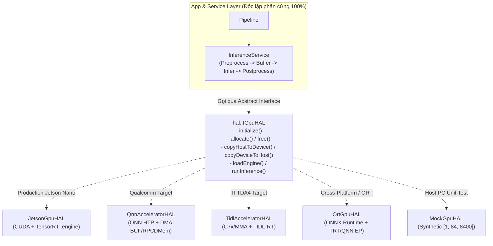
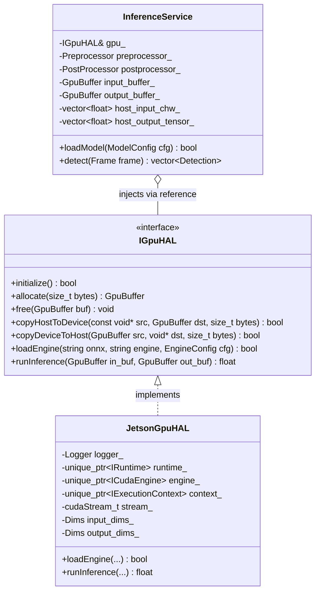

# 04. Triển Khai TensorRT Trong C++ & Kiến Trúc Heterogeneous Runtimes (TensorRT, QNN, TIDL, ONNX Runtime)

Tài liệu này giải thích toàn diện bản chất của **Inference Runtime**, chi tiết API **TensorRT trong C++17** (gắn liền với `JetsonGpuHAL`), phân biệt kiến trúc phần cứng **CPU / GPU / DSP / NPU**, và đối chiếu sâu 4 SDK hàng đầu được yêu cầu trong JD: **NVIDIA TensorRT**, **Qualcomm QNN**, **TI TIDL**, và **ONNX Runtime**.

> [!IMPORTANT]
> Toàn bộ mã nguồn C++ trong tài liệu tuân thủ quy tắc **không sử dụng `auto`**.

---

## 1. Begin From Scratch: Bản Chất Của Một Embedded AI Inference Runtime

Tại sao chúng ta không cài PyTorch lên Jetson Nano để gọi `model(img)` mà phải dùng **TensorRT / QNN / TIDL**?
Bởi vì PyTorch là môi trường **Eager Execution** thiết kế cho nghiên cứu/huấn luyện: mỗi lớp `Conv` được gọi lẻ tẻ qua Python interpreter, cấp phát tensor động liên tục, không gộp layer, chiếm hàng GB RAM phụ thuộc.

Một **Embedded AI Inference Runtime** chia vòng đời làm 2 pha tách biệt hoàn toàn:

| Pha thực thi | Nơi chạy & Thời điểm | Công việc diễn ra bên trong |
|---|---|---|
| **1. Offline Build / Compile Phase** | Chạy **1 lần duy nhất** trên máy trạm (QNN/TIDL) hoặc lúc khởi động đầu tiên trên target (TensorRT). | - Parse file `.onnx`.<br>- Chạy Graph Optimization & Operator Fusion (`Conv+BN+SiLU`).<br>- Ánh xạ trọng số & bảng scale `FP16`/`INT8`.<br>- **Kernel Auto-Tuning**: Đo thử hàng chục biến thể kernel CUDA/DSP cho từng kích thước layer trên đúng con chip thật để chọn kernel nhanh nhất.<br>- Lập lịch cấp phát bộ nhớ tĩnh (Memory Reuse Planning) để các tensor trung gian không còn dùng sẽ nhường RAM cho tensor sau.<br>- Đóng gói thành tệp nhị phân thực thi (`.engine` / `.dlc` / `.bin`). |
| **2. Online Execution Runtime Phase** | Chạy **liên tục** trong production (`edge-ai-manager` 30 FPS). | - Dùng Runtime nhẹ (`IRuntime`, `QnnContext`) nạp file nhị phân trong vài trăm ms.<br>- Tạo Execution Context, gắn con trỏ Input/Output buffer cấp phát sẵn.<br>- Đẩy lệnh chạy bất đồng bộ xuống Hardware Queue (`cudaStream_t` / DSP queue) với chi phí CPU gần bằng `0`. |

> [!WARNING]
> **Quy tắc bất di bất dịch của TensorRT**: Tệp `.engine` (Plan file) **KHÔNG mang tính khả chuyển (Not Portable)** giữa các dòng GPU khác nhau và phiên bản TensorRT khác nhau! Một file `yolov8n_fp16.engine` biên dịch trên RTX 3080 (Ampere SM 8.6) **sẽ lỗi hoặc sập ngay lập tức** nếu copy sang Jetson Nano (Maxwell SM 5.3) vì trình biên dịch đã nhúng mã máy CUDA (SASS/PTX) và kết quả benchmark riêng cho SM 8.6. **Luôn phải build `.engine` ngay trên chính thiết bị Jetson đích!** (Đúng như logic fallback build từ ONNX tại [`src/hal/jetson/jetson_gpu_hal.cpp#L101-L153`](file:///media/tinhtran/01D85BC599D1D460/FreeLancer/Object-Detection-With-Yolov8-In-Jetson-Nano/src/hal/jetson/jetson_gpu_hal.cpp#L101-L153)).

---

## 2. NVIDIA TensorRT Chuyên Sâu & Triển Khai Trong C++

### 2.1. Giải phẫu 9 đối tượng cốt lõi trong C++ API của TensorRT (`NvInfer.h`)

| Lớp API TensorRT | Pha sử dụng | Nhiệm vụ cụ thể |
|---|---|---|
| `nvinfer1::ILogger` | Cả 2 pha | Nhận toàn bộ thông báo cảnh báo, lỗi parse ONNX hoặc bảng thời gian profiling từ nhân TensorRT. |
| `nvinfer1::IBuilder` | Build | Bộ máy chính chịu trách nhiệm tạo mạng, cấu hình tối ưu và biên dịch engine. |
| `nvinfer1::INetworkDefinition` | Build | Biểu diễn đồ thị các lớp (`ILayer`) và tensor (`ITensor`) trong bộ nhớ của TensorRT (nhớ bật cờ `kEXPLICIT_BATCH` cho ONNX!). |
| `nvonnxparser::IParser` | Build | Đọc tệp `.onnx` và điền các nút mạng vào `INetworkDefinition`. |
| `nvinfer1::IBuilderConfig` | Build | Chứa các cờ quyết định chiến lược biên dịch: `kFP16`, `kINT8`, dung lượng workspace (`setMemoryPoolLimit` / `setMaxWorkspaceSize`), `setInt8Calibrator`, và `IOptimizationProfile` (nếu dùng Dynamic Shape). |
| `nvinfer1::IHostMemory` | Build | Vùng đệm RAM chứa toàn bộ Engine đã biên dịch và tuần tự hóa (`buildSerializedNetwork`), sẵn sàng ghi ra đĩa (`.engine`). |
| `nvinfer1::IRuntime` | Runtime | Bộ máy nhẹ trên thiết bị đích dùng để giải tuần tự hóa (`deserializeCudaEngine`) tệp `.engine` thành đối tượng thực thi. |
| `nvinfer1::ICudaEngine` | Runtime | Chứa trọng số và kế hoạch thực thi đã nạp lên bộ nhớ thiết bị. Một Engine có thể được chia sẻ bởi nhiều Context (đa luồng). |
| `nvinfer1::IExecutionContext` | Runtime | Lưu trạng thái thực thi (địa chỉ buffer kích hoạt trung gian) cho một luồng suy luận cụ thể. Gọi `enqueueV2()` (TRT 7/8) hoặc `enqueueV3()` (TRT 8.5+/10) để chạy bất đồng bộ trên `cudaStream_t`. |

### 2.2. Thiết kế Kiến trúc Tích hợp TensorRT trong Dự án (`IGpuHAL` & `InferenceService`)
Trong dự án `edge-ai-manager`, chúng ta **không bao giờ** gọi thẳng `nvinfer1::IExecutionContext` bên trong `Pipeline` hay `InferenceService`. Thay vào đó, ta áp dụng **Dependency Inversion Principle (HAL Pattern)**:
- `InferenceService` ([`src/service/inference_service.cpp`](file:///media/tinhtran/01D85BC599D1D460/FreeLancer/Object-Detection-With-Yolov8-In-Jetson-Nano/src/service/inference_service.cpp)) chỉ phụ thuộc vào interface trừu tượng `hal::IGpuHAL` ([`include/hal/i_gpu_hal.h`](file:///media/tinhtran/01D85BC599D1D460/FreeLancer/Object-Detection-With-Yolov8-In-Jetson-Nano/include/hal/i_gpu_hal.h)).
- Khi chạy trên Jetson Nano: `EdgeAIManager` bơm `JetsonGpuHAL` (chứa CUDA + TensorRT).
- Khi chạy Unit Test / CI trên máy Host x86 không có GPU (`--mock`): `EdgeAIManager` bơm `MockGpuHAL` ([`src/hal/mock/mock_gpu_hal.h`](file:///media/tinhtran/01D85BC599D1D460/FreeLancer/Object-Detection-With-Yolov8-In-Jetson-Nano/src/hal/mock/mock_gpu_hal.h)) sinh tensor giả `[1, 84, 8400]` để test sạch toàn bộ luồng Tracker, Rule Engine, MQTT, SQLite!
- Khi muốn chuyển sản phẩm sang chip **Qualcomm Snapdragon** hay **TI TDA4VM**: chỉ cần viết thêm `QnnGpuHAL` hoặc `TidlGpuHAL` kế thừa `IGpuHAL`, **0 dòng code nào ở tầng App/Service phải sửa đổi**!

---

## 3. Kiến Trúc Tính Toán Không Đồng Nhất (Heterogeneous Computing) & So Sánh 4 Runtime Trong JD

Một hệ thống AI nhúng hiện đại không chỉ có CPU và GPU mà là tập hợp nhiều bộ tăng tốc chuyên biệt trên cùng một SoC (**Heterogeneous SoC**):

### 3.1. Giải phẫu 4 Loại Kiến Trúc Phần Cứng Tính Toán

| Bộ xử lý | Mô hình thực thi | Bộ nhớ nội (On-chip SRAM) | Điểm mạnh tuyệt đối | Điểm yếu |
|---|---|---|---|---|
| **CPU** *(ARM Cortex-A57, A78)* | **Scalar / Superscalar Out-of-Order** (4–8 nhân mạnh) | Cache L1/L2 tự động (Hardware-managed) | Logic rẽ nhánh `if/else`, vòng lặp động, quản lý OS/IO, NMS, Kalman Filter, Hungarian. | Ít ALU song song; tốn điện và chậm khi nhân ma trận CNN khổng lồ. |
| **GPU** *(NVIDIA Maxwell / Ampere)* | **SIMT** (Hàng trăm–hàng nghìn nhân chạy cùng lệnh trên nhiều dữ liệu) | Shared Memory + Register File + L2 Cache | Băng thông bộ nhớ cao, lập trình linh hoạt (CUDA), chạy tốt FP32/FP16 và cả Tensor Cores. | Tiêu thụ điện cao hơn NPU/DSP; kém hiệu quả nếu kernel quá nhỏ hoặc rẽ nhánh nhiều (Warp Divergence). |
| **DSP** *(Qualcomm Hexagon HVX, TI C7x)* | **VLIW** (Đóng gói nhiều lệnh vào 1 chu kỳ) + **Vector SIMD rộng** (512–1024 bit) | **Scratchpad SRAM (L2/VTCM)** do **phần mềm/DMA điều khiển thủ công** | Độ trễ cực kỳ ổn định (deterministic), rất tiết kiệm điện cho xử lý tín hiệu, ảnh, hoặc layer AI lạ không chạy được trên NPU. | Khó lập trình; nếu DMA không nạp sẵn dữ liệu vào SRAM kịp (**Tiling**), DSP sẽ bị đứng chờ DRAM. |
| **NPU / HTP / MMA** *(Hexagon HTP, TI MMA, DLA)* | **Systolic Array / 2D MAC Grid** (Hàng nghìn bộ nhân-cộng INT8 gắn cứng) | **On-chip Weight/Activation SRAM** (VTCM / MSMC) | Hiệu suất năng lượng đỉnh cao (**TOPS/Watt** gấp 5–10x GPU) chuyên cho Conv2D, MatMul INT8/FP16. | Kém linh hoạt: chỉ hỗ trợ tập toán tử cố định; gặp op lạ sẽ gây **CPU Fallback**. |

---

### 3.2. Bảng So Sánh Chuyên Sâu 4 Runtime Được Liệt Kê Trong JD

| Tiêu chí kỹ thuật | NVIDIA TensorRT | Qualcomm QNN (Qualcomm AI Engine Direct) | TI TIDL (Texas Instruments Deep Learning) | ONNX Runtime (ORT) |
|---|---|---|---|---|
| **Phần cứng mục tiêu** | NVIDIA Jetson (Nano, Xavier, Orin), dGPU | Snapdragon SoCs (CPU, Adreno GPU, **Hexagon HTP/DSP**) | TI Jacinto / Sitara TDA4VM / AM6x (**C7x DSP + MMA**) | Đa nền tảng (qua **Execution Providers — EP**) |
| **Định dạng đầu vào & Chuyển đổi** | `.onnx` $\to$ `nvonnxparser` $\to$ `.engine` | `.onnx`/`.tflite` $\to$ `qnn-onnx-converter` $\to$ C++ graph $\to$ `qnn-context-binary-generator` (`.bin`) | `.onnx`/`.tflite` $\to$ `tidl_model_import.out` $\to$ Subgraph `.bin` | Chạy trực tiếp `.onnx` (kèm thư viện EP tương ứng) |
| **Lượng tử hóa ưa chuộng** | FP16 (Jetson Nano), INT8 PTQ (Entropy/MinMax) & QAT (Orin/Xavier) | **INT8 / INT16 Asymmetric** (Per-channel weights) cho Hexagon HTP | **INT8 / INT16 Symmetric Power-of-2** tối ưu cho MMA | Hỗ trợ QDQ ONNX format; ủy quyền cho TensorRT EP / QNN EP |
| **Quản lý bộ nhớ tăng tốc** | CUDA Unified/Device memory + Workspace (`128 MB`) | **VTCM (Vector Tightly Coupled Memory)**: NPU tự chia nhỏ tensor (tiling) vào VTCM 4–8MB cực nhanh + **RPC Shared Ion/DMA-BUF** | **DMA Tiling tự động** kéo từng mảnh tensor từ DDR vào L2 SRAM / MSMC SRAM của C7x+MMA | Phụ thuộc EP; nếu có **CPU Fallback** giữa 2 EP sẽ tốn copy qua OrtValue |
| **Xử lý Op không hỗ trợ** | Viết CUDA Custom Plugin (`IPluginV2DynamicExt`) | Viết Custom HTP Op Package hoặc fallback về Adreno GPU / ARM CPU | Fallback từng subgraph về ARM Cortex-A72 (qua TIDL-RT / ONNX Runtime TIDL EP) | Tự động **Graph Partitioning**: cắt subgraph giao cho NPU EP, phần lạ chạy trên CPU EP |
| **Ứng dụng điển hình** | Robotics, Edge Vision Box, Jetson ADAS | Smartphone AI, Camera thông minh, Automotive Cockpit | ADAS Camera/Radar (TI TDA4VM), Công nghiệp | Triển khai nhanh đa nền tảng (Cross-platform deployment) |

> [!TIP]
> **Mẹo trả lời phỏng vấn khi được hỏi về QNN / TIDL dù bạn làm dự án trên Jetson Nano**:
> *"Dù nền tảng thực tế của em là Jetson Nano với TensorRT, nhưng toàn bộ nguyên lý cốt lõi đều giống hệt nhau và dự án đã trừu tượng hóa qua lớp `IGpuHAL`: PyTorch $\to$ ONNX $\to$ Calibration INT8/FP16 $\to$ Graph Fusion $\to$ Biên dịch nhị phân tĩnh (`.engine` tương ứng `.bin` context binary của QNN hay artifact của TIDL) $\to$ Tối ưu bộ nhớ DMA/Zero-copy để tránh copy từ RAM lên vùng nhớ của Accelerator (VRAM trên Jetson hay VTCM/L2 SRAM trên QNN/TIDL)."*

---

## 4. High-Level Design (HLD) & Low-Level Design (LLD)

### 4.1. HLD: Kiến Trúc Đa Nền Tảng Heterogeneous HAL Trong Dự Án



### 4.2. LLD: Sơ Đồ Lớp & Vòng Đời Thực Thi TensorRT Trong `JetsonGpuHAL`



---

## 5. Code Examples Thực Chiến (C++17 — Chuẩn Không `auto`)

### 5.1. C++17: Xây Dựng TensorRT Engine Đầy Đủ (FP16 + INT8 + Dynamic Shape Profile + Caching)

```cpp
#if defined(ENABLE_JETSON_CUDA)
#include <NvInfer.h>
#include <NvOnnxParser.h>
#include <cuda_runtime_api.h>
#include <fstream>
#include <iostream>
#include <memory>
#include <string>
#include <vector>

class TrtLogger : public nvinfer1::ILogger {
public:
    void log(Severity severity, const char* msg) noexcept override {
        if (severity <= Severity::kWARNING) {
            std::cerr << "[TensorRT] " << msg << std::endl;
        }
    }
};

// Biên dịch ONNX -> Serialized TensorRT Engine (.engine) hỗ trợ FP16/INT8 & Dynamic Shape
bool buildTensorRtEngine(const std::string& onnx_path,
                         const std::string& engine_path,
                         bool enable_fp16,
                         nvinfer1::IInt8Calibrator* int8_calibrator,
                         TrtLogger& logger) {
    std::unique_ptr<nvinfer1::IBuilder> builder(nvinfer1::createInferBuilder(logger));
    if (!builder) {
        return false;
    }

    const uint32_t explicit_batch =
        1U << static_cast<uint32_t>(nvinfer1::NetworkDefinitionCreationFlag::kEXPLICIT_BATCH);

    std::unique_ptr<nvinfer1::INetworkDefinition> network(
        builder->createNetworkV2(explicit_batch)
    );
    if (!network) {
        return false;
    }

    std::unique_ptr<nvonnxparser::IParser> parser(
        nvonnxparser::createParser(*network, logger)
    );
    if (!parser || !parser->parseFromFile(
            onnx_path.c_str(), static_cast<int>(nvinfer1::ILogger::Severity::kWARNING))) {
        std::cerr << "[TensorRT] Failed to parse ONNX: " << onnx_path << std::endl;
        return false;
    }

    std::unique_ptr<nvinfer1::IBuilderConfig> config(builder->createBuilderConfig());
    if (!config) {
        return false;
    }

    // Jetson Nano 4GB: giới hạn workspace ~128 MB để tránh Kernel OOM-Killer
    config->setMaxWorkspaceSize(128ULL * 1024ULL * 1024ULL);

    if (enable_fp16 && builder->platformHasFastFp16()) {
        config->setFlag(nvinfer1::BuilderFlag::kFP16);
    }

    if (int8_calibrator != nullptr && builder->platformHasFastInt8()) {
        config->setFlag(nvinfer1::BuilderFlag::kINT8);
        config->setInt8Calibrator(int8_calibrator);
    }

    // Nếu mô hình ONNX có Dynamic Batch hoặc Dynamic Resolution: cấu hình OptimizationProfile
    nvinfer1::ITensor* input_tensor = network->getInput(0);
    nvinfer1::Dims input_dims = input_tensor->getDimensions();
    if (input_dims.d[0] == -1) {
        nvinfer1::IOptimizationProfile* profile = builder->createOptimizationProfile();
        const char* input_name = input_tensor->getName();
        profile->setDimensions(input_name, nvinfer1::OptProfileSelector::kMIN,
                               nvinfer1::Dims4(1, 3, 640, 640));
        profile->setDimensions(input_name, nvinfer1::OptProfileSelector::kOPT,
                               nvinfer1::Dims4(1, 3, 640, 640));
        profile->setDimensions(input_name, nvinfer1::OptProfileSelector::kMAX,
                               nvinfer1::Dims4(4, 3, 640, 640));
        config->addOptimizationProfile(profile);
    }

    std::unique_ptr<nvinfer1::IHostMemory> serialized_plan(
        builder->buildSerializedNetwork(*network, *config)
    );
    if (!serialized_plan) {
        return false;
    }

    std::ofstream outfile(engine_path, std::ios::binary);
    if (!outfile.good()) {
        return false;
    }
    outfile.write(reinterpret_cast<const char*>(serialized_plan->data()),
                  static_cast<std::streamsize>(serialized_plan->size()));
    outfile.close();
    return true;
}
#endif
```

### 5.2. C++17: Khung Triển Khai ONNX Runtime C++ API (Với TensorRT / QNN Execution Provider)

Ví dụ này minh họa cách viết một Adapter HAL thay thế `JetsonGpuHAL` sử dụng **ONNX Runtime C++ API**, giúp dễ dàng mang cùng một mã nguồn `InferenceService` sang chạy trên Qualcomm QNN hoặc TI TIDL:

```cpp
#if defined(ENABLE_ONNXRUNTIME)
#include <onnxruntime_cxx_api.h>
#include "hal/i_gpu_hal.h"
#include <cstring>
#include <memory>
#include <string>
#include <unordered_map>
#include <vector>

namespace edge_ai { namespace hal {

class OrtAcceleratorHAL : public IGpuHAL {
public:
    OrtAcceleratorHAL()
        : env_(ORT_LOGGING_LEVEL_WARNING, "EdgeAIManagerORT"),
          memory_info_(Ort::MemoryInfo::CreateCpu(OrtArenaAllocator, OrtMemTypeDefault)) {}

    bool initialize() override {
        session_options_.SetIntraOpNumThreads(2);
        session_options_.SetGraphOptimizationLevel(GraphOptimizationLevel::ORT_ENABLE_ALL);

        // Ví dụ kích hoạt TensorRT Execution Provider hoặc QNN Execution Provider:
        // OrtTensorRTProviderOptions trt_opts{};
        // trt_opts.fp16_enable = 1;
        // session_options_.AppendExecutionProvider_TensorRT(trt_opts);

        // Hoặc trên Qualcomm Snapdragon (QNN EP):
        // std::unordered_map<std::string, std::string> qnn_opts;
        // qnn_opts["backend_path"] = "/usr/lib/libQnnHtp.so";
        // session_options_.AppendExecutionProvider("QNN", qnn_opts);

        return true;
    }

    void destroy() override {
        session_.reset();
        loaded_ = false;
    }

    GpuBuffer allocate(size_t bytes) override { return std::malloc(bytes); }
    void free(GpuBuffer buf) override { std::free(buf); }

    bool copyHostToDevice(const void* host_src, GpuBuffer dev_dst, size_t bytes) override {
        std::memcpy(dev_dst, host_src, bytes);
        return true;
    }

    bool copyDeviceToHost(GpuBuffer dev_src, void* host_dst, size_t bytes) override {
        std::memcpy(host_dst, dev_src, bytes);
        return true;
    }

    bool loadEngine(const std::string& onnx_path,
                    const std::string& /*engine_cache_path*/,
                    const EngineConfig& /*config*/) override {
        session_ = std::make_unique<Ort::Session>(env_, onnx_path.c_str(), session_options_);
        input_dims_.shape = {1, 3, 640, 640};
        output_dims_.shape = {1, 84, 8400};
        loaded_ = (session_ != nullptr);
        return loaded_;
    }

    float runInference(GpuBuffer input_buffer, GpuBuffer output_buffer) override {
        if (!loaded_ || !session_) {
            return 0.0f;
        }

        const std::vector<int64_t> in_shape = {1, 3, 640, 640};
        const std::vector<int64_t> out_shape = {1, 84, 8400};

        Ort::Value input_tensor = Ort::Value::CreateTensor<float>(
            memory_info_, static_cast<float*>(input_buffer), 1 * 3 * 640 * 640,
            in_shape.data(), in_shape.size()
        );
        Ort::Value output_tensor = Ort::Value::CreateTensor<float>(
            memory_info_, static_cast<float*>(output_buffer), 1 * 84 * 8400,
            out_shape.data(), out_shape.size()
        );

        const char* input_names[1] = {"images"};
        const char* output_names[1] = {"output0"};

        session_->Run(Ort::RunOptions{nullptr},
                      input_names, &input_tensor, 1,
                      output_names, &output_tensor, 1);
        return 0.0f;
    }

    Dims getInputDims() const override { return input_dims_; }
    Dims getOutputDims() const override { return output_dims_; }
    bool isEngineLoaded() const override { return loaded_; }

private:
    Ort::Env env_;
    Ort::SessionOptions session_options_;
    Ort::MemoryInfo memory_info_;
    std::unique_ptr<Ort::Session> session_{nullptr};
    Dims input_dims_;
    Dims output_dims_;
    bool loaded_{false};
};

}} // namespace edge_ai::hal
#endif
```

### 5.3. C++17: Khung Viết Custom TensorRT Plugin (`IPluginV2DynamicExt`) Tránh CPU Fallback

Khi gặp toán tử mới (ví dụ Custom Activation hoặc Custom Decode Box) mà `nvonnxparser` chưa hỗ trợ, viết Custom Plugin giúp toán tử chạy trực tiếp trên GPU trong TensorRT:

```cpp
#if defined(ENABLE_JETSON_CUDA)
#include <NvInfer.h>
#include <cuda_runtime_api.h>

// Khai báo hàm wrapper CUDA kernel viết trong file .cu
void launchCustomScaleSigmoidKernel(const float* input, float* output, int num_elems,
                                    float scale, cudaStream_t stream);

class CustomScaleSigmoidPlugin : public nvinfer1::IPluginV2DynamicExt {
public:
    explicit CustomScaleSigmoidPlugin(float scale) : scale_(scale) {}

    nvinfer1::DimsExprs getOutputDimensions(
        int outputIndex,
        const nvinfer1::DimsExprs* inputs,
        int nbInputs,
        nvinfer1::IExprBuilder& exprBuilder) noexcept override {
        (void)outputIndex;
        (void)nbInputs;
        (void)exprBuilder;
        return inputs[0]; // Output có kích thước giống hệt Input
    }

    bool supportsFormatCombination(
        int pos,
        const nvinfer1::PluginTensorDesc* inOut,
        int nbInputs,
        int nbOutputs) noexcept override {
        (void)nbInputs;
        (void)nbOutputs;
        return (inOut[pos].type == nvinfer1::DataType::kFLOAT) &&
               (inOut[pos].format == nvinfer1::TensorFormat::kLINEAR);
    }

    int enqueue(const nvinfer1::PluginTensorDesc* inputDesc,
                const nvinfer1::PluginTensorDesc* outputDesc,
                const void* const* inputs,
                void* const* outputs,
                void* workspace,
                cudaStream_t stream) noexcept override {
        (void)outputDesc;
        (void)workspace;
        int total_elems = 1;
        for (int i = 0; i < inputDesc[0].dims.nbDims; ++i) {
            total_elems *= inputDesc[0].dims.d[i];
        }
        const float* in_ptr = static_cast<const float*>(inputs[0]);
        float* out_ptr = static_cast<float*>(outputs[0]);
        launchCustomScaleSigmoidKernel(in_ptr, out_ptr, total_elems, scale_, stream);
        return 0;
    }

    nvinfer1::DataType getOutputDataType(
        int index, const nvinfer1::DataType* inputTypes, int nbInputs) const noexcept override {
        (void)index;
        (void)nbInputs;
        return inputTypes[0];
    }

    int getNbOutputs() const noexcept override { return 1; }
    int initialize() noexcept override { return 0; }
    void terminate() noexcept override {}
    size_t getWorkspaceSize(const nvinfer1::PluginTensorDesc*, int,
                            const nvinfer1::PluginTensorDesc*, int) const noexcept override { return 0; }
    void configurePlugin(const nvinfer1::DynamicPluginTensorDesc*, int,
                         const nvinfer1::DynamicPluginTensorDesc*, int) noexcept override {}
    const char* getPluginType() const noexcept override { return "CustomScaleSigmoid"; }
    const char* getPluginVersion() const noexcept override { return "1"; }
    void destroy() noexcept override { delete this; }
    nvinfer1::IPluginV2DynamicExt* clone() const noexcept override {
        return new CustomScaleSigmoidPlugin(scale_);
    }
    void setPluginNamespace(const char* ns) noexcept override { namespace_ = ns; }
    const char* getPluginNamespace() const noexcept override { return namespace_.c_str(); }
    size_t getSerializationSize() const noexcept override { return sizeof(float); }
    void serialize(void* buffer) const noexcept override {
        std::memcpy(buffer, &scale_, sizeof(float));
    }

private:
    float scale_;
    std::string namespace_;
};
#endif
```
