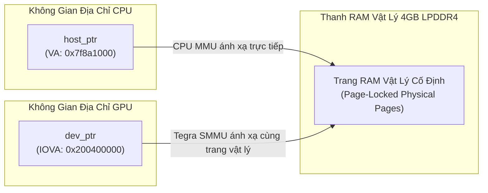

# 05. Tối Ưu Hóa End-to-End Camera Pipeline, DMA, Zero-Copy & Băng Thông Bộ Nhớ (Memory Bandwidth)

Một câu nói kinh điển của các chuyên gia Embedded AI: *"Mô hình AI của bạn có thể chạy mất 15 ms, nhưng tổng thời gian hệ thống vẫn là 60 ms chỉ vì CPU đang bận copy và chuyển đổi màu ảnh qua lại trong RAM."*
Tài liệu này giải phẫu toàn bộ đường đi dữ liệu hình ảnh trong dự án (`JetsonCameraHAL` $\to$ `Preprocessor` $\to$ `InferenceService`) và trình bày các kỹ thuật cốt lõi về **DMA**, **Zero-Copy**, **NVMM/DMA-BUF**, **Fused CUDA Kernel**, và **ARM NEON SIMD**.

> [!IMPORTANT]
> Toàn bộ mã nguồn C++/CUDA trong tài liệu tuân thủ quy tắc **không sử dụng `auto`**.

---

## 1. Begin From Scratch: Đường Đi Dữ Liệu Thực Tế Trong Chuỗi Camera $\to$ AI $\to$ App

Hãy nhìn thẳng vào pipeline GStreamer đang cấu hình trong dự án tại [`src/hal/jetson/jetson_camera_hal.cpp#L12-L23`](file:///media/tinhtran/01D85BC599D1D460/FreeLancer/Object-Detection-With-Yolov8-In-Jetson-Nano/src/hal/jetson/jetson_camera_hal.cpp#L12-L23):

```text
nvarguscamerasrc sensor-id=0 !
video/x-raw(memory:NVMM), width=1280, height=720, format=NV12, framerate=30/1 !
nvvidconv flip-method=0 !
video/x-raw, format=BGRx !
videoconvert !
video/x-raw, format=BGR !
appsink drop=true max-buffers=1
```

### Phân tích từng điểm hao phí (Data-Movement Overhead) trong đường ống trên:
1. **`nvarguscamerasrc` $\to$ `memory:NVMM` (NV12)**: Cảm biến IMX219 đẩy dữ liệu thô qua bus **MIPI CSI-2** vào bộ **ISP** phần cứng. ISP tạo ảnh `NV12` (1.5 bytes/pixel $\approx$ **1.38 MB**/frame) nằm trong bộ nhớ phần cứng **NVMM (NVIDIA Memory Management — dựa trên DMA-BUF)**. *Bước này 0% CPU!*
2. **`nvvidconv`**: Bộ tăng tốc phần cứng **VIC (Video Image Compositor)** đọc NV12 từ NVMM, chuyển sang `BGRx` (4 bytes/pixel $\approx$ **3.69 MB**/frame) và **copy từ vùng nhớ phần cứng NVMM ra bộ nhớ CPU thông thường (`video/x-raw`)**.
3. **`videoconvert` (Điểm nghẽn ẩn #1)**: GStreamer `videoconvert` chạy **bằng CPU** để bỏ byte `x` (4 bytes $\to$ 3 bytes `BGR` $\approx$ **2.76 MB**). Việc đọc 3.69 MB và ghi 2.76 MB ở 30 FPS tiêu tốn `~193 MB/s` băng thông LPDDR4 và ~5–8% CPU!
4. **`Preprocessor::process()` (Điểm nghẽn ẩn #2 — [`src/service/preprocessor.cpp#L11-L66`](file:///media/tinhtran/01D85BC599D1D460/FreeLancer/Object-Detection-With-Yolov8-In-Jetson-Nano/src/service/preprocessor.cpp#L11-L66))**:
   - `cv::resize`: Đọc 2.76 MB $\to$ ghi ảnh resize (`640x360x3 = 0.69 MB`).
   - `canvas.copyTo` + `cv::cvtColor(BGR->RGB)`: Đọc/ghi thêm ~3.6 MB.
   - Vòng lặp `for` 2 chiều (`640 x 640`) trên **1 nhân ARM**: Đọc 1.23 MB RGB, nhân `1.0f/255.0f`, ghi ra `4.91 MB` `host_input_chw_`!
   - **Tổng cộng cho 1 frame trước khi vào GPU**: Dữ liệu bị đọc/ghi qua lại trên thanh LPDDR4 tới **~15–20 MB**, ngốn **4–6 ms** CPU!
5. **`copyHostToDevice()` (`cudaMemcpyAsync`)**: Lại đọc `4.91 MB` từ vùng nhớ **Pageable Host (`std::vector<float>`)**, CUDA driver phải copy ngầm qua một Pinned Staging Buffer trung gian rồi mới DMA sang GPU Device Buffer!

> **Bài học Senior**: Tổng lượng dữ liệu di chuyển trên thanh RAM 25.6 GB/s cho 1 frame đã vượt xa kích thước một bức ảnh gốc 1.38 MB!

---

## 2. Giải Phẫu 4 Kiểu Bộ Nhớ Trên Embedded Linux & Jetson (DMA & Zero-Copy)

### 2.1. Pageable Memory vs Pinned Memory vs Zero-Copy Mapped Memory vs DMA-BUF

| Loại bộ nhớ | Cách cấp phát | Cách DMA / GPU truy cập | Số lần copy thừa | Khi nào dùng? |
|---|---|---|---|---|
| **1. Pageable Host Memory** | `malloc()`, `new`, `std::vector` | OS có thể swap trang nhớ ra đĩa hoặc di chuyển trang vật lý $\implies$ **DMA phần cứng KHÔNG thể trỏ thẳng tới**. CUDA driver buộc phải copy sang một vùng đệm Pinned ẩn rồi mới kích hoạt DMA! | **2 lần copy** (Pageable $\to$ Staging Pinned $\to$ Device) | Dữ liệu nhỏ hoặc ít truyền qua GPU (như `std::vector<Detection>`). **Tránh dùng cho Tensor ảnh!** |
| **2. Pinned (Page-Locked) Memory** | `cudaMallocHost()` hoặc `cudaHostAlloc(..., cudaHostAllocDefault)` | Nhân Linux khóa cố định trang RAM vật lý (`mlock`), cấm swap. Bộ điều khiển **DMA Engine** đọc thẳng từ RAM vào GPU mà không cần CPU can thiệp. | **1 lần DMA copy** (Pinned $\to$ Device) với tốc độ đỉnh | Nền tảng GPU rời (dGPU qua khe PCIe), hoặc khi muốn dùng `cudaMemcpyAsync` chạy song song trên CUDA Stream riêng. |
| **3. Zero-Copy (Mapped) Memory** *(Vũ khí bí mật trên Tegra UMA)* | `cudaHostAlloc(&host_ptr, bytes, cudaHostAllocMapped)` + `cudaHostGetDevicePointer(&dev_ptr, host_ptr, 0)` | Vì Jetson Nano có **Unified Memory** (CPU & GPU chung 1 thanh LPDDR4), `host_ptr` và `dev_ptr` ánh xạ vào **ĐÚNG MỘT ĐỊA CHỈ VẬT LÝ** trên thanh RAM! GPU đọc trực tiếp ngay trong lúc chạy Kernel mà **KHÔNG CẦN gọi `cudaMemcpy`**! | **0 lần copy** (`0 ms` H2D & D2H!) | Hệ thống SoC Unified Memory (Jetson Nano/Xavier/Orin) cho input/output tensor. *(Lưu ý: Trên Tegra, mapped memory tắt CPU cache để giữ nhất quán nên CPU không nên đọc đi đọc lại ngẫu nhiên nhiều lần).* |
| **4. NVMM / Linux DMA-BUF** | `NvBufferCreateEx` / `NvBufSurface` / GStreamer `memory:NVMM` | Bộ nhớ vật lý liên tục (hoặc Scatter-Gather qua SMMU) đại diện bởi **1 số nguyên File Descriptor (`dmabuf_fd`)**. ISP, VIC, Video Decoder và CUDA ánh xạ thẳng vào cùng vùng vật lý qua `EGLImage` (`cuGraphicsEGLRegisterImage`). | **0 lần copy & 0 byte qua CPU!** | Pipeline Production tốc độ cao: `CSI Camera (NVMM) -> VIC Resize -> CUDA Kernel -> TensorRT` đạt 30+ FPS với tải CPU < 15%! |

### 2.2. High-Level Design (HLD): So Sánh Pipeline Hiện Tại vs Pipeline Zero-Copy Tối Ưu

```mermaid
flowchart TB
    subgraph OLD["Pipeline Hiện Tại (~51.4 ms | Nhiều lần chạm DRAM & CPU)"]
        direction LR
        O1["CSI ISP\n(NVMM NV12)"] -->|"VIC Copy"| O2["CPU RAM\n(BGRx -> videoconvert BGR)"]
        O2 -->|"CPU Resize +\nCvtColor + /255"| O3["Pageable Vector\n(host_input_chw_)"]
        O3 -->|"Staging + DMA\ncudaMemcpyAsync"| O4["GPU Buffer"]
        O4 --> O5["TensorRT\nInference (42ms)"]
        O5 -->|"DMA D2H"| O6["Pageable Vector\n(host_output_)"]
        O6 -->|"CPU Decode/NMS"| O7["App"]
    end

    subgraph NEW["Pipeline Tối Ưu Zero-Copy (~38-40 ms | Giải phóng 90% CPU Preproc)"]
        direction LR
        N1["CSI ISP\n(NVMM NV12)"] -->|"Zero-Copy\nDMA-BUF fd"| N2["VIC Hardware\nScale + Crop\n(NVMM RGBA)"]
        N2 -->|"cuGraphicsEGLRegisterImage\n(0 copy!)"| N3["Fused CUDA Kernel\nLetterbox + RGBA->RGB\n+ /255 + HWC->CHW\n(< 0.4 ms!)"]
        N3 -->|"Device Ptr"| N4["TensorRT\nInference"]
        N4 -->|"Zero-Copy Mapped\nOutput Buffer"| N5["CPU PostProcessor\n(Không cần D2H copy!)"]
        N5 --> N6["App"]
    end
```



### 2.3. Low-Level Design (LLD): Ánh Xạ Địa Chỉ Vật Lý Trong Zero-Copy Mapped Memory (Tegra X1)



---

## 3. Tối Ưu Hóa Tiền Xử Lý (Preprocessing) & Hậu Xử Lý (Postprocessing)

Nếu giữ nguyên code `Preprocessor::process()` hiện tại trên CPU, thời gian chạy tốn `4–6 ms` trên 1 nhân ARM. Kỹ sư Embedded AI có 2 lựa chọn tối ưu triệt để:

### Lựa chọn A: Fused CUDA Preprocessor Kernel (Khi Camera/Input đã lên GPU hoặc dùng Zero-Copy)
Gộp toàn bộ **5 bước** (1. Tính tọa độ ngược Bilinear Resize, 2. Kiểm tra vùng viền Letterbox điền `114.0f/255.0f`, 3. Đổi thứ tự `BGR` $\to$ `RGB`, 4. Chia `255.0f`, 5. Tách 3 mặt phẳng `CHW`) vào **DUY NHẤT 1 CUDA Kernel**. Mỗi luồng CUDA chịu trách nhiệm tính đúng 1 pixel `(dx, dy)` trên lưới `640 x 640`. Tổng cộng $640 \times 640 = 409,600$ luồng chạy song song chỉ mất **`~0.35 ms`** trên Jetson Nano!

### Lựa chọn B: ARM NEON SIMD Intrinsics (Khi muốn giữ GPU 100% rảnh cho TensorRT hoặc chạy trên CPU-only DSP/SoC)
Kiến trúc ARM64 của Jetson Nano (Cortex-A57) có bộ thanh ghi vector **NEON 128-bit**.
- Lệnh thông thường xử lý từng pixel (`R, G, B`).
- Lệnh NEON **`vld3q_u8`** đọc một phát **16 pixels (`48 bytes` BGR)** từ RAM vào **3 thanh ghi 128-bit riêng biệt** (Thanh ghi 0 chứa toàn bộ 16 giá trị B, Thanh ghi 1 chứa 16 giá trị G, Thanh ghi 2 chứa 16 giá trị R) — **tự động giải quyết bài toán tách HWC $\to$ CHW trong phần cứng chỉ với 1 lệnh!**
- Sau đó mở rộng `uint8 -> uint16 -> uint32 -> float32x4_t` và nhân vector với `1.0f / 255.0f` (`vmulq_n_f32`) tính 4 pixel cùng lúc. Tốc độ chuẩn hóa CHW trên CPU tăng **~4x–6x**!

---

## 4. Code Examples Thực Chiến (C++17 / CUDA / ARM NEON — Chuẩn Không `auto`)

### 4.1. C++17: Cấp Phát & Sử Dụng Zero-Copy Mapped Memory Trên Jetson Nano

```cpp
#if defined(ENABLE_JETSON_CUDA)
#include <cuda_runtime_api.h>
#include <cstddef>
#include <iostream>

struct ZeroCopyBuffer {
    void* host_ptr;
    void* device_ptr;
    std::size_t bytes;

    ZeroCopyBuffer() : host_ptr(nullptr), device_ptr(nullptr), bytes(0) {}

    ~ZeroCopyBuffer() {
        release();
    }

    bool allocate(std::size_t size_bytes) {
        release();
        // Cờ cudaHostAllocMapped ánh xạ cùng địa chỉ RAM vật lý cho cả CPU & GPU
        cudaError_t err = cudaHostAlloc(&host_ptr, size_bytes, cudaHostAllocMapped);
        if (err != cudaSuccess) {
            std::cerr << "[CUDA] cudaHostAlloc failed: "
                      << cudaGetErrorString(err) << std::endl;
            host_ptr = nullptr;
            return false;
        }

        err = cudaHostGetDevicePointer(&device_ptr, host_ptr, 0);
        if (err != cudaSuccess) {
            std::cerr << "[CUDA] cudaHostGetDevicePointer failed: "
                      << cudaGetErrorString(err) << std::endl;
            release();
            return false;
        }

        bytes = size_bytes;
        return true;
    }

    void release() {
        if (host_ptr != nullptr) {
            cudaFreeHost(host_ptr);
            host_ptr = nullptr;
            device_ptr = nullptr;
            bytes = 0;
        }
    }
};

// Cách dùng trong InferenceService:
// 1. CPU ghi dữ liệu vào static_cast<float*>(in_buf.host_ptr)
// 2. KHÔNG CẦN gọi cudaMemcpyAsync(H2D)!
// 3. Truyền thẳng in_buf.device_ptr và out_buf.device_ptr vào TensorRT enqueueV2()
// 4. Gọi cudaStreamSynchronize(stream_) để đảm bảo GPU đã ghi xong vào DRAM
// 5. KHÔNG CẦN gọi cudaMemcpyAsync(D2H)! CPU đọc thẳng static_cast<float*>(out_buf.host_ptr)
#endif
```

### 4.2. CUDA Kernel: Fused Letterbox Resize + BGR-to-RGB + Normalize + HWC-to-CHW

```cpp
#if defined(ENABLE_JETSON_CUDA)
#include <cuda_runtime_api.h>
#include <cstdint>
#include <algorithm>

__global__ void fusedLetterboxPreprocessKernel(
    const uint8_t* __restrict__ src_bgr,
    int src_w,
    int src_h,
    int src_step_bytes,
    float* __restrict__ dst_chw,
    int dst_size,
    float scale,
    int pad_x,
    int pad_y,
    int resized_w,
    int resized_h) {
    int dx = blockIdx.x * blockDim.x + threadIdx.x;
    int dy = blockIdx.y * blockDim.y + threadIdx.y;

    if (dx >= dst_size || dy >= dst_size) {
        return;
    }

    const int channel_stride = dst_size * dst_size;
    const int dst_idx = dy * dst_size + dx;

    // Kiểm tra xem tọa độ đích có nằm trong phần viền Letterbox hay không
    int rx = dx - pad_x;
    int ry = dy - pad_y;

    if (rx < 0 || rx >= resized_w || ry < 0 || ry >= resized_h) {
        const float pad_val = 114.0f / 255.0f;
        dst_chw[0 * channel_stride + dst_idx] = pad_val; // R
        dst_chw[1 * channel_stride + dst_idx] = pad_val; // G
        dst_chw[2 * channel_stride + dst_idx] = pad_val; // B
        return;
    }

    // Ánh xạ ngược tọa độ về ảnh gốc (Bilinear Interpolation)
    float src_xf = (static_cast<float>(rx) + 0.5f) / scale - 0.5f;
    float src_yf = (static_cast<float>(ry) + 0.5f) / scale - 0.5f;

    int x0 = static_cast<int>(floorf(src_xf));
    int y0 = static_cast<int>(floorf(src_yf));
    int x1 = min(x0 + 1, src_w - 1);
    int y1 = min(y0 + 1, src_h - 1);
    x0 = max(0, min(x0, src_w - 1));
    y0 = max(0, min(y0, src_h - 1));

    float wx = src_xf - static_cast<float>(x0);
    float wy = src_yf - static_cast<float>(y0);
    wx = fmaxf(0.0f, fminf(1.0f, wx));
    wy = fmaxf(0.0f, fminf(1.0f, wy));

    const uint8_t* p00 = src_bgr + y0 * src_step_bytes + x0 * 3;
    const uint8_t* p10 = src_bgr + y0 * src_step_bytes + x1 * 3;
    const uint8_t* p01 = src_bgr + y1 * src_step_bytes + x0 * 3;
    const uint8_t* p11 = src_bgr + y1 * src_step_bytes + x1 * 3;

    float w00 = (1.0f - wx) * (1.0f - wy);
    float w10 = wx * (1.0f - wy);
    float w01 = (1.0f - wx) * wy;
    float w11 = wx * wy;

    const float inv_255 = 1.0f / 255.0f;

    // Nội suy và tách thẳng từ BGR (HWC) sang R, G, B (CHW) chuẩn hóa [0, 1]
    float b = (w00 * p00[0] + w10 * p10[0] + w01 * p01[0] + w11 * p11[0]) * inv_255;
    float g = (w00 * p00[1] + w10 * p10[1] + w01 * p01[1] + w11 * p11[1]) * inv_255;
    float r = (w00 * p00[2] + w10 * p10[2] + w01 * p01[2] + w11 * p11[2]) * inv_255;

    dst_chw[0 * channel_stride + dst_idx] = r;
    dst_chw[1 * channel_stride + dst_idx] = g;
    dst_chw[2 * channel_stride + dst_idx] = b;
}

void launchFusedPreprocess(const uint8_t* dev_src_bgr,
                           int src_w,
                           int src_h,
                           int src_step_bytes,
                           float* dev_dst_chw,
                           int dst_size,
                           cudaStream_t stream) {
    float scale = std::min(static_cast<float>(dst_size) / src_w,
                           static_cast<float>(dst_size) / src_h);
    int resized_w = static_cast<int>(roundf(src_w * scale));
    int resized_h = static_cast<int>(roundf(src_h * scale));
    int pad_x = (dst_size - resized_w) / 2;
    int pad_y = (dst_size - resized_h) / 2;

    dim3 block(16, 16);
    dim3 grid((dst_size + block.x - 1) / block.x, (dst_size + block.y - 1) / block.y);

    fusedLetterboxPreprocessKernel<<<grid, block, 0, stream>>>(
        dev_src_bgr, src_w, src_h, src_step_bytes,
        dev_dst_chw, dst_size, scale, pad_x, pad_y, resized_w, resized_h
    );
}
#endif
```

### 4.3. ARM64 NEON SIMD: Vector Hóa Tách Kênh HWC $\to$ CHW & Chuẩn Hóa Trên CPU ARM Cortex-A57

Đoạn code dưới đây tăng tốc trực tiếp vòng lặp `for` lồng nhau tại [`src/service/preprocessor.cpp#L54-L63`](file:///media/tinhtran/01D85BC599D1D460/FreeLancer/Object-Detection-With-Yolov8-In-Jetson-Nano/src/service/preprocessor.cpp#L54-L63) bằng tập lệnh **ARM NEON (`arm_neon.h`)**, xử lý **16 pixels mỗi vòng lặp**:

```cpp
#if defined(__aarch64__) || defined(__ARM_NEON)
#include <arm_neon.h>
#include <cstddef>
#include <cstdint>

// Chuyển đổi 1 ảnh uint8 BGR (HWC) -> float32 RGB (CHW) chuẩn hóa [0, 1] bằng ARM NEON
void neonBgrHwcToRgbChwNorm(const uint8_t* src_bgr,
                            float* dst_chw,
                            int width,
                            int height) {
    const int total_pixels = width * height;
    float* r_plane = dst_chw;
    float* g_plane = dst_chw + total_pixels;
    float* b_plane = dst_chw + 2 * total_pixels;

    const float32x4_t v_inv255 = vdupq_n_f32(1.0f / 255.0f);
    int i = 0;

    // Xử lý 16 pixels mỗi lần (48 bytes input -> 3 thanh ghi 16 bytes B, G, R)
    for (; i + 16 <= total_pixels; i += 16) {
        // vld3q_u8 tự động tách xen kẽ BGRBGR... thành:
        // bgr.val[0] = 16 giá trị B
        // bgr.val[1] = 16 giá trị G
        // bgr.val[2] = 16 giá trị R
        uint8x16x3_t bgr = vld3q_u8(src_bgr + i * 3);

        uint8x16_t channels[3] = { bgr.val[2], bgr.val[1], bgr.val[0] }; // Thứ tự R, G, B
        float* planes[3] = { r_plane + i, g_plane + i, b_plane + i };

        for (int c = 0; c < 3; ++c) {
            uint16x8_t lo_u16 = vmovl_u8(vget_low_u8(channels[c]));
            uint16x8_t hi_u16 = vmovl_u8(vget_high_u8(channels[c]));

            float32x4_t f0 = vcvtq_f32_u32(vmovl_u16(vget_low_u16(lo_u16)));
            float32x4_t f1 = vcvtq_f32_u32(vmovl_u16(vget_high_u16(lo_u16)));
            float32x4_t f2 = vcvtq_f32_u32(vmovl_u16(vget_low_u16(hi_u16)));
            float32x4_t f3 = vcvtq_f32_u32(vmovl_u16(vget_high_u16(hi_u16)));

            vst1q_f32(planes[c] + 0,  vmulq_f32(f0, v_inv255));
            vst1q_f32(planes[c] + 4,  vmulq_f32(f1, v_inv255));
            vst1q_f32(planes[c] + 8,  vmulq_f32(f2, v_inv255));
            vst1q_f32(planes[c] + 12, vmulq_f32(f3, v_inv255));
        }
    }

    // Xử lý phần dư (nếu total_pixels không chia hết cho 16)
    const float inv_255 = 1.0f / 255.0f;
    for (; i < total_pixels; ++i) {
        b_plane[i] = static_cast<float>(src_bgr[i * 3 + 0]) * inv_255;
        g_plane[i] = static_cast<float>(src_bgr[i * 3 + 1]) * inv_255;
        r_plane[i] = static_cast<float>(src_bgr[i * 3 + 2]) * inv_255;
    }
}
#endif
```
