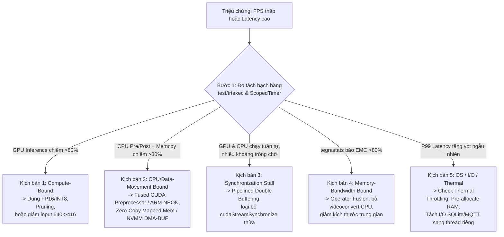

# 06. Profiling, Chẩn Đoán Điểm Nghẽn Hệ Thống & Ngân Hàng Câu Hỏi Phỏng Vấn Thực Chiến

Tài liệu này trang bị cho bạn bộ kỹ năng điều tra hiệu năng một cách có hệ thống (*"systematically determine why an AI workload is slow, where the bottleneck is, and how to optimize it"*), làm chủ các công cụ đo đạc (`trtexec`, `nsys`, `tegrastats`, `perf`), kỹ thuật **Double-Buffered Pipelining**, và **28 câu hỏi phỏng vấn thực chiến** kèm câu trả lời chuẩn Senior Embedded AI Engineer.

> [!IMPORTANT]
> Toàn bộ mã nguồn C++ trong tài liệu tuân thủ quy tắc **không sử dụng `auto`**.

---

## 1. Begin From Scratch: Các Chỉ Số Hiệu Năng & Phương Pháp Đo Lường

### 1.1. Định nghĩa chuẩn xác 6 chỉ số cốt lõi

| Chỉ số | Định nghĩa chính xác | Vì sao quan trọng trong Production? |
|---|---|---|
| **Latency (Độ trễ — ms)** | Thời gian từ lúc ánh sáng/pixel của Frame $N$ vào hệ thống đến khi xuất ra kết quả của chính Frame $N$. | Quyết định **thời gian phản ứng** (xe tự hành phanh kịp hay không, cánh tay robot gắp vật trượt hay trúng). |
| **Throughput (Thông lượng — FPS)** | Số khung hình hoàn thành xử lý được trong **1 giây** (Frames Per Second). | Cho biết năng lực chịu tải liên tục (ví dụ: có theo kịp camera 30 FPS hoặc chạy 4 luồng camera cùng lúc không). |
| **Tail Latency (P95 / P99)** | Độ trễ tại phân vị thứ 95 hoặc 99 (ví dụ: 99% frame xong dưới 52 ms, nhưng **1% frame tệ nhất nhảy vọt lên 140 ms**!). | Trong hệ thống Real-time, **Mean (trung bình)** che giấu lỗi! P99 tăng vọt báo hiệu có GC/Heap Allocation, SD card blocking, hoặc lock contention. |
| **Jitter (Độ rung trễ)** | Độ lệch chuẩn hoặc chênh lệch `Max - Min` của Latency giữa các frame liên tiếp. | Jitter cao làm bộ lọc Kalman (`TrackerService`) dự đoán sai vận tốc vì giả định $\Delta t$ cố định bị phá vỡ. |
| **Accelerator Utilization (%)** | Tỷ lệ thời gian GPU/NPU thực sự làm việc tính toán (trên `tegrastats` là `GR3D_FREQ`). | Nếu FPS thấp mà `GR3D` chỉ đạt 40%, chứng tỏ **GPU đang bị đói việc** do CPU tiền xử lý chậm hoặc chờ đồng bộ! |
| **Memory Bandwidth Usage (EMC %)** | Tỷ lệ băng thông bộ nhớ ngoài (External Memory Controller) đang bị tiêu thụ trên bus LPDDR4 (`25.6 GB/s`). | Nếu `EMC` bão hòa (~80–90%), hệ thống bị **Memory-Bandwidth Bound**: mọi nhân CPU lẫn GPU đều chậm lại vì xếp hàng chờ đọc RAM! |

### 1.2. Nghịch lý Latency vs Throughput (Batching vs Pipelining)
- Nếu chạy **Batch = 4**: GPU ghép 4 ảnh tính một lần $\implies$ **Throughput (FPS) tăng** (vì chỉ đọc weights 1 lần cho 4 ảnh), nhưng **Latency tăng gấp ~3x** (ảnh thứ 1 phải nằm chờ thu đủ 3 ảnh sau mới được chạy!). $\implies$ **Cấm dùng Batch lớn trong Camera thời gian thực ADAS/Robotics!**
- Muốn **giảm cả chu kỳ giữa các frame mà vẫn giữ Latency thấp**: Dùng **Pipelining (Double Buffering)** — CPU tiền xử lý Frame $N+1$ và hậu xử lý Frame $N-1$ **song song** với lúc GPU đang chạy suy luận Frame $N$.

---

## 2. Bộ Công Cụ Profiling Thực Chiến Trên Jetson Nano & Embedded Linux

### 2.1. `tegrastats` — Đồng hồ đo mạch máu thời gian thực của Jetson
Chạy lệnh `sudo tegrastats --interval 500` trong lúc `edge-ai-manager` đang hoạt động:

```text
RAM 1120/3964MB (lfb 420x4MB) CPU [32%@1428,28%@1428,15%@1428,12%@1428] EMC_FREQ 45%@1600 GR3D_FREQ 98%@921 PLL@52C CPU@54.5C GPU@53C POM_5V_IN 6850/6700
```

**Cách đọc như một Senior Engineer**:
- `RAM 1120/3964MB`: Tiến trình đang ổn định ở ~1.1 GB trên tổng 4 GB (còn nhiều block trống `lfb`).
- `CPU [32%@1428, ...]`: Tất cả 4 nhân ARM đang chạy max xung `1428 MHz`. Nếu 1 nhân lên `100%` trong khi 3 nhân kia `5%`, bạn đang có điểm nghẽn đơn luồng trên CPU (ví dụ `Preprocessor` hoặc `Postprocessor` chưa song song hóa!).
- `EMC_FREQ 45%@1600`: Bộ điều khiển LPDDR4 đang dùng 45% băng thông (`1600 MHz`). Nếu con số này nhảy lên `> 85%`, bạn phải lập tức tối ưu Zero-Copy / Fusion / giảm copy `cv::Mat`!
- `GR3D_FREQ 98%@921`: 128 nhân Maxwell GPU đang chạy tối đa công suất ở `921 MHz`. Nếu `GR3D_FREQ` nhảy lên xuống `0% - 99% - 0%`, chứng tỏ GPU liên tục phải dừng chờ CPU!
- `GPU@53C` / `CPU@54.5C`: An toàn (Jetson Nano bắt đầu giảm xung — **Thermal Throttling** — ở ngưỡng `80–85°C`).

> **Lệnh khóa xung tối đa để benchmark không bị sai số (Power Mode)**:
> ```bash
> sudo nvpmodel -m 0      # Bật chế độ công suất tối đa 10W (4 CPU cores + max GPU)
> sudo jetson_clocks      # Khóa cứng CPU/GPU/EMC ở xung nhịp tối đa, tắt DVFS dynamic scaling
> ```

### 2.2. `trtexec` — Đo riêng tầng Graph & Runtime TensorRT
Tách biệt hoàn toàn hiệu năng thuần của mạng YOLOv8 khỏi code Camera/OpenCV:
```bash
/usr/src/tensorrt/bin/trtexec \
    --onnx=/opt/jetson-ai-detect/models/yolov8n.onnx \
    --saveEngine=/opt/jetson-ai-detect/models/yolov8n_fp16.engine \
    --fp16 \
    --workspace=128 \
    --dumpProfile \
    --separateProfileRun
```
- `--dumpProfile`: In ra thời gian chạy (tính bằng ms và %) của **từng layer đã được fuse** trong đồ thị. Giúp bạn thấy ngay 3 layer Conv nào ăn nhiều thời gian nhất, hoặc phát hiện xem có lớp `Reformat` (chuyển đổi layout thừa NCHW $\leftrightarrow$ NC/4HW4) tốn thời gian hay không!

### 2.3. NVIDIA Nsight Systems (`nsys`) — Kính hiển vi Timeline CPU + CUDA
```bash
nsys profile -t cuda,nvtx,osrt -o yolov8_trace ./edge-ai-manager
```
Mở file `.qdrep` / `.nsys-rep` trên PC để soi Timeline:
- Nhìn thấy khoảng trống trắng (**Idle Bubble**) trên dòng GPU CUDA Stream trong lúc dòng CPU Thread 1 đang chạy hàm `Preprocessor::process()` (`5 ms`) và `PostProcessor::decode()` (`2.5 ms`)!
- Nhìn thấy các hàm `cudaMalloc` / `cudaMemcpy` bất thường nếu có.

### 2.4. Linux `perf` — Đo Cache Miss & CPU FlameGraph
Khi muốn biết hàm C++ nào trên ARM Cortex-A57 đang lãng phí chu kỳ CPU hoặc gây lỗi bộ nhớ đệm L1/L2:
```bash
perf stat -e cycles,instructions,cache-references,cache-misses,L1-dcache-load-misses ./edge-ai-manager -m
perf record -F 99 -g ./edge-ai-manager -m
```

---

## 3. Phương Pháp Hệ Thống Chẩn Đoán & Gỡ Bottleneck

Khi nhận bài toán *"Why is my AI pipeline slow?"*, hãy đi theo **Quy trình 5 bước (Top-Down Diagnostic Tree)**:



### 3.1. High-Level Design & Low-Level Design: Tuần Tự (Sequential) vs Pipelined Double Buffering

Trong [`src/app/pipeline.cpp`](file:///media/tinhtran/01D85BC599D1D460/FreeLancer/Object-Detection-With-Yolov8-In-Jetson-Nano/src/app/pipeline.cpp) hiện tại, 1 luồng Thread 1 chạy tuần tự hết bước này mới tới bước kia:

```text
[Tuần tự hiện tại - Chu kỳ ~51.4 ms -> 19.45 FPS]
CPU: |Pre F1(5ms)|---- Chờ GPU Idle (42ms) ----|Post+Trk F1(4.2ms)|Pre F2(5ms)|---- Chờ GPU Idle ----|
GPU:             |------ TensorRT F1 (42ms) ------|                            |--- TensorRT F2 (42ms) ---|
```

Khi áp dụng **Double-Buffered Pipelining** (dùng 2 bộ đệm ping-pong `Buffer[0]` và `Buffer[1]` cùng `cudaStream_t` bất đồng bộ):

```text
[Pipelined Double Buffering - Chu kỳ tối ưu ~42.0 ms -> 23.8 FPS | Và đạt ~30 FPS khi thu hẹp TensorRT hoặc Preproc GPU]
CPU (Pre):  |Pre F1|Pre F2 (chạy song song lúc GPU chạy F1!)|Pre F3|
GPU (TRT):         |-------- TensorRT F1 (42ms) --------|-------- TensorRT F2 (42ms) --------|
CPU (Post):                                             |Post+Trk F1 (song song với F2!)|Post+Trk F2|
```
- Ở đây, toàn bộ thời gian `Preprocess` (~5 ms) và `Postprocess + ByteTrack` (~4.2 ms) của các frame kế tiếp được **che khuất hoàn toàn (Latency Hiding)** dưới bóng thời gian chạy GPU `42 ms`!

---

## 4. Code Examples Thực Chiến (C++17 — Chuẩn Không `auto`)

### 4.1. C++17: Công Cụ Đo Hiệu Năng Độ Phân Giải Cao (`ScopedTimer` & `StageStats` P95/P99)

```cpp
#include <algorithm>
#include <chrono>
#include <iomanip>
#include <iostream>
#include <numeric>
#include <string>
#include <vector>

class StageProfiler {
public:
    explicit StageProfiler(const std::string& name, std::size_t reserve_samples = 1000)
        : name_(name) {
        samples_ms_.reserve(reserve_samples);
    }

    void addSample(double ms) {
        samples_ms_.push_back(ms);
    }

    void printSummary() const {
        if (samples_ms_.empty()) {
            return;
        }
        std::vector<double> sorted = samples_ms_;
        std::sort(sorted.begin(), sorted.end());

        double sum = std::accumulate(sorted.begin(), sorted.end(), 0.0);
        double mean = sum / static_cast<double>(sorted.size());
        double min_v = sorted.front();
        double max_v = sorted.back();
        double p95 = sorted[static_cast<std::size_t>(0.95 * (sorted.size() - 1))];
        double p99 = sorted[static_cast<std::size_t>(0.99 * (sorted.size() - 1))];

        std::cout << std::fixed << std::setprecision(2)
                  << "[Profiler] " << std::left << std::setw(18) << name_
                  << " | Mean: " << mean << " ms"
                  << " | Min: " << min_v << " ms"
                  << " | P95: " << p95 << " ms"
                  << " | P99: " << p99 << " ms"
                  << " | Max: " << max_v << " ms\n";
    }

private:
    std::string name_;
    std::vector<double> samples_ms_;
};

class ScopedStageTimer {
public:
    explicit ScopedStageTimer(StageProfiler& profiler)
        : profiler_(profiler),
          start_(std::chrono::steady_clock::now()) {}

    ~ScopedStageTimer() {
        std::chrono::steady_clock::time_point end = std::chrono::steady_clock::now();
        double elapsed_ms =
            std::chrono::duration<double, std::milli>(end - start_).count();
        profiler_.addSample(elapsed_ms);
    }

private:
    StageProfiler& profiler_;
    std::chrono::steady_clock::time_point start_;
};
```

### 4.2. C++17: Kiến Trúc `DoubleBufferedPipeline` (Ẩn Thời Gian Tiền Xử Lý & Hậu Xử Lý Song Song Với GPU)

```cpp
#if defined(ENABLE_JETSON_CUDA)
#include <NvInfer.h>
#include <cuda_runtime_api.h>
#include <vector>
#include "app/types.h"
#include "service/preprocessor.h"
#include "service/postprocessor.h"

namespace edge_ai {

struct InferenceSlot {
    void* dev_input{nullptr};
    void* dev_output{nullptr};
    void* host_input_pinned{nullptr};
    void* host_output_pinned{nullptr};
    cudaStream_t stream{nullptr};
    cudaEvent_t done_event{nullptr};
    PreprocessMeta meta;
    uint64_t frame_id{0};
    bool in_flight{false};
};

class DoubleBufferedTrtRunner {
public:
    bool initialize(nvinfer1::IExecutionContext* ctx,
                    std::size_t in_bytes,
                    std::size_t out_bytes,
                    int input_size,
                    float conf_thresh,
                    float nms_thresh,
                    const std::string& class_file) {
        context_ = ctx;
        in_bytes_ = in_bytes;
        out_bytes_ = out_bytes;
        preprocessor_ = Preprocessor(input_size);
        postprocessor_ = PostProcessor(conf_thresh, nms_thresh, class_file);

        for (int i = 0; i < 2; ++i) {
            cudaMalloc(&slots_[i].dev_input, in_bytes_);
            cudaMalloc(&slots_[i].dev_output, out_bytes_);
            cudaMallocHost(&slots_[i].host_input_pinned, in_bytes_);
            cudaMallocHost(&slots_[i].host_output_pinned, out_bytes_);
            cudaStreamCreate(&slots_[i].stream);
            cudaEventCreateWithFlags(&slots_[i].done_event, cudaEventDisableTiming);
            slots_[i].in_flight = false;
        }
        return true;
    }

    // Đẩy frame mới vào slot hiện tại và thu hoạch kết quả của slot kia (nếu đang bay)
    bool submitAndHarvest(const Frame& next_frame,
                          std::vector<Detection>& out_detections,
                          uint64_t& out_frame_id) {
        InferenceSlot& curr = slots_[write_idx_];
        InferenceSlot& prev = slots_[1 - write_idx_];

        // 1. Tiền xử lý Frame mới trên CPU trong lúc GPU có thể đang chạy slot `prev`!
        std::vector<float> tmp_chw;
        if (!preprocessor_.process(next_frame.image, tmp_chw, curr.meta)) {
            return false;
        }
        std::memcpy(curr.host_input_pinned, tmp_chw.data(), in_bytes_);
        curr.frame_id = next_frame.frame_id;

        // 2. Thu hoạch kết quả của Frame trước đó (đồng bộ đúng slot `prev`)
        bool has_result = false;
        if (prev.in_flight) {
            cudaEventSynchronize(prev.done_event);
            const float* raw_out = static_cast<const float*>(prev.host_output_pinned);
            out_detections = postprocessor_.decode(raw_out, prev.meta);
            out_frame_id = prev.frame_id;
            prev.in_flight = false;
            has_result = true;
        }

        // 3. Khởi chạy bất đồng bộ H2D -> TensorRT -> D2H cho slot `curr`
        cudaMemcpyAsync(curr.dev_input, curr.host_input_pinned, in_bytes_,
                        cudaMemcpyHostToDevice, curr.stream);

        void* bindings[2] = { curr.dev_input, curr.dev_output };
        context_->enqueueV2(bindings, curr.stream, nullptr);

        cudaMemcpyAsync(curr.host_output_pinned, curr.dev_output, out_bytes_,
                        cudaMemcpyDeviceToHost, curr.stream);
        cudaEventRecord(curr.done_event, curr.stream);
        curr.in_flight = true;

        write_idx_ = 1 - write_idx_;
        return has_result;
    }

    void destroy() {
        for (int i = 0; i < 2; ++i) {
            if (slots_[i].stream != nullptr) cudaStreamSynchronize(slots_[i].stream);
            if (slots_[i].done_event != nullptr) cudaEventDestroy(slots_[i].done_event);
            if (slots_[i].stream != nullptr) cudaStreamDestroy(slots_[i].stream);
            if (slots_[i].dev_input != nullptr) cudaFree(slots_[i].dev_input);
            if (slots_[i].dev_output != nullptr) cudaFree(slots_[i].dev_output);
            if (slots_[i].host_input_pinned != nullptr) cudaFreeHost(slots_[i].host_input_pinned);
            if (slots_[i].host_output_pinned != nullptr) cudaFreeHost(slots_[i].host_output_pinned);
        }
    }

private:
    nvinfer1::IExecutionContext* context_{nullptr};
    std::size_t in_bytes_{0};
    std::size_t out_bytes_{0};
    Preprocessor preprocessor_;
    PostProcessor postprocessor_;
    InferenceSlot slots_[2];
    int write_idx_{0};
};

} // namespace edge_ai
#endif
```

---

## 5. Ngân Hàng 28 Câu Hỏi Phỏng Vấn Embedded AI Engineer (Kèm Đáp Án Chuẩn Senior)

### Nhóm A: Model, CNN/DNN, ONNX & Quantization

**Câu 1: Sự khác biệt cốt lõi giữa `NCHW` và `NHWC` trong bộ nhớ là gì? Vì sao Jetson/CUDA thích `NCHW` còn NPU (QNN HTP / TI MMA) lại thích `NHWC`?**
> **Trả lời**: Cả hai đều trải phẳng vào mảng 1D trong RAM nhưng khác chiều liền kề. `NCHW` đặt các pixel liền nhau theo chiều không gian $W$, phù hợp cách CUDA warps đọc gộp bộ nhớ (coalesced memory access) khi tính Conv truyền thống. `NHWC` đặt tất cả $C$ kênh của cùng 1 pixel liền nhau, cho phép NPU/DSP đọc 1 vector rộng dọc theo chiều kênh $C$ để nạp thẳng vào bộ nhân ma trận (Systolic Array) trong 1 chu kỳ, tối ưu tuyệt đối cho phép `Conv 1x1` và `Depthwise Conv`.

**Câu 2: Arithmetic Intensity & Roofline Model giúp bạn quyết định tối ưu một lớp CNN như thế nào?**
> **Trả lời**: Arithmetic Intensity là tỷ lệ $\text{FLOPs} / \text{Bytes}$ đọc-ghi DRAM. Trên Jetson Nano (472 GFLOPs FP16 / 25.6 GB/s), điểm gãy Roofline là `~18.4 FLOPs/Byte`. Các lớp như `Conv 3x3` có intensity cao nằm ở vùng **Compute-bound** (tối ưu bằng FP16x2, Tensor Core, Winograd, INT8). Ngược lại, `SiLU`, `Concat`, `Split`, `Upsample` có intensity rất thấp (`< 2 FLOPs/Byte`), nằm ở vùng **Memory-bandwidth-bound** — tăng tốc nhân tính toán không có tác dụng, bắt buộc phải dùng **Operator Fusion** (giữ kết quả trên thanh ghi/SRAM) hoặc **giảm bitwidth** (FP32 $\to$ FP16/INT8).

**Câu 3: Giải thích quy trình Export PyTorch $\to$ ONNX và vai trò của `onnxsim`, `opset_version`, `do_constant_folding`.**
> **Trả lời**: `torch.onnx.export` theo dõi đồ thị thực thi để xuất sang chuẩn Protobuf `.onnx`. Ta khóa `opset_version` phù hợp với parser đích (như Opset 12 cho TensorRT 8 trên JetPack), bật `do_constant_folding=True` để tính sẵn các nhánh hằng số, ưu tiên Static Shape `[1, 3, 640, 640]` để trình biên dịch nhúng tối ưu cấp phát bộ nhớ tĩnh, và chạy `onnxsim` để dọn sạch chuỗi node thừa (`Shape -> Gather -> Reshape`) giúp TensorRT/QNN parse trơn tru và kích hoạt được Operator Fusion.

**Câu 4: Graph Partitioning & CPU Fallback là gì? Tại sao 1 toán tử fallback lại làm giảm FPS thê thảm?**
> **Trả lời**: Khi gặp một toán tử không được Accelerator hỗ trợ (hoặc tham số vượt giới hạn phần cứng), Runtime phải cắt đồ thị thành các subgraph: phần chạy NPU/GPU, phần rơi về CPU (**CPU Fallback**). Một op fallback nhỏ ở giữa mạng gây ping-pong bộ nhớ (Device-to-Host $\to$ CPU $\to$ Host-to-Device), ép dừng và đồng bộ hóa pipeline phần cứng, triệt tiêu khả năng Operator Fusion qua ranh giới cắt, và gây CPU/Cache thrashing. Cách giải quyết trong dự án là tách `Decode + NMS` ra khỏi đồ thị ONNX ở đầu ra `[1, 84, 8400]` và viết thuần C++/CUDA, hoặc viết Custom Plugin.

**Câu 5: Tại sao trong dự án Jetson Nano bạn chọn `FP16` thay vì `INT8`? Còn trên Jetson Orin hoặc Qualcomm HTP thì sao?**
> **Trả lời**: Vì GPU Maxwell (SM 5.3) trên Jetson Nano **không có Tensor Cores và không có lệnh phần cứng DP4A INT8**. Nó chỉ có ALU hỗ trợ **FP16x2** (nhân đôi thông lượng so với FP32) và giảm 50% băng thông DRAM, nên FP16 là điểm tối ưu hoàn hảo nhất cho Jetson Nano. Ngược lại, trên Jetson Orin (Ampere Tensor Cores), Qualcomm Hexagon HTP, hay TI C7x+MMA, phần cứng có hàng nghìn bộ nhân ma trận INT8 chuyên dụng nên INT8 nhanh hơn FP16 gấp 2–4x và tiết kiệm điện vượt trội.

**Câu 6: Giải thích toán học Symmetric vs Asymmetric Quantization và Per-Tensor vs Per-Channel.**
> **Trả lời**: Ánh xạ $r = S(q - Z)$. **Symmetric** ép $Z = 0$ với dải đối xứng $[-\alpha, \alpha]$, triệt tiêu số hạng chéo $Z_W \sum x$ trong phép nhân ma trận nên cực nhanh cho **Weights**. **Asymmetric** cho phép $Z \neq 0$, tận dụng hết 256 mức của dải lệch dương như ReLU/SiLU nên tối ưu cho **Activations**. **Per-Channel** gán một hệ số $S_c$ riêng cho từng bộ lọc đầu ra $C_{out}$ của Conv2D, giải quyết tình trạng biên độ giữa các filter chênh nhau hàng chục lần làm mất thông tin nếu dùng Per-Tensor.

**Câu 7: Cách `IInt8EntropyCalibrator2` (KL-Divergence) của TensorRT tìm ngưỡng cắt tốt hơn MinMax ở chỗ nào?**
> **Trả lời**: `MinMax` lấy đúng cực trị $\max(|x|)$, nên chỉ 1 outlier nhiễu là làm giãn scale, phá nát độ mịn của 99.9% giá trị bình thường. `KL-Divergence` xây dựng histogram phân phối FP32 (2048 bins) từ tập ảnh Calibration, sau đó tìm ngưỡng cắt $T^*$ sao cho độ lệch thông tin tương đối $D_{KL}(P_{\text{FP32}} \| Q_{\text{INT8}})$ nhỏ nhất — chấp nhận kẹp vài outlier để giữ độ phân giải tốt nhất cho vùng giá trị trung tâm.

**Câu 8: Khi nào PTQ không đủ và phải dùng QAT? Giải thích vai trò của Fake-Quantize và STE.**
> **Trả lời**: Trên các mô hình nhỏ ít dư thừa kênh như YOLOv8n (đặc biệt ở nhánh DFL hồi quy Box và hàm SiLU), PTQ đôi khi làm tụt >2% mAP. Khi đó phải dùng **QAT**: chèn node **Fake-Quantize** ($Q \to DQ$) vào đồ thị PyTorch để mô phỏng nhiễu làm tròn ngay trong lúc fine-tune. Vì đạo hàm của `round()` bằng `0` hầu như mọi nơi, ta dùng **Straight-Through Estimator (STE)** ở pha backward để truyền thẳng gradient (`1` trong khoảng cắt, `0` ngoài khoảng cắt), giúp trọng số tự học cách thích nghi với sai số lượng tử.

**Câu 9: Giải thích Conv+BN Folding và Vertical Fusion (`Conv + Bias + SiLU`).**
> **Trả lời**: Ở pha inference, tham số $\mu, \sigma^2, \gamma, \beta$ của BatchNorm là hằng số nên ta nhân gộp đại số thẳng vào ma trận $W$ và vector $b$ của lớp Conv trước đó — triệt tiêu 100% lớp BN với sai số `0`. Vertical Fusion giữ kết quả tích chập trong **thanh ghi (Registers/SRAM)** để cộng bias và tính luôn `SiLU` trước khi ghi xuống LPDDR4 RAM 1 lần duy nhất, giảm 2–3x áp lực băng thông bộ nhớ.

---

### Nhóm B: TensorRT, QNN, TIDL, ONNX Runtime & Kiến Trúc Phần Cứng

**Câu 10: Phân biệt `ICudaEngine` và `IExecutionContext` trong TensorRT. Tại sao cần tách riêng 2 lớp này?**
> **Trả lời**: `ICudaEngine` là đối tượng nặng chứa trọng số mạng và kế hoạch kernel đã giải tuần tự hóa (chỉ đọc — Read-only). `IExecutionContext` là trạng thái nhẹ lưu bộ nhớ kích hoạt trung gian và stream thực thi cho một luồng chạy cụ thể. Nhờ tách rời, nếu ứng dụng cần chạy đa luồng (ví dụ 2 camera chạy trên 2 CUDA streams), ta chỉ tốn RAM nạp **1 `ICudaEngine` duy nhất** và tạo **2 `IExecutionContext`** dùng chung bộ trọng số đó!

**Câu 11: Tại sao file `.engine` của TensorRT không chạy được trên máy tính khác dù cùng phiên bản TensorRT?**
> **Trả lời**: Vì trong pha Build, TensorRT chạy **Kernel Auto-Tuning** trực tiếp trên GPU mục tiêu để đo tốc độ và biên dịch mã máy SASS/PTX tối ưu riêng cho số SM, dung lượng Shared Memory và Cache của đúng GPU đó (ví dụ Maxwell SM 5.3 trên Nano khác hoàn toàn Ampere SM 8.6 hay Orin SM 8.7). Vì vậy trong `JetsonGpuHAL::loadEngine()`, dự án ưu tiên load cache `.engine`, nếu không có sẽ tự parse `.onnx` và build lại ngay trên thiết bị đích.

**Câu 12: So sánh kiến trúc lập trình bộ nhớ của GPU (CUDA) với DSP/NPU (Qualcomm HTP / TI C7x+MMA).**
> **Trả lời**: GPU quản lý Cache L1/L2 phần cứng tự động và ẩn độ trễ RAM bằng cách đảo hàng nghìn luồng nhẹ (warp switching). Ngược lại, DSP (VLIW+SIMD) và NPU (Systolic Array) có ít luồng phần cứng hơn, phụ thuộc vào **On-chip Scratchpad SRAM (VTCM trên Qualcomm, L2/MSMC SRAM trên TI)** cực nhỏ nhưng cực nhanh; trình biên dịch phải tự chia nhỏ Tensor (**Tiling**) và điều khiển **DMA Engine** kéo trước mảnh dữ liệu tiếp theo từ DDR vào SRAM song song với lúc lõi MAC đang tính mảnh hiện tại (**Double-Buffered DMA Tiling**).

**Câu 13: Bạn hiểu thế nào về Execution Providers (EPs) trong ONNX Runtime?**
> **Trả lời**: ORT đóng vai trò bộ điều phối thống nhất: nó đọc file `.onnx`, hỏi các Execution Provider (như `TensorrtExecutionProvider`, `QNNExecutionProvider`, `TIDLExecutionProvider`) xem mỗi EP hỗ trợ được những cụm node nào (`GetCapability`). Các cụm được hỗ trợ sẽ gán cho EP tăng tốc phần cứng biên dịch thành subgraph; các node còn lại rơi về `CPUExecutionProvider`.

**Câu 14: Tại sao dự án dùng lớp trừu tượng `IGpuHAL` (`JetsonGpuHAL` / `MockGpuHAL`) thay vì gọi thẳng TensorRT trong `InferenceService`?**
> **Trả lời**: Đây là nguyên lý **Dependency Inversion (HAL Pattern)**. Nhờ tách biệt: (1) Ta chạy toàn bộ test tích hợp (`test_pipeline`, `test_tracker`, `test_rule_engine`) trên Host PC x86 hoặc CI/CD không cần GPU thật thông qua `MockGpuHAL`; (2) Có thể hoán đổi sang `QnnAcceleratorHAL`, `TidlAcceleratorHAL` hoặc `OrtAcceleratorHAL` mà không phải sửa bất kỳ dòng code nào ở tầng `InferenceService`, `Pipeline` hay `RuleEngine`.

---

### Nhóm C: Memory, DMA, Zero-Copy, OS, Threads & IPC

**Câu 15: Giải thích kiến trúc Unified Memory trên Jetson Nano. Sự khác nhau giữa Pageable, Pinned, Zero-Copy Mapped Memory và NVMM/DMA-BUF?**
> **Trả lời**: Trên Tegra X1, CPU và GPU dùng chung 1 thanh 4GB LPDDR4.
> - *Pageable (`std::vector`)*: OS có thể di chuyển trang nhớ nên CUDA phải copy qua staging buffer trước khi DMA.
> - *Pinned (`cudaMallocHost`)*: Khóa trang vật lý, DMA Engine đọc thẳng tốc độ cao.
> - *Zero-Copy Mapped (`cudaHostAllocMapped`)*: CPU và GPU ánh xạ cùng một trang RAM vật lý (chỉ khác địa chỉ ảo VA vs IOVA qua SMMU), xóa bỏ hoàn toàn lệnh `cudaMemcpy`.
> - *NVMM / DMA-BUF*: Chia sẻ buffer phần cứng bằng `dmabuf_fd` xuyên suốt từ Camera ISP $\to$ VIC $\to$ CUDA (`EGLImage`) mà không copy một byte ảnh nào vào không gian người dùng CPU!

**Câu 16: Vấn đề Cache Coherency xảy ra thế nào khi dùng DMA hoặc Zero-Copy?**
> **Trả lời**: CPU thường ghi qua L1/L2 Write-back Cache; nếu GPU/DMA đọc thẳng DRAM trước khi CPU flush cache xuống RAM, GPU sẽ đọc dữ liệu cũ (stale data). Ngược lại, khi DMA vừa ghi ảnh mới vào DRAM, CPU phải invalidate cache của mình trước khi đọc. Khi dùng `cudaMemcpyAsync`, CUDA driver lo phần đồng bộ này; còn khi dùng Zero-Copy Mapped Memory trên Tegra, trang nhớ được cấu hình chế độ uncached/write-combined cho CPU (hoặc tự quản lý qua `cudaStreamSynchronize` + `DMA_BUF_IOCTL_SYNC`).

**Câu 17: Vì sao `InferenceService` cấp phát toàn bộ `input_buffer_`, `output_buffer_`, `host_input_chw_` một lần lúc `loadModel()` thay vì trong `detect()`?**
> **Trả lời**: Để đảm bảo **Zero-Allocation trong Hot Loop** 30 FPS. Cấp phát bộ nhớ động (`malloc`, `cudaMalloc`) bên trong vòng lặp xử lý frame gây phân mảnh Heap, kích hoạt mutex nội bộ của allocator/CUDA driver (vốn thực hiện đồng bộ ngầm toàn GPU!), tạo ra độ trễ giật cục (**Tail Latency / Jitter**) rất nguy hiểm cho hệ thống real-time.

**Câu 18: Trong dự án có 6 luồng chạy song song; làm thế nào tránh Deadlock, Race Condition và Drop Frame trễ?**
> **Trả lời**:
> - *Chống trễ tích lũy*: Camera chạy 30 FPS (33.3 ms), AI chạy ~19.5 FPS (51.4 ms). `CameraService` dùng **Ring Buffer kích thước 2** với chính sách **Drop Oldest** và truyền `cv::Mat` theo cơ chế đếm tham chiếu (Zero-copy con trỏ), đảm bảo AI luôn nhận frame mới nhất.
> - *Tách I/O chậm*: `Pipeline` không tự gửi MQTT hay ghi SQLite mà đẩy vào hàng đợi không chặn của `EventBus` (`< 0.05 ms`).
> - *Chống Deadlock trong `EventBus`*: `dispatchLoop()` chỉ khóa `subs_mutex_` để copy nhanh danh sách callback ra vector cục bộ, **mở khóa trước khi gọi callback**, nên dù callback có gọi lại `subscribe/unsubscribe/publish` cũng không bao giờ bị Deadlock.

**Câu 19: Khi nào bạn giữ 1 Process nhiều Threads (như dự án) và khi nào phải tách thành nhiều Processes dùng IPC? Cơ chế IPC nào nhanh nhất để truyền ảnh Camera?**
> **Trả lời**: 1 Process nhiều Threads cho phép chia sẻ ảnh `cv::Mat` tức thì trong cùng Heap/Address Space, tối ưu cho thiết bị tài nguyên hạn chế như Jetson Nano. Ta tách thành nhiều Processes khi cần **Fault Isolation** (cô lập lỗi: tiến trình Cloud/UI sập không kéo theo tiến trình AI an toàn) hoặc **Privilege Separation** (phân quyền bảo mật Linux). Để truyền frame ảnh giữa 2 Process, nhanh nhất là **DMA-BUF FD Passing (`SCM_RIGHTS` qua Unix Domain Socket)** hoặc **POSIX Shared Memory (`shm_open` + `mmap` + `sem_t`/atomic)** để đạt Zero-Copy hoàn toàn.

**Câu 20: Giải thích Priority Inversion và cách xử lý trên Embedded Linux.**
> **Trả lời**: Xảy ra khi Thread ưu tiên thấp giữ Mutex, Thread ưu tiên cao chờ Mutex đó, nhưng Thread ưu tiên trung bình lại chen ngang chiếm CPU khiến Thread ưu tiên thấp không chạy tiếp được để nhả khóa. Khắc phục bằng: (1) Thu hẹp tối đa thời gian giữ khóa (chỉ `std::move` con trỏ/lưu biến nhỏ, không làm I/O trong mutex); (2) Bật giao thức **Priority Inheritance (`PTHREAD_PRIO_INHERIT`)** để nhân Linux tạm nâng mức ưu tiên của Thread đang giữ khóa lên bằng Thread đang chờ.

**Câu 21: Tại sao `StorageService` phải gom mẻ (Batch Insert trong 1 Transaction) và có Ring-Buffer Auto-Purge?**
> **Trả lời**: Thẻ nhớ MicroSD/eMMC có tốc độ ghi ngẫu nhiên rất chậm và giới hạn số lần ghi/xóa (flash wear). Mỗi câu lệnh `INSERT` đơn lẻ mặc định tạo 1 transaction `fsync()` xuống đĩa, gây nghẽn I/O wait toàn hệ thống. Gom 50 bản ghi hoặc mỗi 5 giây ghi 1 lần trong `BEGIN TRANSACTION ... COMMIT` giúp tăng tốc gấp hàng chục lần. Đồng thời giới hạn `100,000` dòng (xóa 10,000 dòng cũ nhất) đảm bảo thiết bị chạy 24/7 nhiều tháng không bao giờ hết dung lượng lưu trữ.

**Câu 22: Vai trò của ký tự `'V'` khi đóng `/dev/watchdog` trong `JetsonWatchdogHAL::close()`?**
> **Trả lời**: Trong chuẩn Linux Watchdog Driver (`magic close`), nếu tiến trình đóng file descriptor `/dev/watchdog` bình thường (hoặc bị crash sập), bộ đếm phần cứng vẫn tiếp tục đếm ngược và **tự động reset cứng toàn bộ bo mạch** khi hết timeout (60s). Chỉ khi ta chủ động ghi ký tự magic `'V'` trước khi `close()` trong lúc tắt hệ thống có chủ đích (`EdgeAIManager::shutdown()`), driver mới hiểu là tắt an toàn và ngừng bộ đếm watchdog.

---

### Nhóm D: End-to-End Pipeline, Profiling & Tối Ưu Hóa Hệ Thống

**Câu 23: Nếu bạn kiểm tra `Preprocessor::process()` hiện tại trong dự án, bạn thấy những điểm nghẽn nào và sẽ tối ưu ra sao?**
> **Trả lời**: Hiện tại `JetsonCameraHAL` dùng `videoconvert` trên CPU chuyển `BGRx -> BGR`, sau đó `Preprocessor` chạy `cv::resize`, `copyTo`, `cvtColor` và vòng lặp `for` lồng nhau chia `255.0f` chuyển `HWC -> CHW` trên **1 nhân CPU ARM** (tốn ~5 ms và copy nhiều lần trên DRAM). Tối ưu theo 3 tầng: (1) Bỏ `videoconvert`, nhận thẳng `RGBA/BGRx` từ `nvvidconv` hoặc `NVMM DMA-BUF`; (2) Viết **Fused CUDA Kernel** (gộp Resize + Letterbox + BGRx->RGB + `/255` + CHW xuống còn `< 0.4 ms`), hoặc dùng **ARM NEON (`vld3q_u8`)** trên CPU; (3) Thay `host_input_chw_` thành **Zero-Copy Mapped Memory (`cudaHostAllocMapped`)** để bỏ luôn `cudaMemcpyAsync`.

**Câu 24: Tại sao lại chọn thuật toán ByteTrack kết hợp Kalman Filter + Hungarian thay vì DeepSORT trên Jetson Nano?**
> **Trả lời**: DeepSORT đòi hỏi chạy thêm một mạng CNN trích xuất đặc trưng ngoại hình (Re-ID model) cho **từng bounding box** được phát hiện — nếu có 10 người trong khung hình thì mỗi frame phải chạy thêm 10 lần inference CNN, làm sập FPS trên Jetson Nano! ByteTrack + Kalman Filter + Hungarian trong dự án hoàn toàn là toán học tuyến tính gọn nhẹ trên CPU (`~1.5 ms`), không tốn thêm tài nguyên GPU.

**Câu 25: Bạn đang có pipeline chạy 15 FPS trên thiết bị nhúng trong khi yêu cầu là 30 FPS. Hãy trình bày từng bước bạn điều tra và tối ưu.**
> **Trả lời**:
> 1. **Đo đạc phân tách (Isolate)**: Dùng `ScopedStageTimer` đo từng đoạn (Capture, Pre, H2D, TensorRT, D2H, Post, Track) và chạy `trtexec` + `tegrastats` + `nsys`.
> 2. **Xác nhận nguồn điện & nhiệt**: Bật `nvpmodel -m 0`, `jetson_clocks`, kiểm tra xem có bị Thermal Throttling không.
> 3. **Nếu nghẽn ở CPU / Copy (`EMC` cao, `GR3D` bị ngắt quãng)**: Loại bỏ `videoconvert`, đưa Preprocessor lên **Fused CUDA Kernel**, dùng **Zero-Copy / DMA-BUF**, và bật **Double Buffering** để ẩn hoàn toàn thời gian Pre/Post của CPU dưới thời gian chạy GPU.
> 4. **Nếu nghẽn thuần ở GPU (`GR3D` = 99%, TensorRT mất > 40 ms)**: Kiểm tra `trtexec --dumpProfile` xem có layer nào rơi về FP32 hoặc `Reformat` không; chuyển sang FP16/INT8 (hoặc QAT trên chip có NPU), thử giảm độ phân giải đầu vào từ `640x640` xuống `480x480` hoặc `416x416` (giảm FLOPs theo bình phương diện tích!), hoặc cân nhắc tỉa kênh (Pruning) / chưng cất (Distillation).

**Câu 26: Nếu `tegrastats` báo `GR3D_FREQ` dao động mạnh (lúc 0%, lúc 99%) và tổng FPS rất thấp dù từng lần gọi TensorRT rất nhanh, chuyện gì đang xảy ra?**
> **Trả lời**: Đó là dấu hiệu điển hình của **GPU Starvation & Synchronization Stall**. GPU phải ngồi chờ CPU chuẩn bị dữ liệu quá lâu (ví dụ CPU bị nghẽn bởi `cv::resize`, giải mã RTSP bằng CPU, hoặc `cudaStreamSynchronize` chặn tuần tự không pipelining), hoặc đồ thị bị **CPU Fallback** ở giữa mạng khiến GPU phải dừng liên tục. Giải pháp là xem timeline trên **Nsight Systems (`nsys`)** để tìm khoảng trống trắng trên dòng CUDA Stream và xử lý phần CPU đang chạy trước khoảng trống đó.

**Câu 27: Làm sao đảm bảo hệ thống chạy 24/7 trong thực tế sản xuất (Production Edge AI) mà không bị treo hoặc rò rỉ bộ nhớ?**
> **Trả lời**: 5 lớp bảo vệ đã tích hợp trong dự án: (1) Pre-allocated buffers + RAII `std::unique_ptr` (không leak RAM/VRAM); (2) Bounded Ring Buffers ở mọi ranh giới bất đồng bộ (`CameraService`, `EventBus`, `MqttService`, `StorageService` auto-purge); (3) Auto-reconnect cho Camera CSI/USB và MQTT Broker kèm Offline Queue; (4) `HealthService` giám sát nhiệt độ CPU/GPU và tải hệ thống; (5) **Hardware Watchdog (`/dev/watchdog`)** + `systemd` `Restart=on-failure` để tự phục hồi ngay cả khi gặp lỗi phần cứng hoặc treo deadlock cực đoan.

**Câu 28: Nếu công ty chuyển sản phẩm hiện tại từ Jetson Nano sang chip Qualcomm Snapdragon (QNN HTP) hoặc TI TDA4VM (TIDL), kế hoạch chuyển đổi của bạn là gì?**
> **Trả lời**:
> 1. **Giữ nguyên 100% App & Service Layer** (`Pipeline`, `TrackerService`, `RuleEngine`, `EventBus`, `MqttService`, `StorageService`) vì đã cô lập sau giao diện HAL.
> 2. **Chuẩn hóa mô hình**: Giữ đồ thị ONNX sạch đầu ra `[1, 84, 8400]` (đã tách NMS); chuẩn bị bộ 200–500 ảnh thực tế để chạy **INT8 Calibration / QAT** (bắt buộc vì HTP và MMA tối ưu cho INT8, khác với FP16 trên Maxwell Nano).
> 3. **Kiểm tra tương thích Op & Graph Partitioning**: Chạy công cụ chuyển đổi (`qnn-onnx-converter` / `tidl_model_import.out`), kiểm tra xem các lớp `SiLU`, `Upsample`, `Split`, `Concat` có chạy trọn vẹn trên HTP/MMA hay bị CPU Fallback về ARM; điều chỉnh nếu cần.
> 4. **Viết mới HAL Adapter**: Hiện thực `QnnAcceleratorHAL` / `TidlAcceleratorHAL` kế thừa `IGpuHAL` và `CameraHAL` kết nối với DMA-BUF/Ion/V4L2 trên nền tảng mới, rồi profile End-to-End bằng công cụ hãng (Qualcomm Profiler / TI Edge AI Benchmark).
