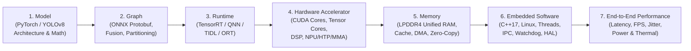

# Cẩm Nang Toàn Diện Embedded AI Engineer (Focus: YOLOv8 & NVIDIA Jetson Nano)

Thư mục này tổng hợp toàn bộ kiến thức cốt lõi và thực chiến cho vị trí **Embedded AI Engineer**, được xây dựng trực tiếp từ việc giải phẫu dự án **Object Detection with YOLOv8 on Jetson Nano (`edge-ai-manager`)** kết hợp đầy đủ các yêu cầu trong JD (từ Qualcomm QNN, NVIDIA TensorRT, TI TIDL, ONNX Runtime cho tới kiến trúc bộ nhớ, DMA/Zero-Copy, đa luồng, IPC và tối ưu hóa End-to-End).

> [!IMPORTANT]
> **Quy tắc mã nguồn (Coding Standard)**: Toàn bộ các ví dụ code C++17/CUDA trong bộ tài liệu này đều tuân thủ tuyệt đối quy tắc **tường minh kiểu dữ liệu (Explicit Types — KHÔNG sử dụng từ khóa `auto`)**, đồng nhất 100% với toàn bộ source code trong dự án.

---

## 1. Tư Duy Cốt Lõi Của Một Senior Embedded AI Engineer

Một kỹ sư AI thông thường chỉ dừng ở bước *"chạy được mô hình trên PyTorch/Python"*. Một **Embedded AI Engineer** đẳng cấp Production phải làm chủ toàn bộ chuỗi giá trị xuyên suốt 7 tầng từ mô hình toán học cho tới từng chu kỳ xung nhịp phần cứng và băng thông RAM:

Khi hệ thống chạy chậm, câu hỏi không phải là *"Đoán xem hàm nào chậm?"*, mà là **xác định có hệ thống điểm nghẽn đang nằm ở tầng nào** trong 7 tầng trên:
- Nghẽn tính toán trên Accelerator (**Compute-bound**)?
- Nghẽn băng thông đọc/ghi DRAM (**Memory-bandwidth-bound**)?
- Nghẽn chuyển đổi định dạng dữ liệu & copy CPU $\leftrightarrow$ GPU (**Data-movement overhead**)?
- Nghẽn đồ thị bị rớt toán tử về CPU (**CPU Fallback / Graph Partitioning**)?
- Nghẽn đồng bộ hóa luồng, khóa mutex, cấp phát động heap hoặc ghi I/O (**Synchronization / Embedded Software bottleneck**)?

---

## 2. Cấu Trúc Bộ Tài Liệu (`interview/`)

| Tệp tài liệu | Chủ đề trọng tâm | Kiến thức nền tảng (From Scratch) & Thiết kế (HLD/LLD) |
|---|---|---|
| [`01_end_to_end_execution_flow.md`](file:///media/tinhtran/01D85BC599D1D460/FreeLancer/Object-Detection-With-Yolov8-In-Jetson-Nano/interview/01_end_to_end_execution_flow.md) | **Luồng chạy toàn trình & Hệ điều hành Nhúng** | Giải phẫu từ lúc `systemd` chạy `main()` đến kết quả MQTT/SQLite qua chuỗi 7 tầng; vai trò của **RAM**, **Quản lý bộ nhớ**, **CPU**, **Process vs Thread**, **Synchronization**, **IPC** (`shm_open`, `mmap`, DMA-BUF, POSIX MQ, Socket). Kèm HLD/LLD & Code C++. |
| [`02_cnn_dnn_yolov8_and_onnx.md`](file:///media/tinhtran/01D85BC599D1D460/FreeLancer/Object-Detection-With-Yolov8-In-Jetson-Nano/interview/02_cnn_dnn_yolov8_and_onnx.md) | **CNN/DNN, YOLOv8 & ONNX chuyên sâu** | Bản chất Tensor (`NCHW` vs `NHWC`), `Conv2D` (im2col+GEMM, Winograd), FLOPs/Arithmetic Intensity/Roofline Model; kiến trúc YOLOv8n (`C2f`, `SPPF`, Decoupled Head); giải phẫu **ONNX Protobuf**, `opset`, `onnxsim`; **Operator Compatibility, Graph Partitioning & CPU Fallback**. Kèm HLD/LLD & Code Python/C++. |
| [`03_model_optimization_and_quantization.md`](file:///media/tinhtran/01D85BC599D1D460/FreeLancer/Object-Detection-With-Yolov8-In-Jetson-Nano/interview/03_model_optimization_and_quantization.md) | **Tối ưu Mô hình, Quantization, PTQ/QAT & Fusion** | Biểu diễn bit **FP32/FP16/BF16/INT8**; toán học **Quantization** (Scale/Zero-point, Symmetric vs Asymmetric, Per-Tensor vs Per-Channel, INT32 Accumulator); **PTQ** (MinMax, Percentile, KL-Divergence Entropy) vs **QAT** (Fake-Quant, STE); Mixed-Precision; **Operator Fusion** (Conv+BN Folding, Vertical/Horizontal Fusion, Concat Elision). Kèm HLD/LLD & Code C++ `IInt8EntropyCalibrator2`. |
| [`04_tensorrt_and_heterogeneous_runtimes.md`](file:///media/tinhtran/01D85BC599D1D460/FreeLancer/Object-Detection-With-Yolov8-In-Jetson-Nano/interview/04_tensorrt_and_heterogeneous_runtimes.md) | **TensorRT C++ & Heterogeneous Runtimes (QNN, TIDL, ORT)** | Chu trình Build vs Runtime; toàn bộ API **TensorRT C++** (`IBuilder`, `IRuntime`, `ICudaEngine`, `IExecutionContext`, `IPluginV2DynamicExt`); kiến trúc phần cứng **CPU vs GPU (SIMT) vs DSP (VLIW/SIMD) vs NPU (Systolic Array)**; so sánh sâu **TensorRT vs Qualcomm QNN/HTP vs TI TIDL/C7x+MMA vs ONNX Runtime (EP)**. Kèm HLD/LLD & Code C++. |
| [`05_camera_pipeline_dma_zerocopy.md`](file:///media/tinhtran/01D85BC599D1D460/FreeLancer/Object-Detection-With-Yolov8-In-Jetson-Nano/interview/05_camera_pipeline_dma_zerocopy.md) | **Camera Pipeline, DMA, Zero-Copy & Memory Bandwidth** | Chuỗi `MIPI CSI-2 → ISP → VIC → Pre-process → Inference → Post-process → Tracker`; giải phẫu Pageable vs Pinned (`cudaHostAlloc`) vs **Zero-Copy Mapped Memory** vs **NVMM/DMA-BUF**; tối ưu điểm nghẽn `Preprocessor` bằng **Fused CUDA Kernel** và **ARM NEON Intrinsics**. Kèm HLD/LLD & Code C++/CUDA/NEON. |
| [`06_profiling_bottlenecks_and_interview_qa.md`](file:///media/tinhtran/01D85BC599D1D460/FreeLancer/Object-Detection-With-Yolov8-In-Jetson-Nano/interview/06_profiling_bottlenecks_and_interview_qa.md) | **Profiling, Gỡ Bottleneck & Ngân hàng Phỏng vấn** | Latency vs Throughput/FPS vs Tail Latency (P95/P99); sử dụng thực chiến `trtexec`, `nsys`, `tegrastats`, `perf`; quy trình chẩn đoán 5 loại nghẽn; **Double-Buffered Pipelining**; bộ **25+ câu hỏi phỏng vấn thực chiến** có đáp án mẫu gắn với dự án. |

---

## 3. Bảng Ánh Xạ JD $\leftrightarrow$ Tài Liệu $\leftrightarrow$ Source Code Dự Án

Bảng dưới đây giúp bạn chứng minh với nhà tuyển dụng rằng mọi gạch đầu dòng trong JD đều có kiến thức nền tảng vững chắc và bằng chứng triển khai thực tế trong dự án:

| Yêu Cầu Trong JD (Responsibilities & Qualifications) | Tài Liệu Ôn Luyện (`interview/`) | Bằng Chứng Thực Tế Trong Dự Án (`src/`, `include/`, `docs/`) |
|---|---|---|
| Deploy CNN/DNN onto embedded runtimes (TensorRT, QNN, TIDL, ORT) | [04_tensorrt_and_heterogeneous_runtimes.md](file:///media/tinhtran/01D85BC599D1D460/FreeLancer/Object-Detection-With-Yolov8-In-Jetson-Nano/interview/04_tensorrt_and_heterogeneous_runtimes.md) | [`include/hal/i_gpu_hal.h`](file:///media/tinhtran/01D85BC599D1D460/FreeLancer/Object-Detection-With-Yolov8-In-Jetson-Nano/include/hal/i_gpu_hal.h), [`src/hal/jetson/jetson_gpu_hal.cpp`](file:///media/tinhtran/01D85BC599D1D460/FreeLancer/Object-Detection-With-Yolov8-In-Jetson-Nano/src/hal/jetson/jetson_gpu_hal.cpp) |
| Convert & optimize PyTorch $\to$ ONNX $\to$ target runtime | [02_cnn_dnn_yolov8_and_onnx.md](file:///media/tinhtran/01D85BC599D1D460/FreeLancer/Object-Detection-With-Yolov8-In-Jetson-Nano/interview/02_cnn_dnn_yolov8_and_onnx.md) | [`src/hal/jetson/jetson_gpu_hal.cpp#L90-L161`](file:///media/tinhtran/01D85BC599D1D460/FreeLancer/Object-Detection-With-Yolov8-In-Jetson-Nano/src/hal/jetson/jetson_gpu_hal.cpp#L90-L161) (`nvonnxparser` $\to$ serialized `.engine`) |
| FP16, INT8, PTQ/QAT, quantization, operator fusion, graph opt | [03_model_optimization_and_quantization.md](file:///media/tinhtran/01D85BC599D1D460/FreeLancer/Object-Detection-With-Yolov8-In-Jetson-Nano/interview/03_model_optimization_and_quantization.md) | [`src/hal/jetson/jetson_gpu_hal.cpp#L134-L136`](file:///media/tinhtran/01D85BC599D1D460/FreeLancer/Object-Detection-With-Yolov8-In-Jetson-Nano/src/hal/jetson/jetson_gpu_hal.cpp#L134-L136), [`src/service/preprocessor.cpp#L69-L95`](file:///media/tinhtran/01D85BC599D1D460/FreeLancer/Object-Detection-With-Yolov8-In-Jetson-Nano/src/service/preprocessor.cpp#L69-L95) (`processFP16`) |
| Operator compatibility, graph partitioning, CPU fallback | [02_cnn_dnn_yolov8_and_onnx.md](file:///media/tinhtran/01D85BC599D1D460/FreeLancer/Object-Detection-With-Yolov8-In-Jetson-Nano/interview/02_cnn_dnn_yolov8_and_onnx.md) | Kiến trúc tách Post-processing (Decode + NMS) ra CPU khỏi đồ thị ONNX tại [`src/service/postprocessor.cpp`](file:///media/tinhtran/01D85BC599D1D460/FreeLancer/Object-Detection-With-Yolov8-In-Jetson-Nano/src/service/postprocessor.cpp) |
| Heterogeneous computing (CPU/GPU/DSP/NPU) | [04_tensorrt_and_heterogeneous_runtimes.md](file:///media/tinhtran/01D85BC599D1D460/FreeLancer/Object-Detection-With-Yolov8-In-Jetson-Nano/interview/04_tensorrt_and_heterogeneous_runtimes.md) | ISP/VIC (Camera HW) + Maxwell GPU (TensorRT) + ARM Cortex-A57 (Pre/Post/ByteTrack/Rules) trong [`docs/design/system_workflow.md`](file:///media/tinhtran/01D85BC599D1D460/FreeLancer/Object-Detection-With-Yolov8-In-Jetson-Nano/docs/design/system_workflow.md) |
| Data movement, DMA, shared memory, zero-copy, buffer mgmt | [05_camera_pipeline_dma_zerocopy.md](file:///media/tinhtran/01D85BC599D1D460/FreeLancer/Object-Detection-With-Yolov8-In-Jetson-Nano/interview/05_camera_pipeline_dma_zerocopy.md) | GStreamer `memory:NVMM` tại [`src/hal/jetson/jetson_camera_hal.cpp`](file:///media/tinhtran/01D85BC599D1D460/FreeLancer/Object-Detection-With-Yolov8-In-Jetson-Nano/src/hal/jetson/jetson_camera_hal.cpp), `cv::Mat` shallow copy + `std::move` tại [`src/service/camera_service.cpp`](file:///media/tinhtran/01D85BC599D1D460/FreeLancer/Object-Detection-With-Yolov8-In-Jetson-Nano/src/service/camera_service.cpp), Pre-allocated CUDA buffers tại [`src/service/inference_service.cpp`](file:///media/tinhtran/01D85BC599D1D460/FreeLancer/Object-Detection-With-Yolov8-In-Jetson-Nano/src/service/inference_service.cpp) |
| End-to-End Pipeline: Camera $\to$ Pre $\to$ Infer $\to$ Post $\to$ App | [01_end_to_end_execution_flow.md](file:///media/tinhtran/01D85BC599D1D460/FreeLancer/Object-Detection-With-Yolov8-In-Jetson-Nano/interview/01_end_to_end_execution_flow.md) & [05_camera_pipeline_dma_zerocopy.md](file:///media/tinhtran/01D85BC599D1D460/FreeLancer/Object-Detection-With-Yolov8-In-Jetson-Nano/interview/05_camera_pipeline_dma_zerocopy.md) | [`src/app/pipeline.cpp`](file:///media/tinhtran/01D85BC599D1D460/FreeLancer/Object-Detection-With-Yolov8-In-Jetson-Nano/src/app/pipeline.cpp), [`src/app/edge_ai_manager.cpp`](file:///media/tinhtran/01D85BC599D1D460/FreeLancer/Object-Detection-With-Yolov8-In-Jetson-Nano/src/app/edge_ai_manager.cpp), [`src/app/rule_engine.cpp`](file:///media/tinhtran/01D85BC599D1D460/FreeLancer/Object-Detection-With-Yolov8-In-Jetson-Nano/src/app/rule_engine.cpp) |
| Multithreading, synchronization, memory, shared memory, IPC | [01_end_to_end_execution_flow.md](file:///media/tinhtran/01D85BC599D1D460/FreeLancer/Object-Detection-With-Yolov8-In-Jetson-Nano/interview/01_end_to_end_execution_flow.md) | [`src/service/event_bus.cpp`](file:///media/tinhtran/01D85BC599D1D460/FreeLancer/Object-Detection-With-Yolov8-In-Jetson-Nano/src/service/event_bus.cpp), [`src/service/camera_service.cpp`](file:///media/tinhtran/01D85BC599D1D460/FreeLancer/Object-Detection-With-Yolov8-In-Jetson-Nano/src/service/camera_service.cpp), [`src/service/storage_service.cpp`](file:///media/tinhtran/01D85BC599D1D460/FreeLancer/Object-Detection-With-Yolov8-In-Jetson-Nano/src/service/storage_service.cpp), [`docs/design/threading_model.md`](file:///media/tinhtran/01D85BC599D1D460/FreeLancer/Object-Detection-With-Yolov8-In-Jetson-Nano/docs/design/threading_model.md) |
| Profiling, FPS/latency/bandwidth optimization & bottlenecks | [06_profiling_bottlenecks_and_interview_qa.md](file:///media/tinhtran/01D85BC599D1D460/FreeLancer/Object-Detection-With-Yolov8-In-Jetson-Nano/interview/06_profiling_bottlenecks_and_interview_qa.md) | [`src/service/health_service.cpp`](file:///media/tinhtran/01D85BC599D1D460/FreeLancer/Object-Detection-With-Yolov8-In-Jetson-Nano/src/service/health_service.cpp), [`src/hal/jetson/jetson_sensor_hal.cpp`](file:///media/tinhtran/01D85BC599D1D460/FreeLancer/Object-Detection-With-Yolov8-In-Jetson-Nano/src/hal/jetson/jetson_sensor_hal.cpp), [`src/hal/jetson/jetson_watchdog_hal.cpp`](file:///media/tinhtran/01D85BC599D1D460/FreeLancer/Object-Detection-With-Yolov8-In-Jetson-Nano/src/hal/jetson/jetson_watchdog_hal.cpp) |

---

## 4. Thông Số Tham Chiếu Phần Cứng & Mô Hình Trong Dự Án

Để trả lời phỏng vấn có chiều sâu, bạn luôn cần **con số cụ thể (quantitative numbers)** thay vì nói chung chung:

| Thành phần | Thông số kỹ thuật thực tế | Ý nghĩa tối ưu hóa |
|---|---|---|
| **SoC** | NVIDIA Tegra X1 (Jetson Nano 4GB) | Kiến trúc ARM64 + Maxwell GPU chia sẻ chung RAM vật lý (**Unified Memory Architecture**). |
| **CPU** | Quad-core ARM Cortex-A57 @ 1.43 GHz | Hỗ trợ tập lệnh vector **ARM NEON** 128-bit; L1 cache 48KB I / 32KB D per core; L2 cache 2MB shared. |
| **GPU** | 128-core NVIDIA Maxwell @ 921 MHz | **Lưu ý phỏng vấn cực quan trọng**: Maxwell trên Jetson Nano (Compute Capability 5.3) **KHÔNG có Tensor Cores** và **KHÔNG có phần cứng chuyên dụng DP4A INT8** (DP4A chỉ có từ Pascal SM 6.1+ / Xavier / Orin). Maxwell dùng CUDA cores chạy **FP16x2 (2 phép tính FP16 trong 1 chu kỳ ALU)** cho tốc độ gần gấp đôi FP32! |
| **RAM & Băng thông** | 4 GB 64-bit LPDDR4 @ 1600 MHz | Băng thông lý thuyết tối đa **25.6 GB/s** dùng chung cho CPU, GPU, ISP, VIC, Display. Băng thông là nút thắt lớn! |
| **Camera HW** | MIPI CSI-2 + Tegra ISP + VIC | ISP xử lý thô (Bayer $\to$ NV12), VIC xử lý scale/chuyển màu phần cứng hoàn toàn ngoài CPU. |
| **Model** | YOLOv8n (`3.2M` params, `8.7 GFLOPs` @ 640x640) | Input tensor: `[1, 3, 640, 640]` (`4.91 MB` FP32 / `2.46 MB` FP16). Output tensor: `[1, 84, 8400]` (`2.82 MB` FP32). |
| **Hiệu năng mục tiêu** | Latency ~51.4 ms/frame (~19.5 FPS) ở cấu hình cơ bản; >28–30 FPS khi tối ưu Fused CUDA Preprocess + Zero-Copy + Double Buffering | Chứng minh hiểu rõ giới hạn phần cứng và con đường tối ưu từng bước. |

---

## 5. Lộ Trình Học Hiệu Quả Nhất

1. Đọc **[Tệp 01](file:///media/tinhtran/01D85BC599D1D460/FreeLancer/Object-Detection-With-Yolov8-In-Jetson-Nano/interview/01_end_to_end_execution_flow.md)** trước để nắm bức tranh toàn cảnh cách chương trình `edge-ai-manager` chạy từ lúc khởi động đến lúc ra kết quả, hiểu sâu RAM, CPU, Thread, Process và IPC.
2. Học sâu về mô hình và đồ thị tại **[Tệp 02](file:///media/tinhtran/01D85BC599D1D460/FreeLancer/Object-Detection-With-Yolov8-In-Jetson-Nano/interview/02_cnn_dnn_yolov8_and_onnx.md)** và cách nén/tăng tốc mô hình tại **[Tệp 03](file:///media/tinhtran/01D85BC599D1D460/FreeLancer/Object-Detection-With-Yolov8-In-Jetson-Nano/interview/03_model_optimization_and_quantization.md)**.
3. Nắm cách viết C++ cho TensorRT và hiểu các nền tảng đối thủ (QNN, TIDL, ONNX Runtime) tại **[Tệp 04](file:///media/tinhtran/01D85BC599D1D460/FreeLancer/Object-Detection-With-Yolov8-In-Jetson-Nano/interview/04_tensorrt_and_heterogeneous_runtimes.md)**.
4. Làm chủ nghệ thuật loại bỏ copy bộ nhớ, DMA, Zero-Copy và tăng tốc Pre/Post-processing tại **[Tệp 05](file:///media/tinhtran/01D85BC599D1D460/FreeLancer/Object-Detection-With-Yolov8-In-Jetson-Nano/interview/05_camera_pipeline_dma_zerocopy.md)**.
5. Kết thúc bằng công cụ Profiling và luyện trả lời 25+ câu hỏi hóc búa tại **[Tệp 06](file:///media/tinhtran/01D85BC599D1D460/FreeLancer/Object-Detection-With-Yolov8-In-Jetson-Nano/interview/06_profiling_bottlenecks_and_interview_qa.md)**.
