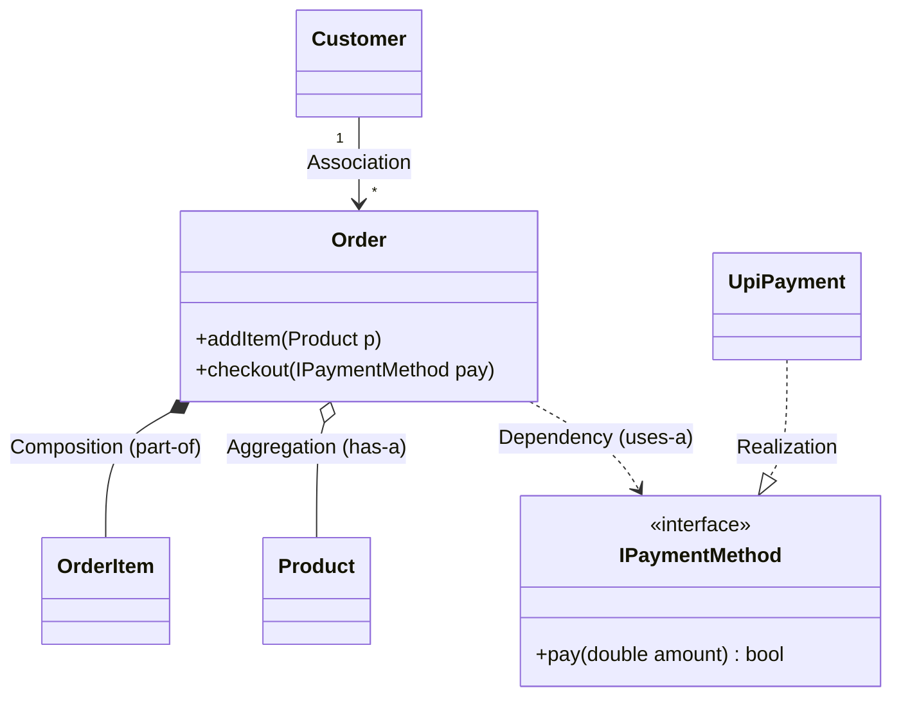

# 01. OOP Fundamentals, Class Relationships & UML

---

## 1. Classes, Objects & Core OOP Pillars

- **Class**: Blueprint defining state (fields/attributes) and behavior (methods).
- **Object**: Concrete runtime instance of a class occupying memory.

| Pillar | Core Idea | Key Mechanism | Why It Matters in LLD |
|---|---|---|---|
| **Encapsulation** | Bundle state + behavior and hide internal invariants | `private` fields + controlled `public` methods | Prevents callers from corrupting object state directly. |
| **Abstraction** | Expose *what* an object does, hide *how* it does it | Pure virtual interfaces / abstract base classes | Decouples high-level business logic from implementation details. |
| **Inheritance** | Derive a specialized class from a base class (*is-a*) | `class Dog : public Animal` | Shares common contracts; **avoid deep inheritance trees** (prefer composition). |
| **Polymorphism** | Same interface, different behavior depending on context | **Compile-time**: overloading, templates<br>**Runtime**: `virtual` dispatch (vtable) | Enables plugging in new behaviors without changing calling code (OCP). |

### Abstract Class vs. Interface (in C++ / OOP)

| Aspect | Interface (Pure Abstract Class in C++) | Abstract Class |
|---|---|---|
| **Methods** | Pure virtual methods only (`= 0`) + virtual destructor | Mix of concrete methods and pure virtual methods |
| **State (Fields)** | No mutable instance state (constants only) | Can hold shared member variables & protected helpers |
| **Multiple Inheritance** | A class can implement many interfaces safely | Best limited to single inheritance (`is-a`) |
| **Use When** | Defining a capability/contract (`IPaymentProcessor`, `IRule`) | Sharing partial implementation among tightly related classes |

```cpp
#include <iostream>
#include <memory>
#include <string>

// Interface (Contract)
class IPaymentMethod {
public:
    virtual ~IPaymentMethod() = default;
    virtual bool pay(double amount) = 0;
};

// Abstract Base Class (Shared State + Partial Behavior)
class BasePayment : public IPaymentMethod {
public:
    explicit BasePayment(const std::string& currency) : currency_(currency) {}
protected:
    std::string currency_;
};

// Concrete Implementation (Runtime Polymorphism)
class CreditCardPayment : public BasePayment {
public:
    explicit CreditCardPayment(const std::string& currency) : BasePayment(currency) {}
    bool pay(double amount) override {
        std::cout << "Paid " << amount << " " << currency_ << " via Credit Card.\n";
        return true;
    }
};
```

---

## 2. Class Relationships

Understanding ownership and coupling strength is critical for clean class diagrams and memory management:

| Relationship | Meaning | Ownership & Lifetime | UML Arrow | C++ Representation |
|---|---|---|---|---|
| **Association** | Peers know and interact with each other (*knows-a*) | Independent lifetimes | `A --> B` | Pointer or reference (`B*` or `B&`) |
| **Aggregation** | Container holds references to parts (*has-a*, weak) | Child **survives** if parent is destroyed | `Parent o-- Child` | Non-owning pointer/ref or `std::shared_ptr` shared externally |
| **Composition** | Whole strictly owns its parts (*part-of*, strong) | Child **dies** when parent is destroyed | `Whole *-- Part` | Value member (`Part part_;`) or `std::unique_ptr<Part>` |
| **Dependency** | Temporary usage inside a method (*uses-a*) | No stored reference | `Client ..> Service` | Method parameter or local variable |
| **Generalization** | Class inherits from base class (*is-a*) | Subclass extends superclass | `Sub --|> Base` | `class Sub : public Base` |
| **Realization** | Class implements an interface (*implements*) | Concrete class fulfills contract | `Impl ..|> Interface` | `class Impl : public IContract` |



---

## 3. UML Diagrams Cheat Sheet

AlgoMaster emphasizes choosing the right UML diagram during design discussions before writing code:

1. **Class Diagram (Static Structure)**:
   - Shows classes, attributes (`-` private, `#` protected, `+` public), methods, and relationships.
   - *Use in LLD*: Always draw this first after identifying core entities.
2. **Sequence Diagram (Dynamic Interaction Over Time)**:
   - Shows lifelines and chronological synchronous/asynchronous method calls between objects.
   - *Use in LLD*: Clarify tricky workflows (e.g., payment processing, seat locking, concurrency races).
3. **State Diagram (Lifecycle Transitions)**:
   - Shows states, transition events, and guard conditions (e.g., `Order`: `Created -> Paid -> Shipped -> Delivered` or `Cancelled`).
   - *Use in LLD*: Directly maps to the **State Pattern**.
4. **Activity Diagram (Workflow / Control Flow)**:
   - Flowchart showing branching (`if/else`), loops, and parallel forks/joins.
   - *Use in LLD*: Visualize multi-step business logic or pipeline execution.
