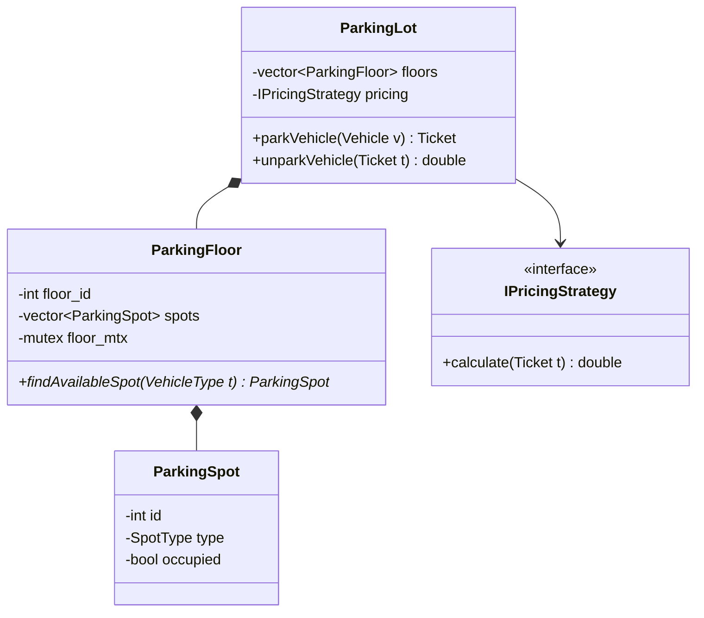
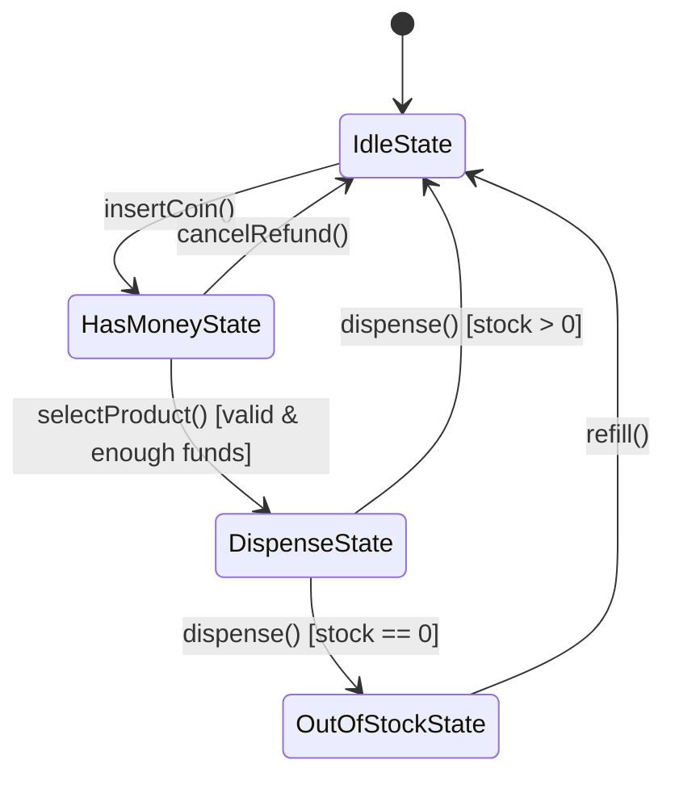

# 05. Concurrency in LLD & Classic Interview Case Studies

> All C++17 examples strictly use explicit types (no `auto` keyword).

---

## 1. Concurrency Essentials for LLD Interviews

Real-world LLD systems fail if two threads concurrently book the same seat, dispense the last item, or assign the same parking spot.

### Core Synchronization Primitives
- **Mutex (`std::mutex` + `std::lock_guard` / `std::unique_lock`)**: Ensures mutual exclusion; always use RAII wrappers so exceptions never leave a mutex locked.
- **Read-Write Lock (`std::shared_mutex`)**: Allows **multiple concurrent readers** (`std::shared_lock`) OR **one exclusive writer** (`std::unique_lock`) — ideal for read-heavy catalogs or availability checks.
- **Condition Variable (`std::condition_variable`)**: Lets threads sleep with zero CPU spin until a predicate becomes true (`cv.wait(lock, predicate)` handles spurious wakeups).
- **Atomic (`std::atomic<T>`)**: Lock-free hardware operations for counters, flags, and sequence IDs.

### Deadlock: 4 Necessary Conditions (Coffman) & How to Break Them
Deadlock occurs only when **all 4** hold simultaneously:
1. Mutual Exclusion
2. Hold and Wait
3. No Preemption
4. Circular Wait

**Practical Prevention in LLD**:
- **Lock Ordering**: Always acquire multiple locks in a fixed canonical order (e.g., `std::scoped_lock(m1, m2)` in C++17, or sort lock IDs `min(id1, id2)` first in bank transfers).
- **Keep Critical Sections Tiny**: Never perform network I/O, disk I/O, or user callbacks while holding a mutex.

### Thread-Safe Bounded Blocking Queue (Producer-Consumer)
```cpp
#include <condition_variable>
#include <cstddef>
#include <mutex>
#include <queue>

template <typename T>
class BlockingQueue {
public:
    explicit BlockingQueue(std::size_t capacity) : capacity_(capacity) {}

    void push(const T& item) {
        std::unique_lock<std::mutex> lock(mtx_);
        not_full_.wait(lock, [this]() { return queue_.size() < capacity_; });
        queue_.push(item);
        not_empty_.notify_one();
    }

    T pop() {
        std::unique_lock<std::mutex> lock(mtx_);
        not_empty_.wait(lock, [this]() { return !queue_.empty(); });
        T val = queue_.front();
        queue_.pop();
        not_full_.notify_one();
        return val;
    }

private:
    std::size_t capacity_;
    std::queue<T> queue_;
    std::mutex mtx_;
    std::condition_variable not_full_;
    std::condition_variable not_empty_;
};
```

---

## 2. Classic AlgoMaster LLD Case Studies (Condensed Blueprints)

### Case Study 1: Parking Lot System
- **Requirements**: Multi-floor lot; spot types (`Compact`, `Large`, `Bike`); multiple entry/exit gates; pluggable pricing (`Hourly`, `Flat`).
- **Key Entities**: `ParkingLot` (Singleton), `ParkingFloor`, `ParkingSpot`, `Vehicle` (`Car`, `Truck`, `Motorcycle`), `Ticket`, `IPricingStrategy`.
- **Patterns Used**: **Singleton** (`ParkingLot`), **Strategy** (`IPricingStrategy` / `ISpotAllocationStrategy`), **Factory** (`VehicleFactory`).
- **Concurrency**: Lock per `ParkingFloor` (or fine-grained spot lock) when assigning a spot so two entry gates never assign the same spot simultaneously.



---

### Case Study 2: Vending Machine
- **Requirements**: Select product, insert coins/cash, dispense item + return change, handle out-of-stock / insufficient funds, refill inventory.
- **Key Entities**: `VendingMachine`, `Inventory`, `ItemShelf`, `IVendingState`, `Coin`.
- **Patterns Used**: **State Pattern** (`IdleState`, `HasMoneyState`, `DispensingState`, `OutOfStockState`) to eliminate messy `if/else` state checks.



---

### Case Study 3: Elevator System
- **Requirements**: $N$ elevators serving $M$ floors; external up/down hall buttons + internal floor buttons; efficient dispatch.
- **Key Entities**: `ElevatorController`, `ElevatorCar`, `Display`, `Button`, `IElevatorSelectionStrategy` (LOOK / SCAN algorithm).
- **Patterns Used**: **State** (`MovingUp`, `MovingDown`, `Idle`), **Strategy** (Dispatch scheduling: NearestCar, SCAN/LOOK), **Observer** (Display updates on floor change).

---

### Case Study 4: Movie Ticket Booking System (BookMyShow)
- **Requirements**: Search movies by city/cinema, view seat map for a show, **prevent double-booking** under high concurrency, handle payment timeout.
- **Key Entities**: `BookingService`, `Theater`, `Screen`, `Show`, `ShowSeat` (`Available`, `Locked`, `Booked`), `Booking`, `SeatLockProvider`.
- **Patterns Used**: **Singleton** (`BookingService`), **Strategy** (`IPaymentStrategy`), **Observer** (booking confirmation notifications).
- **Concurrency Deep-Dive**:
  - Use **Seat Locking with TTL** (e.g., lock seats atomically under a per-`Show` mutex or `std::map` lock for 10 minutes while user pays).
  - If payment succeeds $\to$ mark `ShowSeat = Booked`; if TTL expires $\to$ background sweeper releases lock back to `Available`.

---

### Case Study 5: Splitwise (Expense Sharing App)
- **Requirements**: Create users & groups, add expenses with `EQUAL`, `EXACT`, or `PERCENT` splits, compute net balances, optionally simplify debts (min-cash-flow).
- **Key Entities**: `ExpenseManager`, `User`, `Group`, `Expense`, `Split` (`EqualSplit`, `ExactSplit`, `PercentSplit`), `ISplitStrategy`.
- **Patterns Used**: **Strategy** (`ISplitStrategy` validating and computing split amounts), **Factory** (creating split objects), **Observer** (notifying group members of new expenses).
- **Data Structure**: Maintain an adjacency balance map `balances[userA][userB] = net_owed` updated atomically per expense; simplify group debts using a greedy min-heap / max-heap net balance algorithm.
