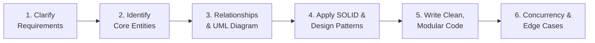

# Low-Level Design (LLD) — Condensed Study Guide

> Condensed summary of the [AlgoMaster Low-Level Design Course](https://algomaster.io/learn/lld/course-introduction). Written as a concise, high-signal reference for software engineering fundamentals and machine-coding interviews.

---

## 1. What is Low-Level Design (LLD)?

- **HLD (High-Level Design)** focuses on system-wide architecture: services, databases, load balancers, caches, and network boundaries.
- **LLD (Low-Level Design)** zooms into **a single component or service**: classes, interfaces, data structures, design patterns, SOLID principles, concurrency handling, and clean, extensible code.

---

## 2. Curriculum Roadmap

| File | Topics Covered |
|---|---|
| [`01_oop_and_class_relationships.md`](file:///media/tinhtran/01D85BC599D1D460/FreeLancer/Object-Detection-With-Yolov8-In-Jetson-Nano/learn_software_from_scratch/low_level_design/01_oop_and_class_relationships.md) | 4 OOP Pillars, Abstract Class vs. Interface, Class Relationships (Association, Aggregation, Composition, Dependency), UML Diagrams cheat sheet. |
| [`02_design_principles.md`](file:///media/tinhtran/01D85BC599D1D460/FreeLancer/Object-Detection-With-Yolov8-In-Jetson-Nano/learn_software_from_scratch/low_level_design/02_design_principles.md) | SOLID Principles (SRP, OCP, LSP, ISP, DIP) with C++ fixes, DRY, KISS, YAGNI, Law of Demeter, Composition over Inheritance. |
| [`03_creational_and_structural_patterns.md`](file:///media/tinhtran/01D85BC599D1D460/FreeLancer/Object-Detection-With-Yolov8-In-Jetson-Nano/learn_software_from_scratch/low_level_design/03_creational_and_structural_patterns.md) | Creational (Singleton, Factory Method, Abstract Factory, Builder, Prototype) & Structural (Adapter, Decorator, Proxy, Bridge, Composite, Facade, Flyweight). |
| [`04_behavioral_patterns.md`](file:///media/tinhtran/01D85BC599D1D460/FreeLancer/Object-Detection-With-Yolov8-In-Jetson-Nano/learn_software_from_scratch/low_level_design/04_behavioral_patterns.md) | Behavioral Patterns (Strategy, Observer, State, Command, Chain of Responsibility, Template Method, Iterator, Mediator, Memento, Visitor). |
| [`05_concurrency_and_interview_case_studies.md`](file:///media/tinhtran/01D85BC599D1D460/FreeLancer/Object-Detection-With-Yolov8-In-Jetson-Nano/learn_software_from_scratch/low_level_design/05_concurrency_and_interview_case_studies.md) | Thread-safety, Locks, Producer-Consumer Queue, Deadlock prevention, plus Classic LLD Case Studies (Parking Lot, Vending Machine, Elevator, Movie Booking, Splitwise). |

---

## 3. The 6-Step LLD Interview Framework

Follow this repeatable framework in every 45–60 minute LLD / machine-coding interview:

1. **Clarify Requirements (3–5 min)**:
   - Ask about scope, actors, scale, and constraints. Explicitly separate **functional** features (what it does) from **non-functional** constraints (thread safety, extensibility, memory).
2. **Identify Core Entities & APIs (5 min)**:
   - Extract nouns as classes/structs (`ParkingLot`, `ParkingSpot`, `Ticket`) and verbs as methods (`park()`, `unpark()`, `calculateFee()`).
3. **Define Relationships & Draw UML (5–10 min)**:
   - Map `is-a` (inheritance), `has-a` (aggregation/composition), and `uses-a` (dependency). Sketch a concise Class Diagram before coding.
4. **Select Design Patterns & Apply SOLID (5 min)**:
   - Spot variation points early: e.g., multiple pricing rules $\to$ **Strategy**, object creation variants $\to$ **Factory**, finite lifecycle states $\to$ **State**, event notifications $\to$ **Observer**.
5. **Implement Clean Code (15–25 min)**:
   - Write well-structured interfaces and classes with clear separation of concerns, meaningful names, and explicit types.
6. **Handle Concurrency & Edge Cases (5 min)**:
   - Address simultaneous requests (e.g., two users booking the same seat or entering the last parking spot), null/invalid inputs, and resource cleanup.
